# WISBAR Documentation

WISBAR is the warehouse and production material system. It records every material from the moment a vendor sends it until a production group uses it, sends it back, or it leaves the site.

Every page in this folder has the same five sections:

1. **Data architecture**: how the tables relate to each other
2. **Data structure**: what each table stores
3. **What it does and how the business process goes**
4. **Step-by-step flowchart**
5. **Step-by-step swimlane with roles**

Diagrams use [Mermaid](https://mermaid.js.org/). They render on GitHub, GitLab and in VS Code (with a Mermaid preview extension).

---

## Index

| Group | Page | What it covers |
| --- | --- | --- |
| Master data | [Account](master_data/account.md) | Users, employees, supervisors, jobdesks, permissions |
| Master data | [Organization](master_data/organization.md) | Vendors, locations, areas, warehouses, bins, productions |
| Master data | [Brand & Item](master_data/brand.md) | Brands, item types, items, units, batches |
| Data process | [Signing](data_process/signing.md) | Document lifecycle: draft → signed → reversed |
| Data process | [Scanning barcode](data_process/scanning_barcode.md) | Box labels → batches, bin codes |
| Moving materials | [Stock movement](moving_materials/stock_movement.md) | Bin stock and every stock change (the core) |
| Moving materials | [Delivery note](moving_materials/delivery_note.md) | What a sender says it is sending |
| Moving materials | [Incoming](moving_materials/incoming.md) | What actually arrived (and weighing) |
| Moving materials | [Plotting](moving_materials/plotting.md) | Planning which bin received stock goes to |
| Moving materials | [Put away](moving_materials/put_away.md) | Putting plotted stock into bins (stock in) |
| Moving materials | [Request](moving_materials/request.md) | Production order, return, transfer, outbound, reject |
| Moving materials | [Allocation](moving_materials/allocation.md) | Reserving bin stock for a request |
| Moving materials | [Picking](moving_materials/picking.md) | Taking allocated stock out of bins (stock out) |
| Moving materials | [Handover](moving_materials/handover.md) | Passing picked material to the receiver |
| Moving materials | [Outbound](moving_materials/outbound.md) | Shipping stock to another organization |
| Moving materials | [Production usage](moving_materials/production_usage.md) | Day sheet: usage, reject, waste, return per group |
| Moving materials | [Item reclassification](moving_materials/item_reclassification.md) | Re-recording stock as another item or batch |
| Moving materials | [Stock reversal](moving_materials/stock_reversal.md) | Cancelling a signed stock document |

---

## The whole material flow at a glance

```mermaid
flowchart LR
    V["Vendor"] -->|"delivery note"| DN["Delivery note"]
    DN --> IN["Incoming<br/>count, weigh, accept/reject"]
    IN --> PL1["Plotting"]
    PL1 --> PA1["Put away<br/>stock IN main / quarantine bins"]

    PA1 --> REQ["Request<br/>order / transfer / outbound / reject / return"]
    REQ --> AL["Allocation<br/>reserve bin stock"]
    AL --> PK["Picking<br/>stock OUT of bins"]
    PK --> HO["Handover"]
    HO -->|"to a warehouse"| PL2["Plotting"]
    PL2 --> PA2["Put away<br/>stock IN target bins"]
    HO -->|"outbound"| OUT["Truck leaves<br/>with our delivery note"]

    PA2 --> DS["Production day sheet<br/>usage, reject, waste, return"]
    DS -->|"group return"| PL3["Plotting"] --> PA3["Put away<br/>back to staging"]
```

Only four document types change bin stock: **put away** (in), **picking** (out), **stock movement / item reclassification** (out + in in the same warehouse) and **stock reversal** (the opposite of an earlier one). Everything else (delivery notes, incomings, requests, handovers, day sheets) is a record that leads to one of these.

---

## Roles used in the swimlanes

A role is a **jobdesk** (see [Account](master_data/account.md)). What a person can actually do depends on the permissions of their jobdesk, plus any extra permissions given directly to them. The names below are the usual jobdesks.

| Role | Typical work |
| --- | --- |
| **Vendor / Driver** | External. Sends goods with a delivery note, or picks up an outbound. |
| **Warehouse Admin** | Enters delivery notes and incomings. Creates plottings, put aways, allocations, pickings and handovers. |
| **Warehouse Staff** | Counts, scans, weighs, picks and moves pallets on the floor. |
| **Logistic Supervisor / Leader** | Supervisor of the warehouse staff. Signs or rejects their documents. |
| **Production Admin** | Creates production orders, production returns, production rejects and the day sheet. |
| **Lead Production Unit** | Supervisor of production staff. Signs or rejects their documents. |
| **Staging Staff** | Receives material at the production staging area. Gives it to groups and takes their returns. |
| **Production Group Member** | Takes material for production and brings back what is unused. |
| **Site Admin / Admin** | Maintains master data: users, bins, designations, brands and items. |
| **System (WISBAR)** | Numbers documents, validates rules, converts units and updates bin stock. |

> **Signing rule:** a document is always signed by the **supervisor of the person who created it** (`employees.supervisor_id`). So "Supervisor" in a swimlane means "the creator's supervisor".

---

## Conventions that apply to every table

| Convention | Meaning |
| --- | --- |
| `created_at`, `updated_at` | Audit times, stored in UTC |
| `deleted_at` / `is_deleted` | Soft delete. Rows are hidden, not removed. Unique keys ignore deleted rows. |
| `valid_from` / `valid_until` | The row is valid in this range. `valid_until = NULL` means open-ended. |
| `code`, `name`, `display` | `display` = `code - name`, generated |
| **CTI (class table inheritance)** | A parent table holds the common columns and a child table shares its `id`. For example, `transaction_headers` is the parent of `incomings`. The `*_type` column says which child owns the row. |
| **Header / line** | Every document is a `transaction_headers` row (header). Its lines are `transactions` rows. |
| **Base unit** | Every stock amount is stored in the item's base unit. Other units go through `item_unit_conversions`, and `base_amount` is calculated by trigger. |
| **Local date** | Times are stored in UTC. Business dates use the location's time zone (WIB, WITA or WIT). |
| `active_key` | `1` while a document is a draft or signed, and `NULL` once it is reversed or deleted. It enforces rules like "only one active put away per incoming". |
