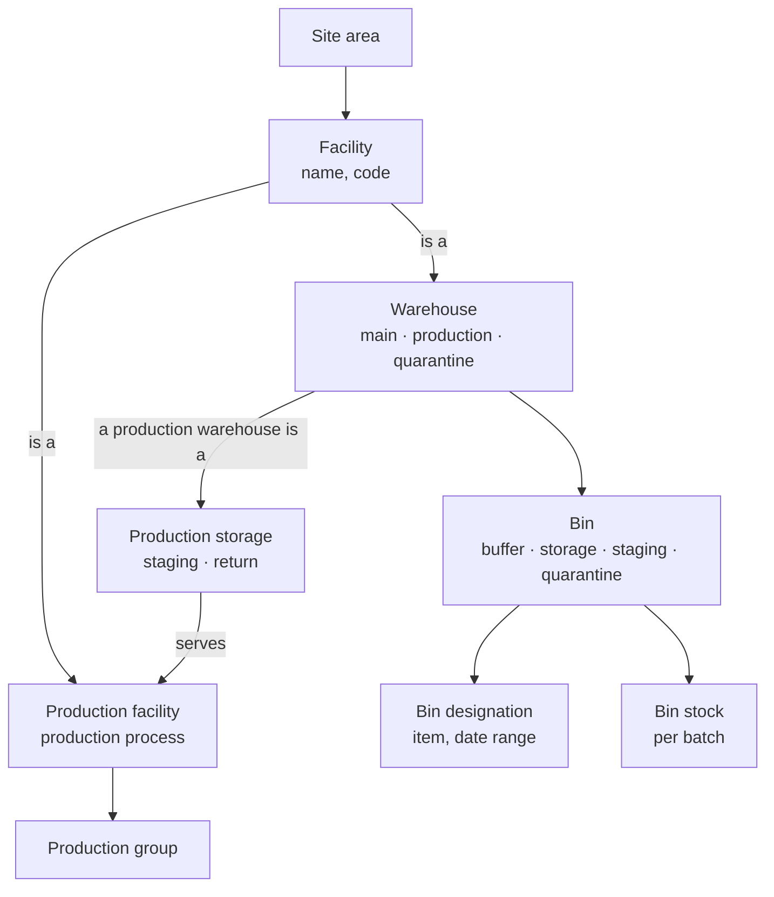

# Facilities and Bins

Where stock is kept and used: the warehouses and production facilities in each
site area, the bins inside each warehouse, which item each bin is meant for,
and how much of each batch each bin holds.

## How they fit together

## Facilities

A **facility** is a place inside a site area: either a **warehouse** or a
**production facility**.

| What WisBar keeps | Why |
| --- | --- |
| Site area, name and code | The code is unique within the site area. |
| Whether it is a warehouse or a production facility | The two are set up and used differently. |

## Warehouses

| Warehouse type | Used for |
| --- | --- |
| Main | Normal storage of good stock. |
| Production | Storage that serves one production facility (see production storages below). |
| Quarantine | Rejected stock only. |

## Bins

A **bin** is one stock location in a warehouse. Every piece of stock is in
exactly one bin.

| What WisBar keeps | Why |
| --- | --- |
| Warehouse, name and code | The code is unique within the warehouse and is what staff scan. |
| Hall, column and position (each optional) | Where to find the bin on the floor. |
| Fill order | A number per bin, set from hall, column and position (front before back). WisBar fills an item's designated bins in this order. Hall, column and position are text, so "10" would sort before "2"; the number avoids that. |
| Maximum number of pallets | The physical size of the bin, for reference when the LPU sets a designation's maximum amount. Must be above zero. WisBar does not plot by it. |
| Bin type | **Buffer:** receiving area. **Storage:** good stock. **Staging:** picked stock waiting for handover. **Quarantine:** rejected stock. |
| Active or not | An inactive bin takes no new put aways or receipts. |

## Bin designations

A **bin designation** says which item a bin is meant for, from a start time
and, when known, until an end time. The office designates bins before
deliveries arrive. An item can have several designated bins; when it is
received, WisBar fills them in hall, column and position order (see
[Item put away](../warehouse_execution/item_put_away.md)).

| What WisBar keeps | Why |
| --- | --- |
| Bin and item | Which item the bin is for. |
| Maximum amount | How much of this item the bin may hold, in the item's base unit, for example 500 kg. The same bin can hold more of a small item than of a bulky one, so the limit belongs to the bin and item together. WisBar never plots more than this. Must be above zero. |
| Start and end (the end can stay open) | Designations change; history is kept rather than overwritten. |
| Who designated it | Accountability. |

## Bin stock

WisBar keeps one stock figure for each **bin and batch**, in the item's base
unit. It is a helper: it shows at a glance whether a bin is full, how much
room it has and what can still be allocated. The record behind it is the
signed stock movements, and every night WisBar checks that the two agree.

| What WisBar keeps | Why |
| --- | --- |
| Current amount | What is physically in the bin. Changed only when a stock document is signed; never below zero. |
| Reserved amount | What is allocated but not picked yet. Worked out from the allocations, not stored. |
| Available amount | Current minus reserved: what can still be allocated. Worked out, not stored. |
| Pallets | How many pallets of the batch are in the bin, for materials counted in pallets. |
| Filled at | When the bin last went from empty to holding the batch. Used to pick the oldest stock first (FIFO). |
| Depleted at | When the bin last became empty. Cleared when it is filled again. |

## Production facilities

| What WisBar keeps | Why |
| --- | --- |
| Production process (name and code) | To classify production facilities. |

### Production storages

A **production storage** is a production-type warehouse that serves exactly one
production facility. A production facility can have several.

| Storage type | Used for |
| --- | --- |
| Staging | Material handed over to production, waiting to be used on the line. See [Production order](../warehouse_execution/production_order.md). |
| Return | Leftover sent back at the end of the day, and used first by the next day's order. The leftover goes into the bins assigned to the production (below). See [Production return](../warehouse_execution/production_return.md) and [Production order](../warehouse_execution/production_order.md). |

### Assigned return bins

Each production has one or more **bins assigned** to keep its end-of-day
leftover for the next day's production. They must be bins of a return storage
of the same production. The production return puts the leftover into them
automatically, in fill order; the next morning's order takes from them first.

| What WisBar keeps | Why |
| --- | --- |
| Production and bin | Which bins hold the production's leftover. |
| From and until (the end can stay open) | Assigned bins change; history is kept. |
| Who assigned it | Accountability. |

### Production groups

A **production group** is a team inside one production facility. Groups take
material from staging during the day, record what they find unfit, and bring
back what they do not use (see
[Production usage](../warehouse_execution/production_usage_and_report.md)).

| What WisBar keeps | Why |
| --- | --- |
| Production facility, name and a unique code | Which facility the group works in. A usage can only name a group of the same production as its day sheet. |
| Members, each from a start date and, when known, until an end date | Who belongs to the group; the person taking or returning material on the day sheet is a member that day. |

## Rules

- A designation's end cannot be before its start.
- A designation's maximum amount must be above zero. To change it, end the
  designation and start a new one, so the limit used for past deliveries stays
  visible.
- A maximum amount may be set lower than what is already in the bin. The bin
  then counts as full until enough stock leaves it; nothing is moved.
- Deleting hides a record but keeps it for history; its code can then be reused.

## For the technical team

`facilities` (parent of `warehouses` and `productions`; carries
`location_id`), `warehouse_bins` (`sort_sequence`),
`warehouse_bin_designations`, `warehouse_bin_inventories` (helper:
`current_amount`, `current_pallet_amount`), `production_processes`,
`productions`, `production_storages` (extends `warehouses` with
`warehouse_type = 'production'`), `production_return_bins`,
`production_groups`, `production_group_members`. Room in a bin:
`fn_warehouse_bin_room` and `v_warehouse_bin_room`; reserved and available
stock: `v_bin_inventory_available`.
