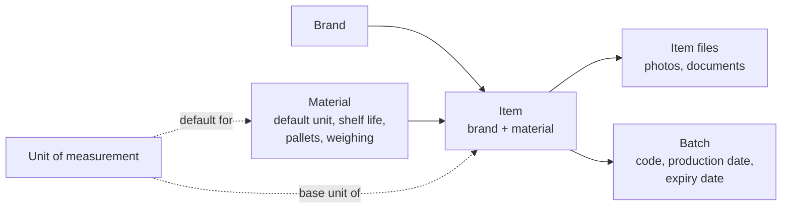

# Items and Batches

What the stock is: the brands and materials WisBar knows, the items made from
them, the files attached to items, the batches each item arrives or is produced
in, and the units quantities are measured in.

## How they fit together

## Brands

| What WisBar keeps | Why |
| --- | --- |
| Name and a unique code | How the brand appears on screens and labels. |
| Valid from and valid until (the end can stay open) | Brands are introduced and retired; history is kept. |

Which brands each site handles is recorded separately (see
[Organizations and sites](organizations_and_sites.md)).

## Materials

A **material** is the kind of thing an item is, with the defaults that apply
to every item of that material.

| What WisBar keeps | Why |
| --- | --- |
| Name and a unique code | To group items. |
| Default unit of measurement | The base unit a new item of this material gets when none is chosen. |
| Default shelf life in days (optional) | To suggest an expiry date for new batches. |
| Uses pallets (yes or no) | Whether stock is also counted in pallets: each move records the pallets, and each bin shows how many pallets it holds. |
| Needs weighing (yes or no) | Whether items must be weighed when they arrive (see [Item incoming](../warehouse_execution/item_incoming.md)). |

## Items

An **item** is one product of one brand and one material. It is what is
ordered, received, stored and used.

| What WisBar keeps | Why |
| --- | --- |
| Brand and material | What the item is. The brand is what incoming checks against. |
| Name and a unique code | What staff search for and scan. |
| Alternate or fixed-asset code (optional, unique) | When the item is also known under another code. |
| Valid from and valid until (both optional) | Items are introduced and retired. |
| Base unit | Every quantity of the item that WisBar keeps as stock is in this unit, so amounts can always be added up. It is the material's default unless chosen otherwise, and it cannot change once the item has a batch. |
| Shelf life in days (optional) | Overrides the material's default shelf life. |

## Unit conversions

People may count an item in another unit than its base unit, for example in
boxes when the base unit is kg. For each such unit WisBar keeps how many base
units it is (1 box = 25 kg).

| What WisBar keeps | Why |
| --- | --- |
| Item, unit, and how many base units one of it is | Converts what people type into the base unit. |

Every line people type (delivery note, incoming, request, handover, usage)
keeps the quantity and unit **as written** and the same quantity **in the base
unit**, converted at that moment. A later change to a conversion therefore
never rewrites history, and quantities are always compared in the base unit.

## Item files

Photos and documents can be attached to an item, for example a product photo or
a specification sheet. See [Document numbers and files](../records_and_audit/document_numbers_and_files.md)
for what is kept about each file.

## Batches

A **batch** is a quantity of one item that arrived or was produced together.
Stock is always counted per batch, so every batch can be traced to its vendor
and its expiry.

| What WisBar keeps | Why |
| --- | --- |
| Item | A batch belongs to exactly one item. |
| Batch code | As printed on the label. Unique for each item and origin. |
| Origin | The organization the batch came from, or our own site for a batch produced in house. Two vendors can print the same code without their batches being mixed up, and every batch can be traced to its vendor. |
| Quality status: released, on hold or rejected | A batch on hold (quality hold, vendor recall) or rejected is never allocated, in any bin, without having to move it. |
| Production date (optional) | For traceability and quality checks. |
| Expiry date (optional) | Decides which batch is used first (FEFO). |
| Who created the batch | Accountability. |

## Units of measurement

| What WisBar keeps | Why |
| --- | --- |
| Measurement type (length, volume, mass or count), name and a unique code | Every quantity in WisBar is stored with its unit, for example kg or box, so quantities in different units are never mixed up. Count is for pieces, boxes, rolls, sacks and pallets. |

## Rules

- Valid-until dates cannot be before valid-from dates.
- Deleting hides a record but keeps it for history; its code can then be reused.

## Status

Brands and items can be managed in the WisBar app today.

## For the technical team

`brands`, `materials` (`use_pallet`, `need_weighing`), `items`
(`unit_of_measurement_id` = base unit), `item_unit_conversions`
(`factor_to_base`), `item_attachments` (links `items` to `attachments`),
`batches` (`origin_organization_id`, `quality_status`),
`unit_of_measurements`. Lines people type have `amount`,
`unit_of_measurement_id` and `base_amount`; stock tables hold base amounts
only.
