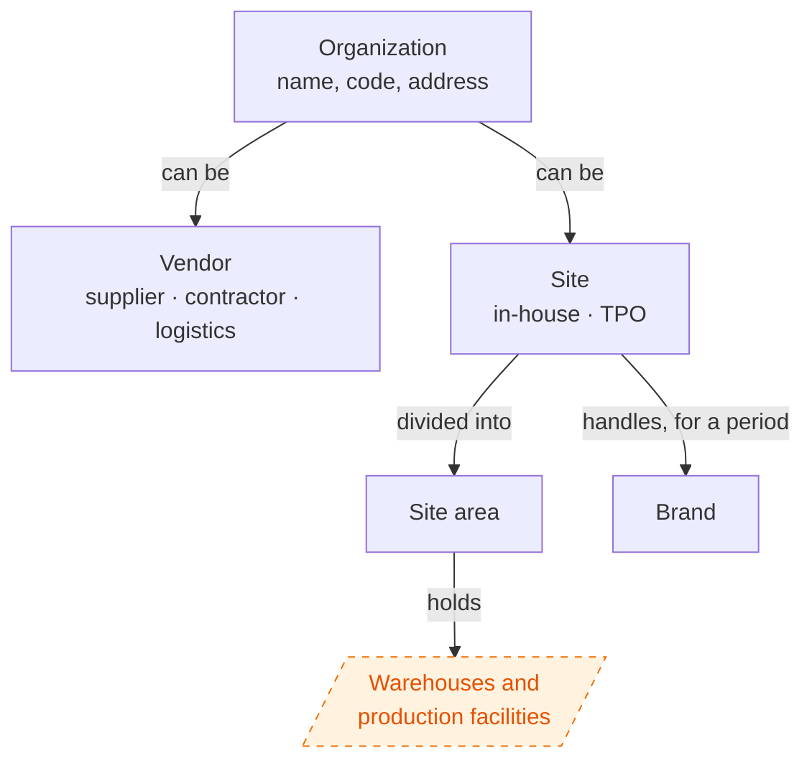

# Organizations and Sites

Who WisBar deals with and where the work happens: the organizations we work
with, which of them are vendors, which are our manufacturing sites, how each
site is divided into areas, and which brands each site handles.

## How they fit together

## Organizations

An **organization** is any company WisBar records: one of our own companies, a
vendor, a logistics company. Every delivery note names a sending and a
receiving organization, and every outbound names the organization it goes to.

| What WisBar keeps | Why |
| --- | --- |
| Official name | How the organization appears on documents. |
| Code | A short unique code used in screens and document numbers. |
| Address | Where to send or collect goods and paperwork. |

## Vendors

A **vendor** is an organization that supplies us. An organization is recorded as
a vendor at most once.

| What WisBar keeps | Why |
| --- | --- |
| The organization | Who the vendor is. |
| Vendor type: supplier, contractor or logistics | Suppliers send material, contractors provide services, logistics companies transport goods. The type can be left open. |

## Sites

A **site** (location) is a manufacturing plant. Every site is an organization, so it can
send and receive delivery notes like any other organization. An organization is
recorded as a site at most once.

| What WisBar keeps | Why |
| --- | --- |
| The organization | Which company the site is. |
| Site type: in-house or TPO | Whether the site is run by us or by a third party (TPO). |
| Time zone: WIB, WITA or WIT | Times are stored in UTC; the site's day (day sheet, count, arrival, document numbers) is its local day. 06:00 WITA is still the previous day in UTC. |

## Site areas

A **site area** is an operational part of a site, used to group its warehouses
and production facilities.

| What WisBar keeps | Why |
| --- | --- |
| The site, a name and a code | The code is unique within the site, so two sites can both have an area "A1". |

## Site brands

A **site brand** records that a site handles a brand from a start date and,
when known, until an end date.

| What WisBar keeps | Why |
| --- | --- |
| The site and the brand | Which brands may be received and produced at the site. |
| First day and last day (the last day can stay open) | Brand assignments change over time; history is kept rather than overwritten. |
| Who entered it | Accountability for brand assignments. |

## Rules

- Organization codes are unique. A site area code is unique within its site.
- A site brand's last day cannot be before its first day.
- **Deleting** a record hides it but keeps it for history. Its code can then be
  reused for a new record.

## Status

Organizations, vendors, sites and site brands can be managed in the WisBar app
today.

## For the technical team

`organizations`, `vendors`, `locations` (`time_zone`, `utc_offset`),
`location_areas`, `location_brands`. Soft delete through
`deleted_at`; codes are unique among active rows only. Local dates:
`fn_site_local_date(site, utc)`.
