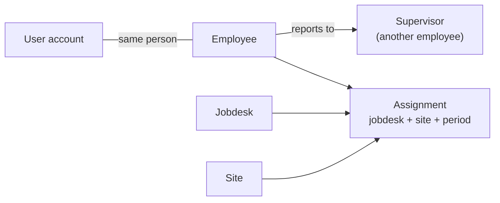

# Employees and Jobdesks

Who works where and in which role: employee records, their supervisors, the
jobdesks each site defines, and which jobdesk each employee holds in which
facility and for how long.

## How they fit together

## Employees

Every employee has a [user account](user_accounts_and_sign_in.md); the
employee record holds the HR side of the same person.

| What WisBar keeps | Why |
| --- | --- |
| Employee number | A unique HR number. WisBar issues it automatically as the date plus a running number, for example `2410230001` for the first employee added on 23 October 2024. |
| First, middle and last name | How the person appears on documents and signatures. |
| Phone number and address (optional) | To contact the person. |
| Supervisor (optional) | Who the person reports to. If the supervisor's record is removed, the link is cleared. |

## Jobdesks

A **jobdesk** is a role, for example "Logistic Admin" or "Production Staff".
A jobdesk is the same at every site and organization.

| What WisBar keeps | Why |
| --- | --- |
| Name and code | The code is unique, because a jobdesk means the same everywhere. |
| Description | What the jobdesk is responsible for. |

## Jobdesk assignments

An **assignment** gives an employee a jobdesk at one site for a period.

| What WisBar keeps | Why |
| --- | --- |
| Employee, jobdesk and site | The same person can be a Logistic Admin at one site and Production Staff at another. |
| Start date and end date (the end can stay open) | Roles change over time; history is kept rather than overwritten. |

The jobdesks an employee holds decide most of what they may do in WisBar (see
[Permissions](permissions.md)).

## Rules

- An assignment's end date cannot be before its start date.
- Removing an employee or a jobdesk also removes its assignments.

## Status

Employees can be added and viewed in the WisBar app today. Jobdesks and
assignments are ready in the records; their screens are being built.

## For the technical team

`employees` (shares its primary key with `users`), `jobdesks` (no site),
`employee_jobdesks` (`location_id`), `production_group_members`.
Employee numbers come from `document_sequences` (document type `employee`,
`yymmdd` in WIB + 4-digit sequence) through `sp_document_number_next`.
