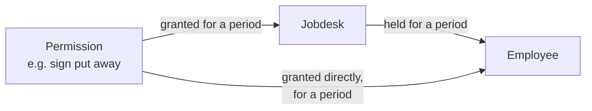

# Permissions

What each person is allowed to do in WisBar, for example which items they may
order or who may sign a put away. Permissions are given to jobdesks, so they
follow the role, and can also be given to one employee directly.

## How permissions reach a person

An employee's permissions are:

1. the permissions of every jobdesk they hold at that site at that time (see
   [Employees and jobdesks](employees_and_jobdesks.md)), plus
2. any permissions granted to them directly at that site.

So the same person can have a permission at one site and not at another.

Granting through jobdesks is the normal way: when someone changes role, their
permissions change with it. Direct grants are for exceptions, such as covering
for a colleague for a week.

## What WisBar keeps and why

| What WisBar keeps | Why |
| --- | --- |
| **Permission:** a unique code, a display name and a description | The code is what WisBar checks; the name and description are what administrators see. |
| **Jobdesk permission:** permission, jobdesk, start and end (the end can stay open) | Everyone holding the jobdesk gets the permission for that period. |
| **Employee permission:** permission, employee, site, start and end (the end can stay open) | An exception for one person at one site, limited in time. |
| **Orderable item:** jobdesk, item, start and end (the end can stay open) | Which items a role may put on a production order. |
| **Site admin:** user and site | Which sites a site admin administers; a site admin may have several. |

Every grant has a period, so access can be given in advance or ended on a set
date without anyone having to remember to remove it.

## Rules

- A grant's end cannot be before its start.
- The same permission cannot be granted twice to the same jobdesk or employee
  (at the same site) with the same start.
- Removing a permission, jobdesk or employee also removes its grants.

## Status

Permissions are ready in the records; their screens are being built.

## For the technical team

`permissions`, `jobdesk_permissions`, `employee_permissions`
(`location_id`), `jobdesk_orderable_items`, `user_admin_sites`. The
view `v_employee_site_permissions` lists what each employee may do at each
site right now. The system-level role in `users.role` is separate from these
permissions.
