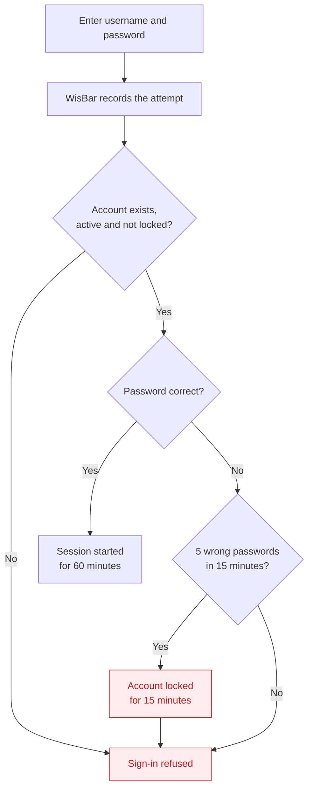

# User Accounts and Sign-In

How people get into WisBar: their account, how they sign in, what happens after
too many wrong passwords, how long a sign-in lasts, and how password changes
are kept.

## Accounts

Every person who uses WisBar has one account. An employee's account and
employee record are the same person (see
[Employees and jobdesks](employees_and_jobdesks.md)).

| What WisBar keeps | Why |
| --- | --- |
| Username | Unique; what the person signs in with. |
| Password, stored only in scrambled form | So the password can be checked but never read back, not even by administrators. |
| Email (optional, unique) | For notifications and password recovery. |
| Status: active, inactive or suspended | Only active accounts can sign in. |
| System role: super admin, admin, site admin or normal | Decides access to administration. Day-to-day permissions come from jobdesks (see [Permissions](permissions.md)). |
| Must change password (yes or no) | Forces a new password at the next sign-in, for example after an administrator resets it. |
| Locked until | Set after too many wrong passwords; sign-in is refused until then. |
| Last sign-in, last password change, last status change | To spot unused accounts and accounts still on their first password. |

## Signing in

1. **Every attempt is recorded**, including attempts with a username that does
   not exist, with the result: success, unknown user, wrong password, account
   locked, or account inactive.
2. **Five wrong passwords within 15 minutes lock the account for 15 minutes.**
   This stops someone guessing passwords.
3. **A successful sign-in starts a session** that lasts 60 minutes.

| What WisBar keeps about each attempt | Why |
| --- | --- |
| The username typed, the matching account if any, the result, the time, the device's network address and browser | To lock accounts under attack and to investigate suspicious sign-ins. Attempts are never changed or removed by the app. |

## Sessions

A **session** is one signed-in device. It ends when it expires, when it is
signed out or revoked, or as soon as the account is no longer active, is
locked, or is deleted.

| What WisBar keeps | Why |
| --- | --- |
| Start time, expiry time and last activity | To end the session on time and show when it was last used. |
| Device: network address, browser, and scanner or terminal ID | To see where an account is signed in, and spot unknown devices. |
| Revoked at, and by whom | An administrator can sign a user out of a device, or of every device at once. |

Sessions that ended more than 30 days ago are removed automatically every night.

## Password changes

| What WisBar keeps | Why |
| --- | --- |
| The previous password (scrambled), when it changed, who changed it | To stop reuse of old passwords and to see who reset an account. |
| Reason: changed by the user, reset by an administrator, forced rotation, or account recovery | To tell routine changes from resets. |

## Status

Sign-in, lockout and sessions work in the WisBar app today.

## For the technical team

`users`, `user_login_attempts` (append-only), `user_sessions`,
`user_password_changes`. Lockout constants are in
`AuthenticationService` (`MaxFailedLoginAttempts = 5`,
`FailedLoginWindowMinutes = 15`, `LockDurationMinutes = 15`,
`SessionLifetimeMinutes = 60`). Session clean-up is the `ev_user_session_purge`
event (daily, 30 days).
