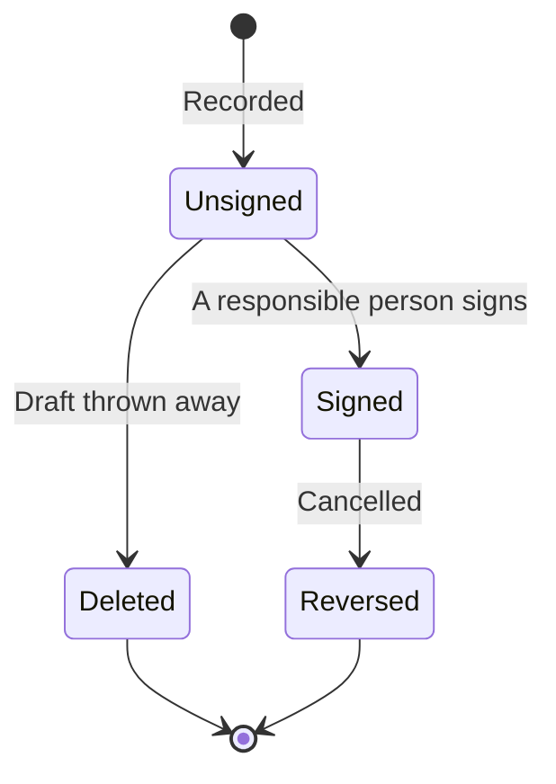
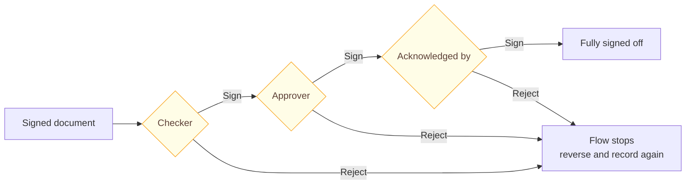
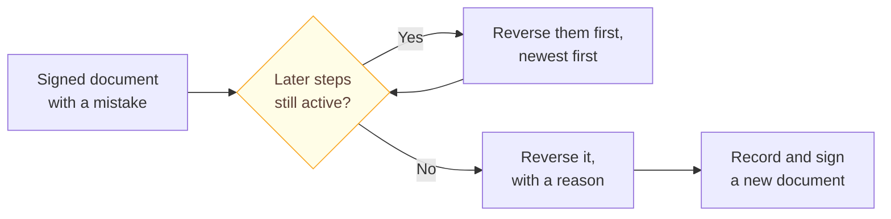

# Signing and Corrections

How every warehouse document in WisBar is confirmed, locked, corrected and
cancelled. This is what makes WisBar's records trustworthy: once a document is
signed, nobody can quietly change it.

## Which documents this applies to

Every step of every warehouse flow: incomings, requests, pickings, handovers,
put aways (including the put away of material a production group brings
back), production group day sheets (usages, rejects and returns), stock counts
(including the end-of-day count), item reclassifications, bin moves and stock
reversals. Each is a **document** made of **lines**, and signing covers the
document and all its lines together. Weighings are lines of their incoming.

Allocations and plottings are plans, not documents: they are not signed. They
are carried out by pickings and put aways, which are.

## The life of a document

| Status | Meaning |
| --- | --- |
| **Unsigned** | Recorded but not confirmed yet. It can still be changed, or deleted. |
| **Signed** | Confirmed by a responsible person and locked. A document that changes stock changes it now. |
| **Reversed** | Cancelled after it was signed. Kept for history, with who reversed it, when and why. |

A deleted draft keeps its document number, so the number is never issued
again.

## Signing

When a responsible person signs a document, WisBar:

1. records who signed and when;
2. seals every line with a **digital fingerprint** of its contents;
3. seals the document with a fingerprint of its own contents and of every
   line's fingerprint;
4. for a document that moves stock, changes the stock of every bin it touches;
5. adds the signing to the site's **seal chain** (see below).

If anything in a signed document or one of its lines is changed later, its
fingerprint no longer matches, so the change can be detected. The
fingerprints are made with a secret key that only the WisBar server holds; it
is never stored in the database. Someone who changes a row directly in the
database therefore cannot make a matching fingerprint. The database also
refuses any change to a signed document or line.

Which key and which method made a fingerprint is recorded with it, so keys
can be replaced later without breaking older documents.

## Sign-off by higher ups

After a document is signed, higher ups sign it off in a fixed order. Each step
is recorded on its own, with who did it, when, and their notes.

Rules:

- A step can only happen after the previous step has signed: no approval
  before checking, no acknowledgement before approval.
- Each step happens once per document.
- A rejection needs a reason, and stops the flow. The document is reversed
  and recorded again, and the new document goes through sign-off again.
- Each step is sealed with its own fingerprint, which also covers the
  document's fingerprint and the previous step's fingerprint, and is added to
  the seal chain. A step is never changed or removed.
- Each step is done by a different person than the one who signed the
  document and the ones who did the other steps.

## Correcting a signed document

A signed document is never edited. A mistake is fixed by **reversing** the
document and **recording a new one** with the right figures.

- **A document that moves stock** (picking, put away, bin move, stock count,
  item reclassification) is reversed by a **stock reversal**: a new document
  with the opposite of every line, which puts the stock back where it was.
  Signing the stock reversal marks the original as reversed. Nothing is
  deleted: both stay in WisBar, so anyone can see what happened.
- **Any other document** (request, handover, incoming, day sheet) is reversed
  directly. What it still held is freed: a request's reserved stock is
  released, and the plans to put away what a handover, incoming or day sheet
  brought in are cancelled.
- **A later step first.** A document cannot be reversed while a later step
  that follows from it is still active. For example, a picking whose handover
  is signed is reversed only after that handover is reversed.
- **Every reversal needs a reason**, and records who reversed it and when. A
  reversal cannot be dated before the signature.
- **Drafts** are simply deleted; they were never signed.

## The seal chain

Every signing, sign-off and reversal of a site is also written to that site's
**seal chain**: a numbered list where each entry carries the fingerprint of
the entry before it. Removing, reordering or changing any entry, or quietly
replacing a signed document, breaks the chain from that point on.

Every night WisBar walks each site's chain from the first entry to the last,
recomputes every fingerprint, and records the result in the
[system log](activity_and_system_logs.md). A broken chain is logged as
critical, with the first entry that does not match.

## What WisBar keeps and why

| What WisBar keeps | Why |
| --- | --- |
| A unique reference and a readable number for every document | Identifies the document everywhere, even after it is deleted or reversed. |
| The kind of document (incoming, picking, handover, ...) | To list and search documents of one kind across every flow. |
| The site the document belongs to | For reporting by site; each site has its own numbers and seal chain. |
| Status, who signed and when, who reversed it, when and why | Shows whether the document can be trusted, and who is accountable. |
| The fingerprints of the document and of each line, and the key that made them | To detect any change after signing. |
| For each line, when it actually happened | The time something happened on the floor can differ from when it was typed in. |
| Every sign-off step: checker, approver or acknowledger, signed or rejected, who and when, their notes, and its fingerprint | Shows which higher ups confirmed the document, in which order, and that no step was changed afterwards. |
| The seal chain of each site | Shows that no signed document, sign-off or reversal was changed, removed or slipped in later. |

## For the technical team

| Concept | Records and procedures |
| --- | --- |
| Document | `transaction_headers` (`uuid`, `transaction_header_type`, `location_id`, `document_number`, `status`, `created_by`, `signed_by`, `signed_at`, `reversed_by`, `reversed_at`, `reversal_reason`, `draft_version`, `hash_algorithm`, `hash_key_id`, `hash_key`) |
| Line | `transactions` (`transaction_header_id`, `transaction_header_type`, `transaction_type`, `occurred_at`, `hash_key`) |
| Sign-off step | `transaction_header_sign_offs` (`role`, `decision`, `remarks`, `signed_by`, `signed_at`, `hash_algorithm`, `hash_key_id`, `hash_key`) |
| Seal chain | `seal_events` (one row per signing, sign-off or reversal, `fk_seal_events_chain` points each row at the previous one), `location_seal_heads` (end of each chain) |
| Stock reversal | `stock_reversals` (`reversed_transaction_header_id`); its lines are `stock_movement_details` with `reverses_stock_movement_detail_id` |
| Create, change, delete a draft | The procedures of each document kind (`sp_picking_create`, `sp_incoming_detail_add`, ...); every change raises `draft_version` (`sp_transaction_header_touch`). Delete: `sp_transaction_header_delete` |
| Sign, sign off, reverse | `sp_seal_head_get`, then one call of `sp_transaction_header_sign`, `sp_transaction_header_sign_off` or `sp_transaction_header_reverse`; stock documents: `sp_stock_reversal_create`, then sign it |
| Write protection | Triggers on `transaction_headers`, `transactions`, `transaction_header_sign_offs`, `seal_events`, `location_seal_heads` |
| Fingerprints and verification | `SealService` and `SealVerificationService` in the API; keys in `SEAL_KEYS` and `SEAL_ACTIVE_KEY_ID` (`.env`) |

Every flow table extends one of the two parents (class table inheritance).
The discriminators always hold the leaf table name, every table of a chain
carries them, and every child-to-parent foreign key includes them, so a row
can only be the subtype it says it is. Lines also carry their document type,
so a line can only sit under the kind of document it belongs to.

### Signing protocol

The API holds the keys; MySQL never sees them. Signing, a sign-off and a
reversal are each one stored procedure call with its own transaction; the API
starts none. To sign, the API:

1. reads the document with its `get` procedure, which returns its
   `draft_version`, and its lines (`sp_transaction_line_query` gives the line
   order), and reads the end of the site's chain with `sp_seal_head_get(site)`
   (last sequence and last event hash);
2. builds the canonical payloads (below) and computes the HMACs: every line,
   the document (over its fields and the line hashes in ascending line id
   order), and the seal event (over site, sequence, document id, event,
   document hash and previous event hash);
3. calls `sp_transaction_header_sign` once, with the `draft_version` and the
   sequence it read and those hashes. In one transaction the procedure seals
   the lines and the header, posts the stock of a stock document
   (`sp_stock_post`), locks the delivery note of an incoming, writes the
   delivery note lines of an outbound handover, and appends the seal event;
4. starts again from step 1 when the procedure refuses with `SealChainMoved`
   (another document of the site was sealed in between) or
   `DocumentChangedSinceRead` (the draft changed after it was read). Nothing
   was written.

A sign-off (`sp_transaction_header_sign_off`) and a reversal
(`sp_transaction_header_reverse`) follow the same steps without the lines.
A stock count is prepared with `sp_stock_count_prepare` before it is read for
signing; signing refuses with `StockChangedSincePrepared` when its bins moved
since, and with `StockCountIsNotPrepared` when a line was changed after it.

### Canonical payload

A JSON object with its keys in ordinal order and no whitespace, written with
relaxed escaping. Keys are the database column names. Every value is `null`, a
string, or (only for `lines`) an array of strings:

| Value | Written as |
| --- | --- |
| Integer, id | Decimal digits, e.g. `"42"` |
| Decimal amount | Three decimals, invariant culture, e.g. `"12.500"` |
| Boolean | `"1"` or `"0"` |
| Date and time | UTC, `"yyyy-MM-ddTHH:mm:ssZ"` |
| Date | `"yyyy-MM-dd"` |
| Enum | Its database value |

The document payload includes `signed_by` and `signed_at` (the API passes the
same `signed_at` to `sp_transaction_header_sign`). Lifecycle columns are left
out, because they change after signing without changing what was signed:
`hash_algorithm`, `hash_key_id`, `hash_key`, `status`, the reversal columns
(covered by the reversal's own seal event), `created_at`, `updated_at`,
`deleted_at`, `active_key` and `requests.status`. The HMAC is HMAC-SHA256 over
the UTF-8 payload, written as lowercase hex.
