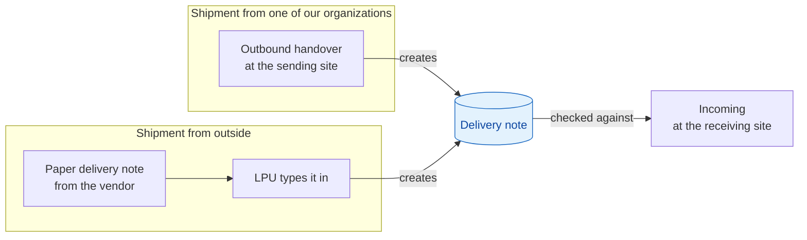

# Delivery Notes

A delivery note is the paperwork that travels with a shipment: who sends what
to whom, on which vehicle, and when it should arrive. In WisBar it is the
meeting point between a sender's [outbound](outbound.md) and a receiver's
[incoming](item_incoming.md).

## At a glance

| | |
| --- | --- |
| Created by | The sending warehouse (at the outbound handover), or the receiving site's LPU (typed in from paper) |
| Used by | The receiving site, to check what arrived |
| Effect on stock | None |

## Where a delivery note comes from

1. **From one of our organizations.** When the sending warehouse hands the
   goods to the driver, WisBar creates the delivery note from what was handed
   over. The receiving site does not type anything: the delivery note is
   already waiting when the truck arrives.
2. **From outside.** A vendor's delivery note arrives on paper. The receiving
   site's LPU types it in before or when the truck arrives.

Either way, the receiving site records its incoming against that delivery
note. When both sides use WisBar, this one delivery note links the sender's
outbound to the receiver's incoming, so a batch can be followed from one site
to the other.

## What a delivery note holds

| Part | What WisBar keeps | Why |
| --- | --- | --- |
| Header | Delivery number as printed by the sender | The number both sides refer to. It is unique for each sender. |
| | Sender and receiver organization | Who is responsible for the goods on each end. They must be different organizations. |
| | Vehicle plate number and delivery service | To identify the truck at the gate, and who to contact if it is late or something is missing. |
| | Expected arrival date | To plan receiving work and spot late deliveries. |
| | Who entered it | Accountability for typed-in delivery notes. |
| | Date printed on the note | The date the sender gave the note. |
| Lines | Item, quantity and unit, exactly as written, and the batch when known | What the sender says they sent. A paper note often has no batch, or a batch WisBar does not know yet: the code is kept as written, and the batch is created at the count. The receiving count is compared against these lines, not against what was ordered. |

A delivery note lists each item and batch only once.

## Rules

- What is written on the delivery note is never overwritten by what actually
  arrived. The incoming records the actual vehicle, date and quantities
  separately, so the two can be compared.
- A delivery note created by an outbound handover belongs to exactly that
  handover.
- Once an incoming against the delivery note is signed, the note is locked: it
  can no longer be changed or deleted.

## For the technical team

| Concept | Records |
| --- | --- |
| Delivery note | `delivery_notes` (`delivery_date`, `locked_at`), `delivery_note_details` (`item_id`, `batch_id` when known, `written_batch_code`, `amount`, `unit_of_measurement_id`, `base_amount`) |
| Created by an outbound | `handovers.delivery_note_id` (one active handover per delivery note) |
| Received by an incoming | `incomings.delivery_note_id` (one active incoming per delivery note); each received line can point at its note line (`incoming_details.delivery_note_detail_id`) |
