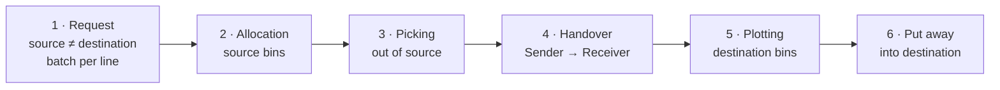

# Internal Transfer

How stock is moved from one warehouse to another warehouse of the same
organization. Ownership does not change; only the location does.

## At a glance

| | |
| --- | --- |
| From → To | A warehouse → a different warehouse of the same organization |
| Starts with | A transfer request |
| Ends with | Stock in the destination warehouse's bins |
| Effect on stock | Source bins go down at picking; destination bins go up at put away |

Moving stock between two bins of the **same** warehouse is not an internal
transfer. It is recorded as a simple bin move: one stock movement out of the
old bin and into the new one.

## Who is involved

| Role | What they do |
| --- | --- |
| Requester (Warehouse Staff) | Raises the transfer: source, destination, batches and quantities. |
| Sender (staff at the source warehouse) | Reserves and picks the stock, and hands it over. |
| Receiver (staff at the destination warehouse) | Checks the stock against the handover, plans the bins and puts it away. |

## Steps

### 1. Transfer request (Requester)

- Record the **source** warehouse and the **destination** warehouse. They must
  be different.
- For each line, choose the **batch** and the quantity. The batch is chosen by
  the rotation rule (the batch closest to expiry first), or by the warehouse
  staff's own judgement, for example to clear a partial pallet. When the
  choice goes against the rotation rule, write the reason in the line's
  remarks.
- Common reasons for a transfer:
  - **Rebalancing** stock between warehouses;
  - **Freeing space** in a full warehouse;
  - **Moving stock closer** to where it will be used.

### 2. Allocation (Sender)

- For each line, choose the source bins holding that batch. The stock is
  reserved for the transfer.

### 3. Picking (Sender)

- Take each allocated quantity out of its bin.

| Result | Next step |
| --- | --- |
| $\text{Picked} = \text{Requested}$ | Continue to **Handover**. |
| $\text{Picked} < \text{Requested}$ | Tell the Requester about the shortage and continue with what was picked. |

### 4. Handover (Sender → Receiver)

- The Sender brings the stock to the destination and hands it to the Receiver.
- The Receiver checks each batch and quantity against the picking.
  - **Matches:** accept the handover.
  - **Does not match:** recount together; the handover records the quantity
    actually handed over.

### 5. Plotting (Receiver)

- Plan which destination bin each handed-over line goes into. Good stock goes
  into an active **storage bin** with room. One line can be split over several
  bins.

### 6. Put away (Receiver)

- Put each item into its planned bin and confirm the quantity.

| Result | Next step |
| --- | --- |
| $\text{Put away} = \text{Handed over}$ | The transfer is **completed**; the stock is available at the destination. |
| $\text{Put away} < \text{Handed over}$ | Find the items not yet put away and continue. |

## Flow diagram

## What WisBar keeps and why

| What WisBar keeps | Why |
| --- | --- |
| Source and destination warehouse, status, reason, who requested | Shows where stock is going and why, and how far the transfer has got. |
| Lines: batch, quantity, unit, remarks | The batch is fixed at request time because it may be chosen on purpose; the remarks explain a choice against the rotation rule. |
| Allocations, picking lines, handover, plottings and put-away lines | The same chain as every flow, so each batch can be followed from its source bin to its destination bin. |
| Who handed over, who received, when | The moment responsibility passes. The two must be different people. |

## Checks

- Source and destination must be different warehouses.
- Every quantity must be above zero.
- Checked by WisBar when each step is recorded: stock is picked from the source
  warehouse, handed over to the destination warehouse and plotted into its bins,
  and the picked batch is the requested batch.

## For the technical team

| Step | Records |
| --- | --- |
| Request | `requests` → `internal_transfers` (`from_warehouse_id`, `to_warehouse_id`), `request_details` (`batch_id`) |
| Allocation | `allocations` through `sp_allocation_reserve` |
| Picking | `pickings` (`from_warehouse_id`), `picking_details` |
| Handover | `handovers` (`from_warehouse_id`, `to_warehouse_id`), `handover_details` |
| Plotting | `plottings` through `sp_plotting_plan` |
| Put away | `put_aways`, `put_away_details` |
| Bin move inside one warehouse | One `stock_movements` document (type `stock_movement`) with an `out` and an `in` line |
