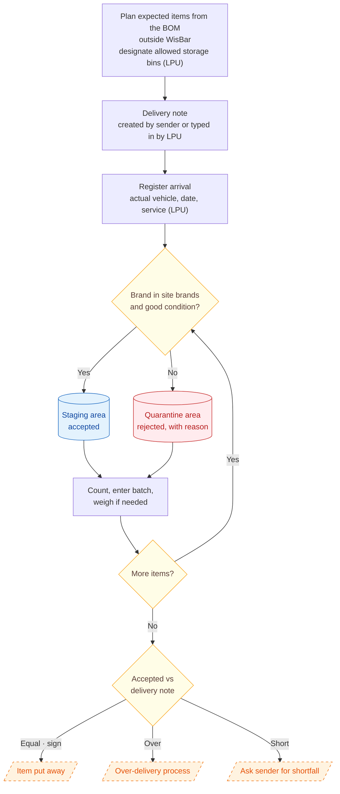

# Item Incoming

How a delivery is received at a site: checked against its delivery note,
checked for the right brand and condition, counted, weighed where needed, and
then accepted into staging or rejected into quarantine.

## At a glance

| | |
| --- | --- |
| From → To | Vendor, or another organization → staging area (accepted) or quarantine area (rejected) |
| Starts with | A [delivery note](delivery_notes.md) |
| Ends with | A signed incoming; continues in [Item put away](item_put_away.md) |
| Effect on stock | None yet. Bin stock goes up only at put away. |

## How the brand is checked: BOM on the floor, site brands in WisBar

On the floor, the LPU works from the **bill of materials (BOM)**. The BOM says
which materials production needs and which brand each one must be. The LPU
uses it to plan what is coming and to judge whether a delivery is the right
one.

WisBar does **not** keep the BOM and does not compare deliveries against it.
The BOM is not part of the system's requirements.

Instead, WisBar keeps a list of the brands each site is manufacturing, and for
which period. These are the **site brands** (see
[Organizations and sites](../master_data/organizations_and_sites.md)). When an
item is received, WisBar checks the item's brand against that list:

- **The brand is on the receiving site's list on the arrival date:** the brand
  check passes.
- **The brand is not on the list, or its period has ended or not started
  yet:** the item does not belong at this site and is rejected.

In short: people plan with the BOM, and WisBar checks against the site brands.
Because the site brand list is broader than a BOM, WisBar confirms that the
brand belongs at the site, not that it matches a specific production plan.
That finer judgement stays with the LPU.

For the check to work, the site brand list must be kept up to date. When a
site starts or stops manufacturing a brand, its site brand record must be
added or given an end date.

## Who is involved

| Role | What they do |
| --- | --- |
| Vendor / Primary | Delivers the material, with its delivery note. |
| Lead Production Unit (LPU) | Administrative role. Plans the receipt, enters the delivery note when it comes from outside, registers the arrival, reviews the result, signs the incoming, and follows up shortages with the sender. |
| Logistic Supervisor / Logistic Admin | Labour role. Unloads, checks condition (WisBar checks the brand), counts, weighs, and places items in the staging or quarantine area. |

## Steps

### 1. Planning (LPU, before arrival)

- LPU plans the expected receipt from the bill of materials (BOM): which items
  are coming and which brand each must be. This planning happens outside
  WisBar; the BOM is not entered into the system.
- LPU designates the storage bins each expected item may go into. When the
  item arrives, WisBar picks the actual bin from those, in a fixed order (see
  [Item put away](item_put_away.md)).

### 2. Delivery note

- **From one of our organizations:** the delivery note already exists. It was
  created when the sender handed the goods to the driver.
- **From outside:** LPU types in the paper delivery note: delivery number,
  sender, vehicle, delivery service, expected arrival date, and each batch and
  quantity written on it.

### 3. Arrival (LPU)

- LPU records what actually arrived against that delivery note: the actual
  sender and receiver, the vehicle that came and its driver, the arrival date
  and the delivery service. These can differ from the delivery note, for example a
  different truck or a late arrival.

### 4. Brand and condition check (Logistic Supervisor / Admin)

- For each item, two checks are made:
  - **Brand (by WisBar):** WisBar checks that the item's brand is one the
    receiving site is manufacturing on the arrival date, using the site
    brands. It does not use the BOM.
  - **Condition (by staff):** staff check that the item is not damaged.
- The result decides where the item goes:
  - **Brand is on the site's list and the item is fine:** the item is
    **accepted** and placed in the **staging area**.
  - **Brand is not on the site's list, or the item is damaged:** the item is
    **rejected**, recorded with the reason, and placed in the **quarantine
    area**.
- If only part of a batch is rejected, record it as two lines of the same
  batch: one accepted, one rejected.

### 5. Count and weigh (Logistic Supervisor / Admin)

- Count the received quantity of each batch.
- Enter the batch code. If the batch is new, record its production date and
  expiry date; the batch belongs to the sender, so another vendor's batch with
  the same code stays separate. The expiry date decides which batch is used
  first (FEFO).
- For materials that must be weighed, record for each batch:
  - the number of boxes and the weight unit (for example kg);
  - the net and gross weight written on the label or document;
  - the measured gross weight and the measured packaging weight;
  - the moisture content, if measured.

  WisBar calculates the measured net weight (gross minus packaging) and the
  difference from the written net weight. A negative difference is a shortage.

### 6. Quantity check and sign-off (LPU)

- Compare the **accepted** quantity of each batch with the delivery note.
  Rejected quantities do not count as received.

| Result | Next step |
| --- | --- |
| $\text{Accepted} = \text{Delivery note}$ | Sign the incoming and continue to [Item put away](item_put_away.md). |
| $\text{Accepted} > \text{Delivery note}$ | Start the over-delivery process with the sender. |
| $\text{Accepted} < \text{Delivery note}$ | Ask the sender to deliver the shortfall. |

## Flow diagram

## What WisBar keeps and why

| What WisBar keeps | Why |
| --- | --- |
| The delivery note it is received against | Everything received is compared to what the sender says they sent. For shipments between our own organizations, it links the sender's outbound to this incoming. |
| Actual sender, receiver, vehicle, arrival date and delivery service | What actually arrived can differ from the paperwork. Keeping both lets late or wrong deliveries be followed up. |
| Each received batch with its quantity and unit | The batch is how material is traced back to its vendor and forward to production. |
| Accepted or rejected, and the reject reason | Decides whether the stock goes into storage or quarantine, and only accepted stock counts as received. The reason supports claims against the vendor. |
| The brands each site is manufacturing, and for which period (site brands) | What the brand check is made against. Kept as master data, not per incoming. |
| New batches with production and expiry dates | The expiry date decides which batch is used first. |
| Weighing results, and who weighed | Proof of a weight shortage against the vendor's stated weight. |
| Who recorded the incoming, and who signed it | Accountability. Once signed, the incoming is locked. |

## Checks

- An incoming's sender and receiver must be different organizations.
- An accepted item's brand must be one the receiving site is manufacturing on
  the arrival date (site brands). The BOM is not checked.
- Every received line must have a quantity above zero.
- A rejected line must have a reason; an accepted line must not.
- Each received line counts once for put away: its plottings and put-away lines
  point back to it.

## Not kept in WisBar

- The bill of materials (BOM). This is by design: the BOM is used by people
  for planning, and WisBar checks brands against the site brands instead.
- Over-delivery and shortfall requests to the sender (not kept yet).

## For the technical team

| Concept | Records |
| --- | --- |
| Delivery note | `delivery_notes`, `delivery_note_details` |
| Incoming document and lines | `incomings` (extends `transaction_headers`; `driver_name`), `incoming_details` (extends `transactions`; `delivery_note_detail_id`, `acceptance`, `reject_reason`, `amount` and unit as counted, `base_amount`) |
| Batches | `batches` (`origin_organization_id` = the sender) |
| Brand check | `incoming_details.batch_id` → `batches.item_id` → `items.brand_id`, matched against `location_brands` of `transaction_headers.location_id`, where `incomings.actual_arrival_date` (site local date) falls between `valid_from` and `valid_until` (`NULL` = open-ended) |
| Weighing | `weighings` (extends `transactions`; `incoming_detail_id`; the weight unit must be a mass unit) |
| Evidence photos | `transaction_attachments` on the incoming or one of its lines |
| Bin designation | `warehouse_bin_designations` |
| Signing | Locks the delivery note (`delivery_notes.locked_at`) |
