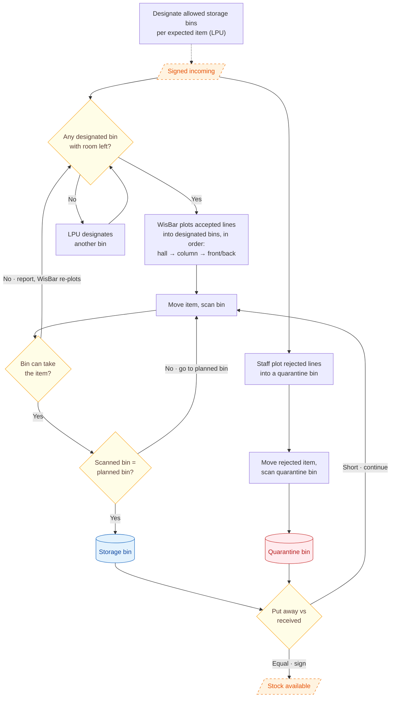

# Item Put Away

How received material is moved from the staging area into storage bins, so it
counts as available stock, and how rejected material is moved from the
quarantine area into quarantine bins, so it is tracked but can never be used.

## At a glance

| | |
| --- | --- |
| From → To | Staging area → storage bins (accepted); quarantine area → quarantine bins (rejected) |
| Starts with | A signed [incoming](item_incoming.md) |
| Ends with | A signed put away |
| Effect on stock | Each bin goes up by what was put into it, for that batch |

## Who is involved

| Role | What they do |
| --- | --- |
| Lead Production Unit (LPU) | Designates which storage bins an item may go into, adds more bins when the designated ones are full, reviews the result and signs the put away. |
| WisBar | Plots each accepted line: picks the actual bin from the LPU's designated bins, in a fixed order. |
| Logistic Supervisor / Logistic Admin | Moves each item to the bin WisBar plotted, scans the bin to confirm, enters the quantity moved, and chooses quarantine bins for rejected items. |

## Designation and plotting: who decides what

Two different decisions are made about where an item goes:

| Decision | Made by | When | Example |
| --- | --- | --- | --- |
| **Designation:** which bins an item is *allowed* to go into | LPU | Before the delivery arrives | Item X may go into bin001 and bin002 |
| **Plotting:** which bin a received quantity *actually* goes into | WisBar, automatically | When the item is received | These 200 kg of item X go into bin001 |

The LPU never picks the bin for a single delivery, and the floor staff never
pick it either. The LPU sets the allowed bins and how much of the item each
may hold; WisBar fills them in order, up to that limit.

## Steps

### 1. Bin designation (LPU, before arrival)

- When the receipt is planned (see [Item incoming](item_incoming.md)), LPU
  designates one or more **storage bins** for each expected item, from a start
  date and, if known, until an end date.
- For each designated bin, LPU sets the **maximum amount** of that item the
  bin may hold and its **unit** (for example 500 kg). The same bin can have a
  different maximum for a different item. The unit must be the item's own
  unit, the one its stock is counted in.
- Only an active storage bin can be designated. Quarantine bins and inactive
  bins cannot.

### 2. Plotting: WisBar plans where each line goes

**Accepted lines** are plotted by WisBar, not by a person. WisBar takes the
storage bins designated for the line's item and fills them one by one, in this
order:

1. **Hall**
2. **Column** within the hall
3. **Position** within the column: front before back

The order is kept as a fill-order number on each bin, set from hall, column
and position, because those are free text and "10" would sort before "2".

WisBar puts as much as possible into the first bin in that order. When that
bin is full, the rest goes into the next bin that still has room, and so on.
One received line can therefore end up split over several bins.

How much room a bin has left for the item:

$$\text{Room} = \text{Maximum amount} - \text{Item already in the bin} - \text{Item plotted into the bin, not yet put away}$$

- **Maximum amount** comes from the bin designation.
- **Item already in the bin** counts every batch of that item in the bin.
- **Plotted, not yet put away** stops two deliveries arriving close together
  from both being planned into the same space.

A bin with no room left is **full** and is skipped. Inactive bins are skipped
too.

Example: item X is designated to bin001 (hall A, column 1, front) with a
maximum of 500 kg, and to bin002 (hall A, column 1, back) with a maximum of
400 kg. Bin001 already holds 300 kg of item X.

| Received | WisBar plots |
| --- | --- |
| 150 kg | 150 kg into bin001 (bin001 now 450 of 500 kg) |
| 450 kg | 200 kg into bin001 (full), 250 kg into bin002 |

**If no designated bin has room left**, WisBar plots what fits and leaves the
rest unplotted. The rest stays in the staging area, and the LPU is asked to
designate another bin. WisBar then plots the rest into it.

**Rejected lines** are not plotted automatically. Logistic Supervisor / Admin
chooses a **quarantine bin**. It must be an active quarantine bin; staff judge
whether it has room, because quarantine bins have no designation and so no
maximum amount. Rejected material must never go into a storage bin.

A plotting records the bin, the batch, the quantity, who or what planned it,
when, and its status: **planned** (waiting to be put away, takes room in the
bin), **put away**, or **cancelled**, with the reason.

### 3. Move accepted items (Logistic Supervisor / Admin)

- For each staged item, WisBar shows the planned bin. Staff do not choose it.
- Move the item there and scan the bin:
  - **Scanned bin is the planned bin:** enter the quantity moved; the item is
    stored.
  - **Scanned bin is a different bin:** not accepted; move the item to the
    planned bin.
  - **Planned bin cannot take the item on the floor** (blocked, or physically
    full even though WisBar says it has room): report it in WisBar. WisBar
    cancels that plotting and plots the quantity again into the next
    designated bin with room. If there is none, LPU designates another bin.

### 4. Move rejected items (Logistic Supervisor / Admin)

- Move each rejected item into its planned quarantine bin, scan the bin and
  enter the quantity moved.

### 5. Completion (LPU)

- Compare the quantity put away with each incoming line, accepted and rejected.

| Result | Next step |
| --- | --- |
| $\text{Put away} = \text{Received}$ | Sign the put away. Accepted stock is available; rejected stock is in quarantine. |
| $\text{Put away} < \text{Received}$ | Find the items still in the staging or quarantine area and continue. |

## Flow diagram

## What WisBar keeps and why

| What WisBar keeps | Why |
| --- | --- |
| Bin designations: item, bin, maximum amount and unit, date range, who designated | The office decides which bins an item may use, and how much of it each may hold, before the truck arrives. The date range lets a bin be re-designated, or its limit changed, without losing history. |
| Bin location: hall, column, position | Decides the order in which WisBar fills the designated bins. |
| Plottings: bin, batch, quantity, who or what planned it, when | The plan the floor follows. Each plotting points to the received line it comes from. |
| Put-away lines: which plotting was carried out, the quantity moved, who moved it, when | Proof that stock reached the bin. Each line raises that bin's stock for the batch. |
| The put away as a whole, linked to its incoming, and its signature | One put away per incoming, so the whole delivery can be reconciled and then locked. |

## Checks

- Each incoming has at most one put away, and each plotting is put away by one
  line only.
- Checked when planning: accepted lines go only into storage bins of the
  receiving site designated for their item, rejected lines only into
  quarantine bins, and the bin is active. Checked by WisBar: the stock goes
  into the bin that was plotted, and never more than was plotted. When less is
  put away, the plotting keeps only what was put away, and the rest of the line
  can be plotted again.
- An accepted line is never plotted over the designation's maximum amount.
- A designated bin is never skipped while it has room: WisBar always fills the
  first bin in hall → column → position order before the next.

## Open points

- **One bin, two items at the same time.** A bin can currently be designated
  to two items for overlapping periods. Each item's maximum amount only counts
  its own stock, so together they could overfill the bin. Either forbid
  overlapping designations of different items on one bin, or accept the risk.
- **Front before back.** The fill order is now a number per bin; that front
  comes before back must still be confirmed with the floor.

## For the technical team

| Concept | Records |
| --- | --- |
| Bin designation | `warehouse_bin_designations` (`maximum_amount` in the item base unit) |
| Plotting | `inventory_reservations` → `plottings` (`source_transaction_id` = the incoming line, `status`, `cancel_reason`) |
| Automatic plotting | `sp_plotting_auto(incoming line, user)`: storage bins of the incoming's site (`facilities.location_id` = `transaction_headers.location_id`) designated to the item now and active, in `sort_sequence`, `code` order, each filled up to `fn_warehouse_bin_room`; returns what did not fit |
| Manual plotting | `sp_plotting_plan` (e.g. rejected lines into a quarantine bin; checks site, bin type, room and the line amount); `sp_plotting_cancel` with a reason |
| Room | `fn_warehouse_bin_room(bin, item)` = maximum − stock of the item in the bin − planned plottings of the item into the bin |
| Put away | `stock_movements` → `put_aways` (`source_header_id` = the incoming; one active put away per incoming); `stock_movement_details` (`in`) → `put_away_details` (`plotting_id`; one active line per plotting) |
| Bin stock | `warehouse_bin_inventories`, changed by `sp_stock_post` when the put away is signed |

`inventory_reservations.reserved_by` is the user who started automatic
plotting.
