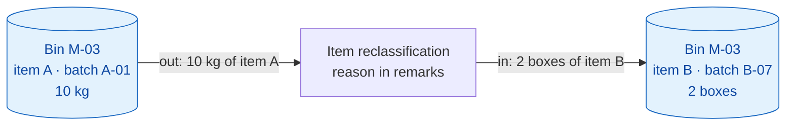

# Item Reclassification

How stock that is already in a bin is recorded under a different item, a
different code, or a different batch, without moving it. The material stays
where it is; only what WisBar calls it changes.

## At a glance

| | |
| --- | --- |
| Where | One bin |
| Starts with | Stock recorded under the wrong item, code or batch, or material that has been repacked |
| Ends with | The same bin holding the stock under its new item and batch |
| Effect on stock | The old item and batch go down in the bin; the new item and batch go up in the same bin |

## When it is used

- **The item is really a different item**, for example material repacked into
  another pack size, or material regraded into another item.
- **The item is the same, but its code is different**, for example the same
  material registered under two item codes, or a batch label that was wrong.

## Who is involved

| Role | What they do |
| --- | --- |
| Warehouse Staff | Finds the stock that must be reclassified and records the reclassification. |
| Supervisor | Signs the reclassification. |

## Steps

1. **Identify the stock:** the bin, the current item and batch, and the
   quantity.
2. **Choose what it becomes:** the new item and its batch. A batch always
   belongs to one item, so a different item needs its own batch, created if it
   does not exist yet.
3. **Record both quantities and units.** They can differ when the unit changes,
   for example 10 kg out and 2 boxes in.
4. **Write the reason** in the remarks.
5. **Sign.** WisBar records one movement out of the bin under the old item, and
   one movement into the same bin under the new item.

## What WisBar keeps and why

| What WisBar keeps | Why |
| --- | --- |
| The movement out (old item and batch) and the movement in (new item and batch) | The bin's stock must go down for one and up for the other, so both bin figures stay true. |
| From item and to item, from quantity and to quantity | Read from the two movements, each in its item's base unit, so reports can show what was turned into what, even when the item stays the same. |
| The reason, who recorded it, who signed it | A reclassification changes what the stock is called, so it must be explained and approved. |

## Checks

- The two movements must be different lines, and each can belong to only one
  reclassification.
- Both quantities must be above zero.
- One movement is out and the other is in, both on this record (kept by the
  database). Checked by WisBar: both movements are on the same bin, and the
  new batch is a different batch.

## For the technical team

| Concept | Records |
| --- | --- |
| Reclassification | `item_reclassifications` (extends `stock_movements`; the reason is `transaction_headers.remarks`) |
| The two movements | `stock_movement_details` of the same document, referenced by `out_stock_movement_detail_id` (must be `out`) and `in_stock_movement_detail_id` (must be `in`) |
