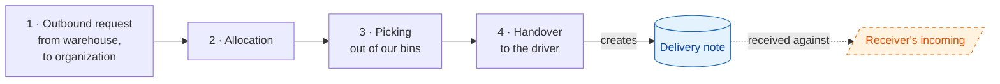

# Outbound

How stock leaves one of our warehouses for another organization, for example
from a primary site to a TPO site, or to a partner. The outbound ends when the
driver takes the goods: from that moment they are on their way to the
receiver, who records them as an [incoming](item_incoming.md) against the same
[delivery note](delivery_notes.md).

## At a glance

| | |
| --- | --- |
| From → To | One of our warehouses → another organization |
| Starts with | An outbound request |
| Ends with | A handover to the driver, which creates the delivery note |
| Effect on stock | Our bins go down at picking. Nothing is put away on our side. |

## Who is involved

| Role | What they do |
| --- | --- |
| Requester | Raises the outbound: from which warehouse, to which organization, batches and quantities. |
| Warehouse Staff | Reserves and picks the stock, loads it and hands it to the driver. |
| Driver | Takes the goods to the receiver. Not a WisBar user; recorded by name. |
| Receiving organization | Records the arrival as an incoming against the same delivery note. |

## Steps

### 1. Outbound request (Requester)

- Record the warehouse the stock is shipped **from** and the organization it is
  shipped **to**.
- For each line, choose the **batch** and the quantity. The batch follows the
  rotation rule (the batch closest to expiry first) or the warehouse staff's
  judgement; write the reason in the remarks when it goes against the rule.

### 2. Allocation (Warehouse Staff)

- For each line, choose the bins holding that batch. The stock is reserved.

### 3. Picking (Warehouse Staff)

- Take each allocated quantity out of its bin.

| Result | Next step |
| --- | --- |
| $\text{Picked} = \text{Requested}$ | Continue to **Handover**. |
| $\text{Picked} < \text{Requested}$ | Tell the Requester about the shortage and continue with what was picked. |

### 4. Handover to the driver (Warehouse Staff)

- Load the goods and record the handover:
  - the driver's name;
  - for each picked line, the batch and quantity actually loaded;
  - the delivery details: delivery number, vehicle plate number, delivery
    service and expected arrival date.
- WisBar creates the **delivery note** from this handover. The outbound is
  **completed**.

### 5. On the receiving side

- **If the receiver uses WisBar:** the delivery note is already waiting when
  the truck arrives. The receiver records an [incoming](item_incoming.md)
  against it, so our outbound and their incoming are linked.
- **If the receiver does not use WisBar:** the printed delivery note goes with
  the driver.

## Flow diagram

## What WisBar keeps and why

| What WisBar keeps | Why |
| --- | --- |
| Source warehouse, receiving organization, status, reason, who requested | Where the stock is going, decided before any paperwork exists. |
| Lines: batch, quantity, unit, remarks | What is to be shipped, batch by batch. |
| Allocations and picking lines | Which bins the stock left, and that the rotation rule was followed. |
| Handover: who loaded it, the driver's name, when, and the batches and quantities loaded | The moment the goods leave our responsibility. The driver is outside WisBar, so only the name is kept. |
| The delivery note created by the handover | The one document both sides refer to; it links our outbound to the receiver's incoming. |

## Checks

- Each picking has one handover, and each handover issues exactly one delivery
  note.
- Every quantity must be above zero.
- Checked by WisBar: stock is picked from the source warehouse, the loaded
  batch is the picked batch, and the delivery note's lines are written from the
  handover when it is signed (one line per batch).
- Deleting or reversing the handover withdraws its delivery note, unless the
  receiver has already recorded an incoming against it.

## For the technical team

| Step | Records |
| --- | --- |
| Request | `requests` → `outbounds` (`from_warehouse_id`, `to_organization_id`), `request_details` (`batch_id`) |
| Allocation | `allocations` through `sp_allocation_reserve` |
| Picking | `pickings`, `picking_details` |
| Handover | `handovers` with `receiver_name` (the driver) and `delivery_note_id`, without `received_by`; `handover_details` |
| Delivery note | `delivery_notes`, `delivery_note_details` |
