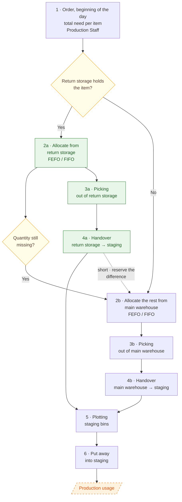

# Production Order

How a production facility gets the material it needs for the day. The order is
raised at the beginning of the day. It is supplied first from the production's
own **return storage**, where yesterday's leftover was put, and only the
remaining quantity is supplied from the **main warehouse**. Everything ends up
in the production's staging storage, ready to be used on the line.

## At a glance

| | |
| --- | --- |
| From → To | The production's return storage first, then the main warehouse → the production's staging storage |
| Starts with | A production order, raised at the beginning of the day |
| Ends with | Material in staging bins, ready for [production usage](production_usage_and_report.md) |
| Effect on stock | Return storage and main warehouse bins go down at picking; staging bins go up at put away |

## Return storage first, then the main warehouse

At the end of each day, the leftover in staging is counted and moved into the
production's return storage (see [Production return](production_return.md)).
The next morning, that leftover must be used **before** any new stock is taken
from the main warehouse.

Production Staff orders the **whole quantity** they need for the day, in one
order. They do not split it themselves. WisBar then supplies each order line in
this order:

1. **From the return storage of the same production**, as much as it holds of
   that item.
2. **From the main warehouse**, only the remaining quantity.

Example: Production Staff orders 100 kg of item A. The return storage holds
30 kg of item A from yesterday.

| Source | Supplies |
| --- | --- |
| Return storage | 30 kg (everything it holds) |
| Main warehouse | 70 kg (the remaining quantity) |
| **Total** | **100 kg**, as ordered |

If the return storage holds nothing of an item, the whole line comes from the
main warehouse. If it holds more than the order, only the ordered quantity is
taken; the rest stays in the return storage.

### The return-first rule (checked by the WisBar app)

**As long as the return storage still has an item available, nobody can take
that item from the main warehouse.** The WisBar app checks this; the database
does not.

"Available" means stock in the return storage of the ordering production that
is not reserved for another order yet and has not expired. Stock already
reserved or already taken counts as used.

The app checks the rule at two moments:

| Moment | What the app checks | If the rule is broken |
| --- | --- | --- |
| **Submitting the order** | For each line, how much of the item is available in the return storage. | Nothing is refused: the order is for the total need. The app shows the split: how much will come from the return storage and how much from the main warehouse. |
| **Allocating from the main warehouse** | Whether the return storage still has the item available. | Refused, with the message that the return storage must be used first and how much is still there. |

The app also limits the main warehouse part of a line:

$$\text{Main warehouse} \le \text{Ordered} - \text{Reserved from the return storage}$$

So the main warehouse can never be used to replace leftover that is still
waiting in the return storage, only to top it up.

## Who is involved

| Role | What they do |
| --- | --- |
| Production Staff (staging) | Raises the order for the items their role may order, receives the material from both sources, checks it, and puts it into the staging storage. |
| Staff of the return storage | Reserves and picks the leftover from the return storage, and hands it over to the staging storage. |
| Warehouse Staff | Reserves and picks the remaining quantity from the main warehouse, and hands it over to production. |

## Steps

### 1. Order (Production Staff, beginning of the day)

- Select the items to order. Only items the person's role is allowed to order
  can be chosen (see [Permissions](../people_and_access/permissions.md)).
- For each item, WisBar shows how much is in the production's return storage,
  so the staff can see what will come from yesterday's leftover.
- Enter the quantity and unit of each item: the **total** needed, not only the
  part missing from the return storage.
- Submit the order. The order is **open**.

An order raised later in the day follows the same rule.

### 2. Allocation: return storage first, then the main warehouse

- **Return storage (Staff of the return storage):** for each order line,
  reserve the item's stock in the return storage of the ordering production,
  up to the ordered quantity. Within the return storage, the rotation rule
  applies: the batch closest to expiry first (FEFO), otherwise the oldest
  arrival first (FIFO).
- **Main warehouse (Warehouse Staff):** for the quantity still missing on each
  line, reserve stock in the main warehouse, again following FEFO / FIFO.
- Reserved stock stays on the shelf, but no other request can plan to use it.

The app refuses a main warehouse allocation for an item while the return
storage still has that item available (see
[the return-first rule](#the-return-first-rule-checked-by-the-wisbar-app)).
Warehouse Staff can only start once the return storage part of the line is
fully reserved, or the return storage has none of the item.

### 3. Picking (one picking per source)

- The return storage and the main warehouse each pick their own part, in
  **separate pickings**. A picking takes stock from one warehouse only, because
  each picking is handed over by one sending warehouse.
- Take each reserved quantity out of its bin. The order is now **in progress**.
- Compare the picked quantity with the reserved quantity.

| Result | Next step |
| --- | --- |
| $\text{Picked} = \text{Reserved}$ | Continue to **Handover**. |
| $\text{Picked} < \text{Reserved}$ in the return storage | Reserve the missing quantity from the main warehouse. |
| $\text{Picked} < \text{Reserved}$ in the main warehouse | Tell Production Staff about the shortage and continue to **Handover** with what was picked. |

### 4. Handover (each source → Production Staff)

- Each picking is handed over on its own: the leftover by the staff of the
  return storage, the new stock by Warehouse Staff.
- Production Staff checks each item, batch and quantity against the picking.
  - **Matches:** accept the handover.
  - **Does not match:** both recount together, and the handover records the
    quantity actually handed over. If the return storage handed over less than
    planned, the missing quantity is reserved from the main warehouse.
- The handover records who handed over, who received, and when. The two must
  be different people.

### 5. Plotting (Production Staff)

- Plan which bin of the production's **staging storage** each handed-over line
  goes into. The bin must be active and have room. One line can be split over
  several bins.

### 6. Put away (Production Staff)

- Put each item into its planned bin and confirm the quantity.
- Compare the total put away for each order line, from both sources, with the
  ordered quantity.

| Result | Next step |
| --- | --- |
| $\text{Put away} = \text{Ordered}$ | The order is **completed**; the material is ready on the line side. |
| $\text{Put away} < \text{Ordered}$ | Find the items not yet put away and continue, or record the shortage. |

An order that will not be supplied is **cancelled**.

## Flow diagram

## What WisBar keeps and why

| What WisBar keeps | Why |
| --- | --- |
| The order: which production and production day it is for, when the material must be on the line, its status, remarks, who raised it | Everyone knows what to prepare and by when, and anyone can see how far the order has been supplied. |
| Order lines: item, total quantity, unit, remarks | What was asked for; every later step is compared to it, whichever source supplied it. |
| Allocations: bin, batch, quantity, status | Holds the stock for this order so it is not promised twice. The bin shows whether it came from the return storage or the main warehouse, so it can be checked that the leftover was used first. |
| Picking lines, each linked to one allocation | What actually left the return storage and the main warehouse. |
| Handovers: sending warehouse, who handed over, who received, when, and the quantity per batch after recount | The moment responsibility passes to production, per source. |
| Plottings and put-away lines | Which staging bin each batch went into, so production knows where its material is. |
| Who signed the order, each picking, each handover and each put away | Each is locked once signed. |

## Checks

- Every quantity must be above zero.
- One order can be picked in several pickings; each picking has exactly one
  handover and each handover exactly one put away.
- Each allocation is picked once, each picked line is handed over once, and
  each plotting is put away once.
- Checked by WisBar when each step is recorded:
  - the order is signed before it is picked, and signing the first picking
    puts the order **in progress**;
  - a picking takes stock from one warehouse only: the return storage of the
    ordering production or a main warehouse;
  - the handed-over batch is the picked batch, the handover goes to the
    staging storage of the ordering production, and the put away goes into
    its bins.
- Checked by the app:
  - **return first:** an item is never allocated from the main warehouse while
    the return storage of the ordering production still has it available (not
    reserved, not expired);
  - the main warehouse part of a line is at most the ordered quantity minus
    what is reserved from the return storage.

## Open points

- **Leftover that nobody orders.** Return storage stock of an item that is not
  ordered stays there. It is not decided how long it may stay, or when it is
  moved back to the main warehouse (for example with an
  [internal transfer](internal_transfer.md)).
- **Return first versus expiry.** The leftover is used first even if the main
  warehouse holds a batch that expires sooner. Expired stock is never
  allocated. To be confirmed with the business.

## For the technical team

Production orders use the shared request chain. The source is told apart by
the warehouse of the allocated bin.

| Step | Records |
| --- | --- |
| Order | `requests` → `production_orders` (`production_id`, `production_date`, `required_at`), `request_details` (one line per item, no batch, total quantity) |
| Allocation | `allocations` through `sp_allocation_reserve`, which refuses stock that is not available, a batch that is on hold or expired, and more than the line asks for. Source = `inventory_reservations.warehouse_bin_inventory_id` → `warehouse_bin_inventories.warehouse_bin_id` → `warehouse_bins.warehouse_id`: a `production_storages` row with `storage_type = 'return'` and the order's `production_id` is the return storage; `warehouses.warehouse_type = 'main'` is the main warehouse |
| Picking | `pickings` (`request_id`, `from_warehouse_id`), `picking_details` (`allocation_id`); one picking per source warehouse |
| Handover | `handovers` (`picking_id`, `from_warehouse_id` = return storage or main), `handover_details` |
| Plotting | `plottings` (`source_transaction_id` = the handover line) |
| Put away | `put_aways` (`source_header_id` = the handover), `put_away_details` |

The return-first rule is enforced by the app. Before calling
`sp_allocation_reserve` for a bin in the main warehouse, inside the same
database transaction:

1. **Return stock left:** lock the `warehouse_bin_inventories` rows of the
   production's return storage for the line's item with `SELECT ... FOR
   UPDATE`, then sum their `available_amount` in `v_bin_inventory_available`
   for batches that are released and not expired. If it is above zero, refuse
   the allocation. The lock stops two orders from both seeing the same
   leftover as available.
2. **Main warehouse cap:** `sp_allocation_reserve` already refuses more than
   the line's `base_amount` over all its reserved and picked allocations.
