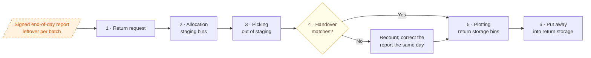

# Production Return

How the day's leftover in the staging storage is moved into the production's
return storage, starting from the counted leftover in the
[end-of-day report](production_usage_and_report.md).

This is not the same as a **group return**, where a production group brings
unused material back to staging during the day. Group returns are put away
into staging bins before the end-of-day count, so they are already part of the
leftover this process moves (see
[Production usage](production_usage_and_report.md)).

## At a glance

| | |
| --- | --- |
| From → To | The production's staging storage → the production's return storage |
| Starts with | A signed end-of-day report |
| Ends with | Leftover in return storage bins |
| Effect on stock | Staging bins go down at picking; return storage bins go up at put away |

## Who is involved

| Role | What they do |
| --- | --- |
| Production Staff (staging) | Raises the return, picks the leftover from staging and hands it over. |
| Staff of the return storage | Checks the leftover against the return and puts it away. |
| Supervisor | Has the end-of-day count reversed and counted again when the leftover turns out to be wrong. |

## Steps

### 1. Return request (Production Staff)

- Raise the return from that day's signed end-of-day report. Each production
  report has at most one return.
- For each leftover batch, enter the quantity to return. It cannot be more than
  the counted leftover.

### 2. Allocation (Production Staff)

- Choose the staging bin each returned batch is taken from. The stock is
  reserved for the return.

### 3. Picking (Production Staff)

- Take each allocated quantity out of its staging bin.

### 4. Handover (staging → return storage)

- Hand the leftover to the staff of the return storage.
- They check each item, batch and quantity against the return.

| Result | Next step |
| --- | --- |
| $\text{Received} = \text{Returned}$ | Accept the handover and continue to **Plotting**. |
| $\text{Received} \neq \text{Returned}$ | Recount together. The handover records what was actually handed over. If the end-of-day count was wrong, the return and the count are reversed and the staging storage is counted again **on the same day**, so the next day starts from the right figures. |

### 5. Plotting

- WisBar plans the leftover into the bins assigned to the production for its
  leftover, in fill order (see [Facilities and bins](../master_data/facilities_and_bins.md)).
  An assigned bin with a designation for the item is only filled up to its
  room.

### 6. Put away

- Put each item into its planned bin and confirm the quantity.

| Result | Next step |
| --- | --- |
| $\text{Put away} = \text{Handed over}$ | The return is **completed**. |
| $\text{Put away} < \text{Handed over}$ | Find the items not yet put away and continue. |

## Flow diagram

## What WisBar keeps and why

| What WisBar keeps | Why |
| --- | --- |
| The return, linked to the end-of-day report it comes from, with its status and who raised it | The returned quantity can always be checked against the counted leftover. |
| Return lines: batch, quantity, unit, remarks | The leftover is already known per batch from the count. |
| Allocations, picking lines, handover, plottings and put-away lines | The same chain as every flow, so each returned batch can be followed from its staging bin to its return storage bin. |
| Who handed over, who received, when | The moment responsibility passes. The two must be different people. |

## Checks

- Every quantity must be above zero.
- Checked by the app: the returned quantity of a batch does not exceed the
  counted leftover.
- Checked by WisBar: stock is picked from the staging storage of the
  production and handed over to its return storage.
- Checked when planning: the leftover goes only into a bin assigned to the
  production.

## What happens next

The leftover in the return storage is used first the next day: the next
[production order](production_order.md) is supplied from the return storage
before anything is taken from the main warehouse.

## Open point

- Leftover of an item that is not ordered the next day stays in the return
  storage. How long it may stay, and when it is moved back to the main
  warehouse, is not decided yet.

## For the technical team

| Step | Records |
| --- | --- |
| Return | `requests` → `production_returns` (`stock_count_id` of a `production_eod` count of the same production; one active return per count), `request_details` (`batch_id`) |
| Allocation | `allocations` through `sp_allocation_reserve` |
| Picking | `pickings`, `picking_details` |
| Handover | `handovers`, `handover_details` |
| Plotting | `sp_plotting_auto(handover line)`: the production's `production_return_bins` valid now, in `sort_sequence` order |
| Put away | `put_aways`, `put_away_details` |
