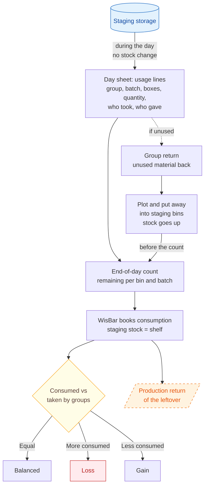

# Production Usage and End-of-Day Report

How material taken from the staging storage by production groups is recorded
during the day, how the staging storage is counted at the end of the day, and
how the difference between the two shows the day's loss or gain.

## At a glance

| | |
| --- | --- |
| Where | The production's staging storage and its production groups |
| During the day | One **day sheet** per production: which group took which batch (usage), what it found unfit (reject), and what it brought back (return). None of these change stock; a return raises staging stock only when it is put away. |
| End of the day | One **end-of-day report**: what is left in each staging bin. This books the day's consumption. |
| Result | Staging stock in WisBar equals what is really on the shelf, the day's loss or gain per batch is known, and the leftover is ready for [production return](production_return.md). |

## Why usage does not reduce stock

Taking boxes to a group does not prove they were used. Some are used, some are
rejected, some are left at the line, some go missing. If every usage reduced
the staging stock, one wrong entry would make the stock figure wrong, and the
leftover returned at the end of the day would start from a wrong number.

So WisBar keeps the two apart:

- **Usage** records what each group *says* it took. It never changes stock.
- **The end-of-day count** records what is *really* left. Only this changes
  the staging stock.
- **The difference between them is the loss or gain.**

## Who is involved

| Role | What they do |
| --- | --- |
| Production group member | Takes material from staging to the group's line. |
| Staging staff (Production Staff) | Gives material out of staging and records each usage; receives material a group brings back and puts it away into a staging bin. |
| Production admin (Production Staff) | Counts the staging storage at the end of the day and records the report. |
| Supervisor | Reviews the day's loss or gain, and has a wrong count reversed and counted again. |

## Steps

### 1. Usage: material goes to a group (during the day)

All usages, rejects and returns of one production on one day are lines of one
document, the **day sheet**. The first usage of the day opens the sheet; every
later usage, reject and return of that day is added to it. The sheet is signed once, at
the end of the day, which locks all of its lines together. This keeps a day's
recap in one place.

Each time material leaves staging for a group, add a usage line:

- the production facility and the group;
- the batch;
- the number of boxes, if counted in boxes;
- the quantity and unit;
- who took it (a member of the group that day) and who gave it;
- when it was taken, and any remarks.

Stock is not changed.

**Reject: part of a usage found unfit.** When a group finds that material it
took is unfit, add a **production reject** line to the same day sheet, against
that usage:

- which usage it belongs to (the group and batch come from it);
- the rejected quantity and unit;
- any remarks, such as what was wrong.

**Return: unused material comes back to staging.** When a group brings back
material it did not use, add a **production group return** line to the same
day sheet, against the usage it was taken in:

- which usage it belongs to (the group and batch come from it);
- the quantity and unit brought back;
- who brought it back (group member) and who received it (staging staff); the
  two must be different people;
- any remarks.

Then put the material back into a staging bin, the same way as any put away:

1. **Plotting:** plan which staging bin of the same production each returned
   line goes into. One line can be split over several bins.
2. **Put away:** put it into the planned bin and confirm the quantity. This
   raises the bin's stock. The put away is its own signed document; a day can
   have several.

A usage can have several rejects and several returns, but together they can
never be more than the usage's quantity, and the unit must be the usage's
unit. WisBar checks both. A reject and a return line do not change
stock themselves; only the return's put away does.

All returns of the day must be put away before the end-of-day count.
Otherwise material already back on the shelf is counted before WisBar knows
about it, and its later put away would count it twice. WisBar does not
prepare the end-of-day count while the day sheet is unsigned or a return of
that day is not fully put away.

### 2. End-of-day count (Production admin)

- Count what is left in each staging bin, per batch.
- Where the count differs from what WisBar shows, record the **remaining
  amount**. WisBar books the difference:
  - **less counted than WisBar shows:** the difference is the day's
    consumption, and the bin goes down;
  - **more counted than WisBar shows:** the extra is found stock, and the bin
    goes up.
- Record every bin you counted, also when it matches WisBar: a missing line
  then means the bin was not counted.
- After the report, WisBar's staging stock equals what is on the shelf.

### 3. Loss or gain per batch (Supervisor)

For each batch, compare what was consumed with what the groups kept:

$$\text{Consumed} = \text{In staging at the start} - \text{Counted at the end}$$

$$\text{Taken by groups} = \text{Usages} - \text{Returns}$$

Material that came back and was put away is on the shelf again, so it is in
the count and does not count as taken.

| Result | Meaning |
| --- | --- |
| $\text{Consumed} = \text{Taken by groups}$ | Balanced. |
| $\text{Consumed} > \text{Taken by groups}$ | **Loss**: material left staging without being recorded as taken. |
| $\text{Consumed} < \text{Taken by groups}$ | **Gain**: groups recorded taking more than actually left staging. |

The Supervisor explains every loss or gain in the report's remarks. If the
count itself was wrong, it is reversed and counted again on the same day (see
[Signing and corrections](../records_and_audit/signing_and_corrections.md)), so
the next day starts from the right figures.

### 4. Leftover

The counted remaining amount is the day's **leftover**. It is the starting
point for the [production return](production_return.md).

### Example

Batch A-01 in staging, one day:

| | Boxes |
| --- | --- |
| In staging at the start of the day | 100 |
| Group 1 took (usage) | 40 |
| Group 2 took (usage) | 35 |
| Group 1 brought back (return, put away) | 10 |
| **Taken by groups** (40 + 35 − 10) | **65** |
| Counted at the end of the day | 30 |
| **Consumed** (100 − 30) | **70** |
| **Loss** (70 − 65) | **5** |

Five boxes left staging without anyone recording that they took them.

## Flow diagram

## What WisBar keeps and why

| What WisBar keeps | Why |
| --- | --- |
| Day sheet: production, day, remarks, who opened it, who signed it | One document per production per day, so the day's usages, rejects and returns are recapped and signed together. |
| Usage line: group, batch, boxes, quantity, unit, who took, who gave, when, remarks | Shows which group took what, so a loss can be traced to a group and a day. The group must belong to the sheet's production. |
| Reject line: the usage it belongs to, quantity, unit, remarks, who recorded it, when | Shows how much of what a group took was unfit, traced back to the group, the batch and its vendor. |
| Return line: the usage it belongs to, quantity, unit, who brought it back, who received it, when, remarks | Shows what a group did not use, so it is not counted as taken. |
| Return plottings and put away: staging bin, batch, quantity, who signed | Where the returned material went, and the stock increase in that bin. |
| End-of-day report: production and day | One closing count per production per day. |
| For every counted bin and batch: what WisBar showed, what was counted, and the difference booked from it | Makes staging stock match the shelf, gives the true consumption for the day, and proves every bin was counted. |
| Who counted, who signed | Accountability for the figures that decide the loss or gain. |

The loss or gain itself is not typed in: it is worked out from the count and
the usages, so it always adds up.

## Rules

- Usage, reject and return lines never change stock. Staging stock changes
  only through the put away of returns (up) and the end-of-day report.
- During the day, the staging stock WisBar shows is higher than what is on the
  shelf, because usage has not been deducted yet. Do not start a production
  return from staging until that day's report is signed.
- Every quantity in a usage must be above zero; boxes, when given, too.
- Every rejected and returned quantity must be above zero. The rejects and
  returns of one usage together are at most the usage's quantity, in the
  usage's unit.
- Checked by WisBar: one active day sheet per production and day; every line
  on a sheet happened on the sheet's day; who took or brought back material is
  a member of the group that day, and who received a return is someone else; a
  usage's group belongs to the sheet's production; a reject or return is on
  the same sheet as its usage; a return is put away only into a staging bin of
  the same production; the day sheet is signed and every return of the day is
  fully put away before the end-of-day count is prepared.
- Until the day sheet is signed, its lines can still be changed. Sign it at the
  end of the day, before the end-of-day report.

## Not covered yet

- **What happens to rejected material.** WisBar records how much of a usage
  was rejected, but not where the material goes afterwards (for example to
  quarantine). That part of the process is not covered yet. Material not on
  the shelf at the end-of-day count is booked as consumption, rejected or not.

## For the technical team

| Concept | Records |
| --- | --- |
| Day sheet | `production_group_usages` (extends `transaction_headers`; `production_id`, `usage_date`; one active sheet per production and day) |
| Usage | `production_group_usage_details` (extends `transactions`; time taken = `transactions.occurred_at`; the group must belong to the sheet's production, enforced by `fk_production_group_usage_details_group`) |
| Production reject | `production_group_rejects` (`production_group_usage_detail_id`, on the same sheet, enforced by `fk_production_group_rejects_usage`). App check: rejects + returns per usage ≤ the usage `base_amount` |
| Group return | `production_group_returns` (`production_group_usage_detail_id`, same sheet, `returned_by`, `received_by`) |
| Group members | `production_group_members`; `taken_by` and `returned_by` are members that day (checked by the procedures) |
| Group return plotting | `plottings` (`source_transaction_id` = the return line, into a staging bin of the same production) |
| Group return put away | `put_aways` (`source_header_id` = the day sheet; several per day), `put_away_details` |
| End-of-day count | `stock_counts` (extends `stock_movements`; `count_type = 'production_eod'`, `production_id`, `count_date`; the warehouse must be the production's staging storage; one active count per production and day), `stock_count_details` (`system_amount`, `counted_amount`, `difference_amount`). `sp_stock_count_prepare` refreshes `system_amount` and adds one `stock_movement_details` line per difference; signing posts them |
| Loss or gain | Per batch: loss = −(sum of `difference_amount` of the count) − (sum of `production_group_usage_details.base_amount` on the sheet of the same production and day). Negative = gain. Group returns need no term: their put away already raised `system_amount`, so they appear on both sides of the business formula and cancel out |
