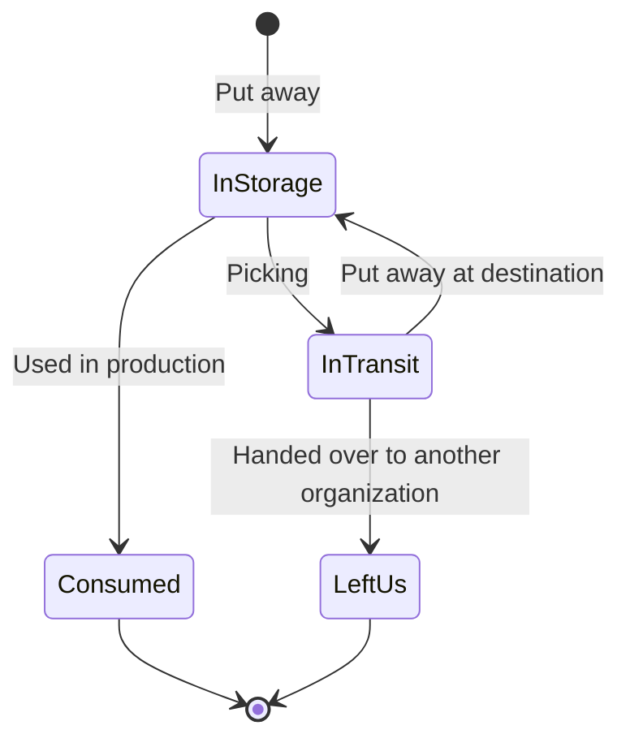
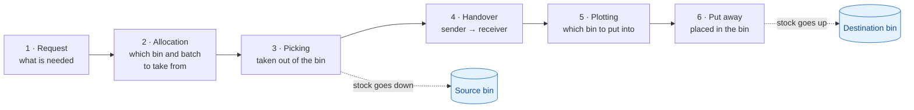

# Warehouse Execution Process

How stock moves from one place to another in a WisBar site, first in general
terms and then as WisBar records it. Every warehouse flow in this folder
follows the pattern described here.

- [Part 1. Warehouse execution in general](#part-1-warehouse-execution-in-general)
- [Part 2. Warehouse execution in WisBar](#part-2-warehouse-execution-in-wisbar)
- [The flows](#the-flows)
- [Current status and open points](#current-status-and-open-points)

---

## Part 1. Warehouse execution in general

### What warehouse execution is

Warehouse execution is the day-to-day work of physically moving stock and
keeping the records true to what happened on the floor. Planning decides
*what* should move; execution is the people, scans and documents that make it
move and prove that it moved.

Every movement, whether it is goods arriving from a vendor, material going to a
production line, or rejects going to quarantine, answers the same questions:

| Question | Answered by |
| --- | --- |
| Who needs what, how much, and from where to where? | Request |
| Which exact stock (bin and batch) will be used? | Allocation |
| Has it been taken out of its bin? | Picking |
| Who handed it to whom, and when? | Handover |
| Did the receiver get what was sent? | Receiving check |
| Where is it stored now? | Put away |
| Is the movement finished and locked? | Closing |

### Stock state

At any time a unit of material is in exactly one of three states. Stock records
are accurate only if every change between them is recorded.

| State | Where it is | Counted as |
| --- | --- | --- |
| In storage | In a bin, as part of a batch | Stock of that bin |
| In transit | Picked, not yet put away | Nobody's bin stock; the handover says who is responsible |
| Consumed or left us | Used up by production, or shipped to another organization | No longer our stock |

### Principles that apply to every movement

- **Every step is a document.** If it is not recorded, it did not happen.
- **Every line traces back.** Each line points to the line of the step before
  it, so any batch can be followed from the vendor to the production line.
- **Quantities are compared step by step.** A difference between two steps is
  an exception to explain, not a rounding error.
- **Records are not edited after they are signed.** A mistake is fixed by
  reversing the record and recording a new one, so both stay visible.

---

## Part 2. Warehouse execution in WisBar

### The six steps

WisBar records a movement in up to six steps. The request, picking, handover
and put away are documents with their own lines, each signed by the person
responsible for it. Allocation and plotting are plans that those documents
carry out.

| Step | What it records | Effect on stock |
| --- | --- | --- |
| 1. Request | What is needed: items or batches, quantities, from where, to where | None |
| 2. Allocation | The exact bin and batch each requested quantity will be taken from | Reserved: still on the shelf, but nobody else can plan to use it |
| 3. Picking | What was actually taken out of each allocated bin | Goes down in the source bin |
| 4. Handover | Who passed the material to whom, when, and the quantity after any recount | None: the material is in transit, and responsibility changes hands |
| 5. Plotting | Which bin each handed-over quantity will go into | None: it is a plan |
| 6. Put away | What was actually placed into each plotted bin | Goes up in the destination bin |

**Closing** is not a separate step: it is the signing of each document. Once a
document is signed it is locked; see
[Signing and corrections](../records_and_audit/signing_and_corrections.md).

Not every flow needs all six steps:

- **Incoming** starts at the handover: a delivery from outside was never in one
  of our bins, so there is nothing to allocate or pick.
- **Outbound** ends at the handover: once the driver takes the goods, they are
  no longer ours to put away.
- **Production group usage** has no request, allocation, picking or handover.
  A production's usages, rejects and returns of one day are lines of one
  **day sheet**. Only material a group brings back goes through steps 5 and 6:
  it is plotted and put away into a staging bin.
- **Item reclassification** is a single record, not a chain of steps.

### Reservations: allocation and plotting

Allocations and plottings are both **reservations**: plans made before stock is
physically moved.

| | Allocation | Plotting |
| --- | --- | --- |
| Plans… | which stock will be **taken** | where stock will be **put** |
| Records | bin, batch, quantity, unit, who planned it, when, and why | the same |
| Holds back stock? | Yes, while it is still *reserved* | No |
| Ends when | the stock is picked, or the reservation is released | the stock is put away, or the plotting is cancelled |

An allocation is **reserved** until it is picked or **released** (cancelled
before picking). Only reserved allocations hold stock back, so the same pallet
cannot be promised to two requests. A plotting is **planned** until it is
**put away** or **cancelled** (for example when the bin cannot take it on the
floor, with the reason). Only planned plottings take room in a bin.

### How bin stock is counted

WisBar always counts stock **per bin and batch**, in the item's base unit (see
[Items and batches](../master_data/items_and_batches.md)). For each bin and
batch it keeps a helper figure, used to see at a glance whether a bin is full,
how much room it has and what can still be allocated. The record behind it is
the signed stock movements; every night WisBar checks that the two agree.

| Figure | Meaning |
| --- | --- |
| Current amount | What is physically in the bin |
| Reserved amount | Part of the current amount that is allocated but not picked yet. Worked out from the allocations, never stored |
| Available amount | Current minus reserved: what can still be allocated |
| Pallets | How many pallets of the batch are in the bin, for materials counted in pallets |
| Filled at | When the bin last went from empty to holding this batch; used for FIFO |
| Depleted at | When the bin last became empty of this batch |

The current amount only changes when a stock document is **signed**: picking
(down), put away (up, including material a production group brings back to
staging), a bin move (one down, one up), item reclassification (one down, one
up), a stock count, including the production end-of-day count (sets the bin to
what was counted), and a stock reversal (undoes a signed stock document).
Production group usages, rejects and returns themselves never change it. It
can never go below zero, and a document may not take stock that is reserved
for another request.

### Rules shared by every flow

- **Each step points to the step before it**, for the whole document and for
  every line. A put-away line points to its plotting, which points to its
  handover line, then its picking line, then its allocation, then the request
  line.
- **Lines can be split, but each piece is carried out once.** One request line
  can be allocated from several bins, and one handed-over line can be plotted
  into several bins. But each allocation is picked by one line only, each
  plotting is put away by one line only, each picking has one handover, and
  each handover has one put away.
- **Quantities are compared at every step.** Picked against requested, handed
  over against picked (the receiver recounts), put away against handed over.
  A shortage is recorded and reported, not hidden.
- **Every document is signed, then locked.** Signing is when stock changes. A
  mistake in a signed document is fixed by reversing it and recording a new
  one (see [Signing and corrections](../records_and_audit/signing_and_corrections.md)).

### Checks the database makes, and checks the app makes

Many rules are kept by the database itself: each step points to a step of the
same request, picking or source document; stock is never allocated twice or
beyond what is available; a bin never gets more than its room; received stock
goes into storage bins and rejected stock into quarantine bins; and a bin is
active. The rules that depend on the flow, for example that stock is taken
from the right warehouse, are checked by WisBar when each step is recorded. A
few are left to the app screens. Each flow lists its own checks.

---

## The flows

| Flow | From → To | Steps |
| --- | --- | --- |
| [Item incoming](item_incoming.md) and [Item put away](item_put_away.md) | Vendor or another organization → storage bins (rejects → quarantine bins) | Delivery note → Incoming → Plotting → Put away |
| [Production order](production_order.md) | Production return storage first, then main warehouse → production staging storage | All six, with one picking and handover per source |
| [Production usage and end-of-day report](production_usage_and_report.md) | Staging storage → production groups, and unused material back into staging bins | One day sheet of usages, rejects and returns; returns go through Plotting → Put away; then one end-of-day count |
| [Production return](production_return.md) | Staging storage → production return storage | All six |
| [Internal transfer](internal_transfer.md) | Warehouse → another warehouse of the same organization | All six |
| [Outbound](outbound.md) | Our warehouse → another organization | Request → Allocation → Picking → Handover (with a [delivery note](delivery_notes.md)) |
| [Item reclassification](item_reclassification.md) | Same bin | One record: stock out under the old item, back in under the new one |
| [Warehouse reject](warehouse_reject.md) *(planned)* | Storage bin → quarantine bins | All six |

**Moving stock between bins of the same warehouse** is not a flow of its own.
It is recorded as one simple stock movement with two lines: out of the old bin
and into the new bin.

### End-to-end example: production order

1. At the beginning of the day, Production Staff orders 100 kg of item A. The
   production's return storage holds 30 kg of batch A-01 from yesterday.
2. The staff of the return storage allocates those 30 kg first. Warehouse Staff
   allocates the remaining 70 kg from the main warehouse: 40 kg of batch A-01
   in bin M-03 and 30 kg of batch A-02 in bin M-07 (A-01 expires first). That
   stock is now reserved.
3. Each source picks its own part, in its own picking. The return storage bin
   goes down by 30 kg, bin M-03 by 40 kg and bin M-07 by 30 kg.
4. Each source hands its material to Production Staff, who recounts it.
5. Production Staff plots 100 kg into staging bin S-01.
6. Production Staff puts it away. Bin S-01 goes up by 100 kg, and the order is
   completed.

The order, each picking, each handover and each put away are signed by the
person responsible for them.

---

## Current status and open points

**Status.** The WisBar app supports sign-in and master data today:
organizations, sites, vendors, site brands, brands, items and employees. The
warehouse flows in this folder are designed and their records are ready; their
screens are being built.

**Open points.**

- Warehouse rejects are planned but have no records yet.
- Material a production group finds unfit is recorded as a reject on the day
  sheet, but where it goes afterwards (for example to quarantine) is not
  covered yet.
- What happens to quarantined stock afterwards (return to the vendor, or
  disposal) is not designed yet.

**By design.** The bill of materials (BOM) is not kept in WisBar. Staff plan
receipts with the BOM outside the system; WisBar checks each incoming item's
brand against the brands the receiving site is manufacturing (site brands).
See [Item incoming](item_incoming.md).

## For the technical team

| Concept | Records |
| --- | --- |
| Document and line of every step | `transaction_headers` (document) and `transactions` (line), extended per step |
| Request of every flow | `requests` (`production_orders`, `production_returns`, `internal_transfers`, `outbounds`) and `request_details` |
| Allocation and plotting | `inventory_reservations`, extended by `allocations` (`status`: reserved, picked, released) and `plottings` (`status`: planned, put_away, cancelled) |
| Picking, handover, put away | `pickings` / `picking_details`, `handovers` / `handover_details`, `put_aways` / `put_away_details`: one shared chain for every flow |
| Stock documents and their lines | `stock_movements` (pickings, put aways, bin moves, stock counts, item reclassifications, stock reversals) and `stock_movement_details` (line, `in` or `out`, per bin inventory, in the item base unit) |
| Bin stock | `warehouse_bin_inventories` (one row per bin and batch, a helper); `v_bin_inventory_available` (reserved and available), `v_bin_inventory_check` (helper against signed lines), `v_warehouse_bin_room` |
| Posting, reserving, plotting | `sp_stock_post` (called when a stock document is signed), `sp_allocation_reserve` / `_release`, `sp_plotting_plan` / `_auto` / `_cancel` |
| Corrections | `sp_transaction_header_reverse`, or for a stock document `sp_stock_reversal_create` and then sign it |

Every step points at the step before it with a composite foreign key that also
carries the request, picking or source document. So a picking line can only
carry out an allocation of its own request, a handover line only a picked line
of its own picking, and a put-away line only a plotting of its own source
document. A one-to-one step (each allocation picked once, each plotting put
away once) is a unique key on the reference plus `active_key`; reversing or
deleting the later step clears `active_key`, so the step can be recorded
again. The design is explained in [DatabaseAnalysis.md](../../../DatabaseAnalysis.md).
