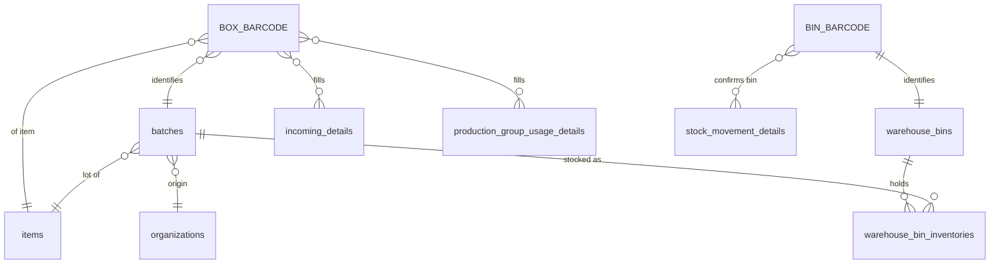
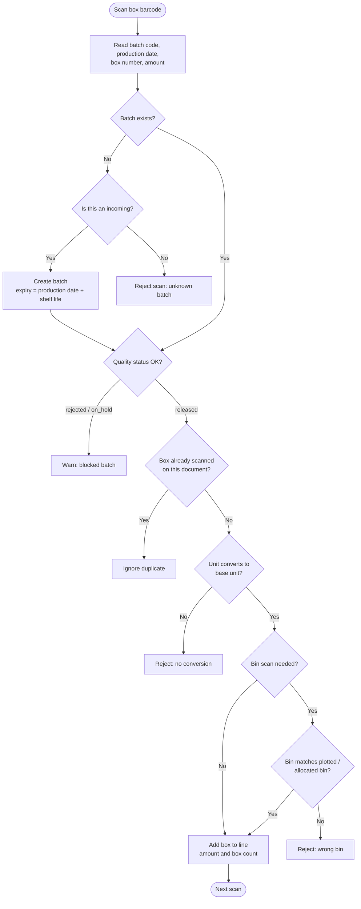
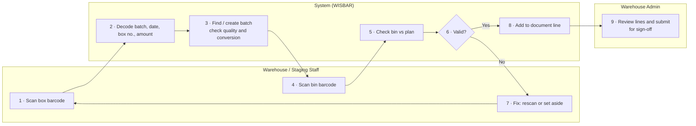

# Scanning Barcode

> Scanning always follows the **same rules, for goods coming in and going out**. A box barcode identifies the **batch** and the content of one box. A bin barcode identifies the **warehouse bin**. Scanning replaces typing, so lines are created from what is physically there.

Related: [Brand & Item](../master_data/brand.md) · [Incoming](../moving_materials/incoming.md) · [Picking](../moving_materials/picking.md) · [Put away](../moving_materials/put_away.md)

---

## 1. Data architecture

`BOX_BARCODE` and `BIN_BARCODE` are not tables. They are the printed labels the scanner reads.

---

## 2. Data structure

### What the box barcode stores

| Barcode part | Saved to |
| --- | --- |
| **Batch code** | `batches.batch_code` |
| **Production date** | `batches.production_date`, which with the item shelf life gives `batches.expiry_date` |
| **Box number** | Counted per line, for example `weighings.box_count` and `production_group_usage_details.box_count` |
| **Amount of item inside the box** | Line `amount` + `unit_of_measurement_id`. The system converts it to `base_amount`. |

The item comes from the label or the delivery note line. The origin organization comes from the sender of the delivery note.

### What the bin barcode stores

| Barcode part | Saved to |
| --- | --- |
| **Bin code** | `warehouse_bins.code` (unique within the warehouse) |

### Device

The scanner or terminal is recorded in `user_sessions.device_identifier`.

---

## 3. What it does & business process

**Purpose:** avoid typing mistakes and make every line traceable to a real box and a real bin.

### Same rules, in and out

1. **Scan the box:** read the batch code, production date, box number and amount.
2. **Resolve the batch:** find the batch by item + origin + batch code. On **incoming**, create it if it is new. On **outgoing**, it must already exist and be in stock.
3. **Check:**
   - The batch must not be `rejected`, and for allocation it must be `released`.
   - The unit must have a conversion to the item base unit.
   - On incoming, compare against the delivery note line.
   - On picking, compare against the allocation.
4. **Scan the bin:** confirm the bin where the box is put (put away) or taken from (picking).
   - On put away it must be the plotted bin.
   - On picking it must be the allocated bin.
5. **Add to the line:** every scan adds a box to the line's amount and box count.
6. **Duplicate check:** the same box number of the same batch is not counted twice on one document. The application enforces this.

### Where scanning is used

| Step | Scan box | Scan bin |
| --- | --- | --- |
| [Incoming](../moving_materials/incoming.md) | ✔ creates or finds the batch | – |
| [Put away](../moving_materials/put_away.md) | ✔ | ✔ plotted bin |
| [Picking](../moving_materials/picking.md) | ✔ | ✔ allocated bin |
| [Handover](../moving_materials/handover.md) | ✔ confirm amount | – |
| [Production usage](../moving_materials/production_usage.md) | ✔ what a group takes or returns | – |
| [Stock movement](../moving_materials/stock_movement.md) | ✔ | ✔ from and to bin |

---

## 4. Flowchart

---

## 5. Swimlane

