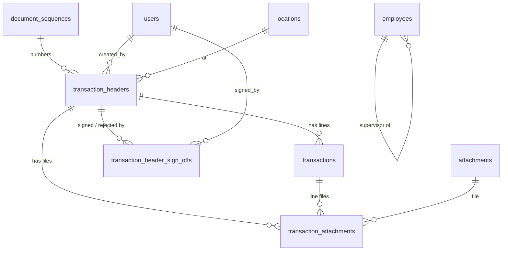
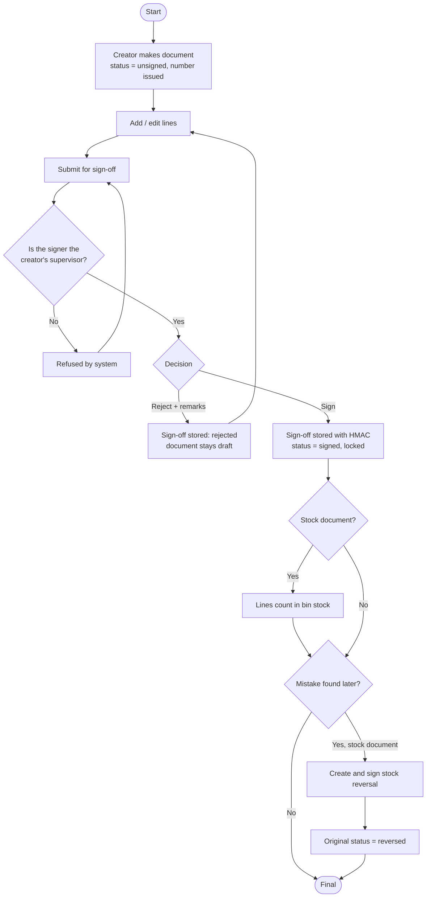
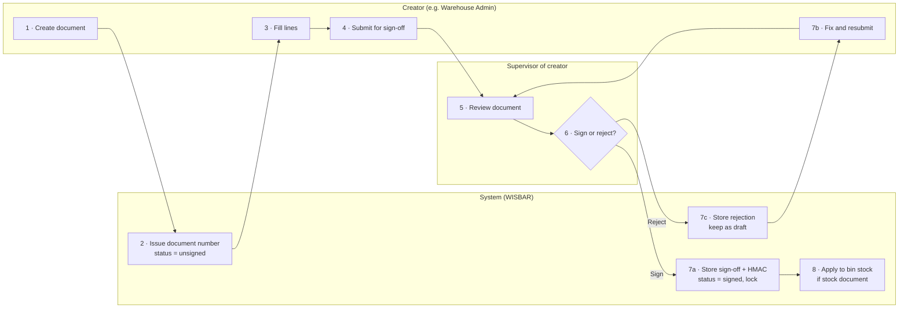

# Signing (Document Lifecycle)

> Every document in WISBAR (delivery note, incoming, request, picking, handover, put away, day sheet, reversal …) is a draft until it is **signed by the supervisor of the person who created it**. Once signed it is locked. A signed stock document can only be cancelled by a [stock reversal](../moving_materials/stock_reversal.md).

Related: [Account](../master_data/account.md) · [Stock reversal](../moving_materials/stock_reversal.md)

---

## 1. Data architecture

**In short:** each document = one `transaction_headers` row and many `transactions` lines. Sign-offs are appended. A *signed* sign-off locks the document.

---

## 2. Data structure

### `document_sequences`: numbering rule per document type

| Field | Stores |
| --- | --- |
| `document_type` | `incoming`, `picking`, `put_away` … |
| `prefix`, `period_format` | For example prefix `INC` + `%y%m%d` gives `INC251125000001` |
| `current_period`, `current_value` | The counter resets when the period changes |
| `padding_length` | Digits of the counter |

### `transaction_headers`: every document (CTI parent)

| Field | Stores |
| --- | --- |
| `uuid` | Public id |
| `transaction_header_type` | Which document it is |
| `location_id` | Site of the document |
| `document_number` | Never reused, even after a draft is deleted |
| `status` | `unsigned` (draft), `signed` (locked) or `reversed` (cancelled after signing) |
| `remarks` | Free text |
| `created_by` | Creator. **Their supervisor signs.** |

### `transactions`: every document line (CTI parent)

`transaction_header_id`, `transaction_type` (which line table), `occurred_at` (business time).

### `transaction_header_sign_offs`: append-only decisions

| Field | Stores |
| --- | --- |
| `decision` | `signed` or `rejected` |
| `remarks` | Required when rejected |
| `signed_by`, `signed_at` | Supervisor and time |
| `hash_algorithm`, `hash_key` | HMAC of the signed content, made by the API (tamper evidence) |

### `transaction_attachments`

Files for a whole document or one line. These can be added even after signing (for example, a photo of the signed paper).

---

## 3. What it does & business process

**Purpose:** make sure every record is checked by a second person, and that nothing changes after it is approved.

1. **Create:** a user creates a document. The system gives it the next number from `document_sequences` and the status `unsigned`.
2. **Fill lines:** lines can only be added, changed or removed while the document is an **active draft**.
3. **Submit:** the creator asks for sign-off.
4. **Review:** the **creator's supervisor** (`employees.supervisor_id`) reviews it:
   - **Sign:** a `signed` sign-off is stored with an HMAC hash, and the document becomes `signed` and read-only.
   - **Reject:** a `rejected` sign-off is stored with remarks. The document stays a draft, the creator fixes it and submits again.
5. **After signing:**
   - The document and its lines can no longer be edited or deleted.
   - Stock documents (picking, put away, bin move, reclassification) now count in bin stock.
6. **Cancel after signing:** a signed **stock** document can only be cancelled by signing a [stock reversal](../moving_materials/stock_reversal.md). The original then becomes `reversed`.
7. **Delete a draft:** soft-deletes the document and its lines. The number is not reused.

### Rules

- A new document must start as an active draft.
- Only the creator's supervisor can sign or reject.
- Sign-offs are never edited or deleted.
- A rejection must have remarks.
- A reversed document never changes again. A stock reversal itself cannot be reversed.

---

## 4. Flowchart

---

## 5. Swimlane

