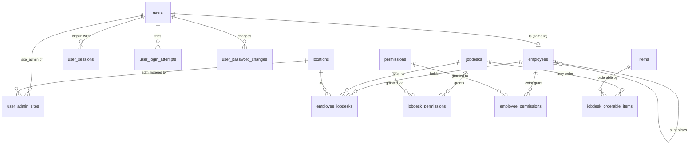
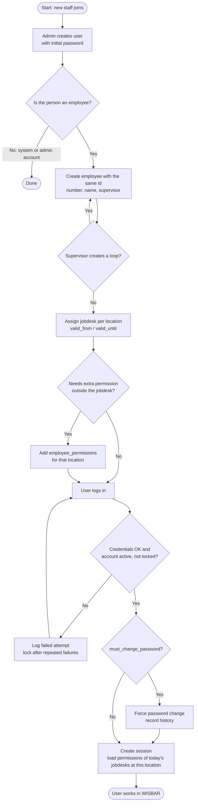
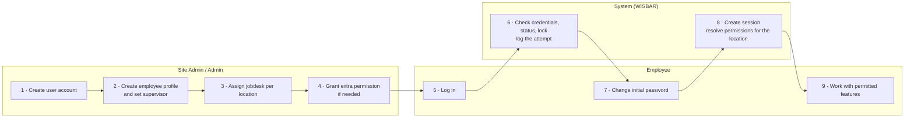

# Account (User, Employee, Jobdesk, Permission)

> **User** is the login account and handles authentication. **Employee** is the person's data and handles biodata and the reporting line. Every employee must be a user, but a user does not have to be an employee (for example a system or admin account).

Related: [Signing](../data_process/signing.md) · [Organization](organization.md)

---

## 1. Data architecture

**In short:** user → employee → jobdesk (per location) → permissions. Extra permissions can be given straight to an employee at one location.

---

## 2. Data structure

### `users`: login account

| Field | Stores |
| --- | --- |
| `username`, `email` | Login name and optional e-mail |
| `password_hash` | One-way hash, never plain text |
| `status` | `active`, `inactive` or `suspended` |
| `role` | System role: `super_admin`, `admin`, `site_admin` or `normal` |
| `must_change_password` | `1` forces a password change after login |
| `is_locked_until` | Login is blocked until this time (lockout) |
| `last_login_at`, `last_password_changed_at` | Login and password history markers |

### `user_sessions`: issued logins

`session_id`, `refresh_token_hash` (SHA-256), `device_identifier` (scanner, terminal or PC), `ip_address`, `issued_at`, `expires_at`, `revoked_at`. Sessions that expired or were revoked more than 30 days ago are purged by a scheduled event.

### `user_login_attempts`: every login try (append-only)

`attempted_username`, `user_id` (NULL if no match), `outcome` (`success`, `wrong_password`, `account_locked` …). Used for rate limiting and lockout.

### `user_password_changes`: password history (append-only)

`previous_password_hash`, `changed_by`, `change_reason` (`self_service`, `administrative_reset`, `forced_rotation`, `recovery`).

### `user_admin_sites`

Locations a `site_admin` user administers. Only a user with role `site_admin` can have rows here.

### `employees`: biodata (same `id` as the user)

| Field | Stores |
| --- | --- |
| `employee_number` | Staff number |
| `first_name`, `middle_name`, `last_name` | Name |
| `phone_number`, `address` | Contact |
| `supervisor_id` | The employee who **signs the documents this employee creates**. A supervisor loop (A → B → A) is blocked. |

### `jobdesks`: the role on the job

`code`, `name`, `description`. For example: Logistic Leader, Logistic Supervisor, Lead Production Unit, PE, Warehouse Admin, Production Admin. Jobdesks are the same at every location.

### `employee_jobdesks`

Which jobdesk an employee holds, **at which location**, from `valid_from` to `valid_until`.

### `permissions`

One row per app feature (`permission_code`, `name`, `description`). The codes are defined by the application.

### `jobdesk_permissions`

Permissions that come with a jobdesk (time-bound). They are valid at every location where the jobdesk is held.

### `employee_permissions`

Extra permissions for one employee at one location, outside their jobdesk. For example, covering for a colleague.

### `jobdesk_orderable_items`

Items a jobdesk may put on a **production order**.

---

## 3. What it does & business process

**Purpose:** decide who can log in, who they are, what they can do at each site, and who signs their documents.

1. **Account creation:** an admin creates a **user** with an initial password (`must_change_password = 1`).
2. **Employee profile:** if the person is staff, an **employee** row is created with the *same id*, their number, name and **supervisor**.
3. **Jobdesk assignment:** the employee gets one or more **jobdesks per location**, each with a validity period. A person can be a Warehouse Admin at plant A and also cover plant B.
4. **Permissions:**
   - effective permissions = permissions of every jobdesk valid today at that location
   - plus `employee_permissions` valid today at that location
5. **Orderable items:** for production orders, the jobdesk also limits which items can be requested.
6. **Login:** each attempt is logged. Too many failures set `is_locked_until`. A successful login creates a session that is refreshed by token and expires or is revoked.
7. **Signing link:** the supervisor link is what [signing](../data_process/signing.md) uses. Only the creator's supervisor can sign their document.

### Rules

- An employee cannot be their own direct or indirect supervisor.
- Only `site_admin` users can be linked to admin sites.
- Jobdesk, permission and orderable-item assignments are **time-bound**: you end one by setting `valid_until`, not by deleting it.

---

## 4. Flowchart

---

## 5. Swimlane

