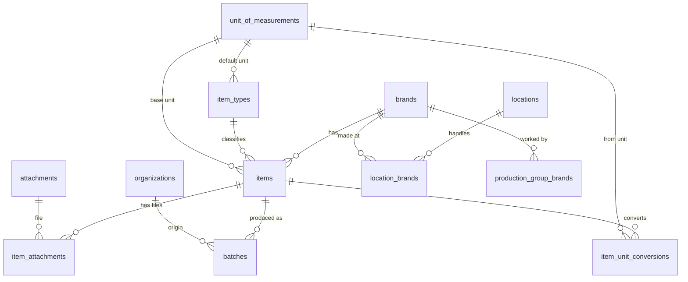
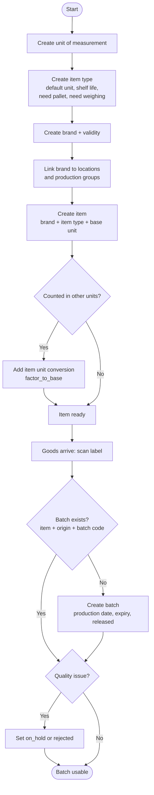

# Brand & Item (Brand, Item Type, Item, Unit, Batch)

> A **brand** is the product brand made at a location, and each brand has its own materials. An **item** is a material needed in production. It is built from a **brand** and an **item type**, and each item type has its own characteristics and rules. A **batch** is one lot of an item, read from the box label.

Related: [Organization](organization.md) · [Scanning barcode](../data_process/scanning_barcode.md)

---

## 1. Data architecture

**In short:** brand + item type → item → batch. Brands are linked to locations and production groups by date range.

---

## 2. Data structure

### `brands`

`code`, `name`, `valid_from`, `valid_until`.

### `location_brands`

Which brands a **location** handles, per date range (local date).

### `item_types`: the characteristics and rules of a material

| Field | Stores |
| --- | --- |
| `default_unit_of_measurement_id` | Base unit given to a new item of this type |
| `default_days_to_expiry` | Default shelf life |
| `need_pallet` | `1` means stock is also counted in pallets |
| `need_weighing` | `1` means the item is **weighed on arrival** (see [Incoming](../moving_materials/incoming.md)) |

### `items`: material master

| Field | Stores |
| --- | --- |
| `brand_id`, `item_type_id` | The two things that build the item |
| `code`, `name`, `fa_code` | Codes (`fa_code` is a fixed-asset or alternate code) |
| `unit_of_measurement_id` | **Base unit**. Every stock amount of this item is in this unit. |
| `days_to_expiry` | Shelf life. NULL means use the item type default. |
| `valid_from`, `valid_until` | When the item can be used |

### `unit_of_measurements`

`type` (`length`, `volume`, `mass`, `count`), `code`, `name`. Count units include pcs, box, roll, sack and pallet.

### `item_unit_conversions`

`factor_to_base`: how many base units are in one of this unit. For example, 1 box = 25 kg means factor 25. The base unit itself has no conversion. To change a factor, delete the row and add a new one.

### `batches`

| Field | Stores |
| --- | --- |
| `item_id` | Item of the batch |
| `origin_organization_id` | Vendor or sender (our own location for in-house batches) |
| `batch_code` | As printed on the label |
| `production_date`, `expiry_date` | Used for FEFO (first expired, first out) |
| `quality_status` | `released` (can be allocated), `on_hold` (blocked in every bin) or `rejected` (never usable) |
| `administered_by` | User who manages the batch |

The same item + origin + batch code is one batch.

### `item_attachments`

Files (spec sheets, photos) linked to an item through `attachments`.

---

## 3. What it does & business process

**Purpose:** define *what* material exists, in which unit it is counted, which sites and groups use it, and identify every physical lot.

1. **Units:** set up units of measurement (kg, pcs, box, roll …).
2. **Item types:** create an item type with its default unit, shelf life, and whether it needs pallets and weighing.
3. **Brands:** create the brand, then link it to the **locations** that make it (`location_brands`) and to **production groups** (`production_group_brands`).
4. **Items:** create the item from brand + item type and set its **base unit**.
5. **Conversions:** add a conversion for each other unit the item is counted in, such as box → kg. Without one, lines in that unit are refused.
6. **Batches:** created when a box label is scanned on arrival (see [Scanning barcode](../data_process/scanning_barcode.md)):
   - the expiry date comes from the production date + shelf life
   - quality status starts as `released`
7. **Quality control:** a batch can be put `on_hold` (stock blocked everywhere) or `rejected`.

### Rules

- Each stock amount is stored in the base unit, and other units are converted on entry (`base_amount`).
- A conversion must not be for the item's own base unit.
- Expiry date cannot be before production date.
- Bins are designated **per item**, so in practice per brand.

---

## 4. Flowchart

---

## 5. Swimlane

```mermaid
flowchart LR
    subgraph ADM["Site Admin / Admin"]
        direction TB
        a1["1 · Create units and item types"]
        a2["2 · Create brand and link to location"]
        a3["3 · Create items and conversions"]
    end
    subgraph PRD["Lead Production Unit"]
        direction TB
        p1["4 · Link brands to production groups"]
    end
    subgraph WS["Warehouse Staff"]
        direction TB
        w1["5 · Scan box label on arrival"]
    end
    subgraph SYS["System (WISBAR)"]
        direction TB
        s1["6 · Find or create batch<br/>and compute expiry"]
    end
    subgraph QC["Quality / Logistic Supervisor"]
        direction TB
        q1["7 · Hold or reject batch if needed"]
    end
    a1 --> a2 --> a3 --> p1 --> w1 --> s1 --> q1
```

