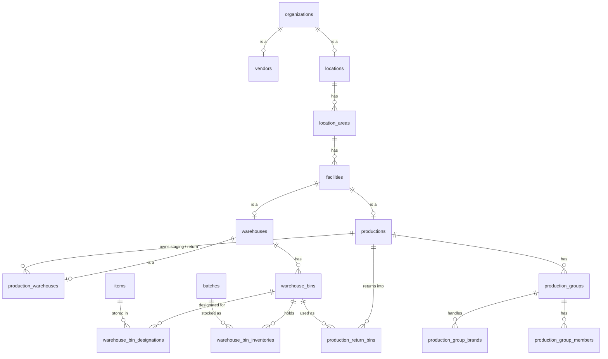
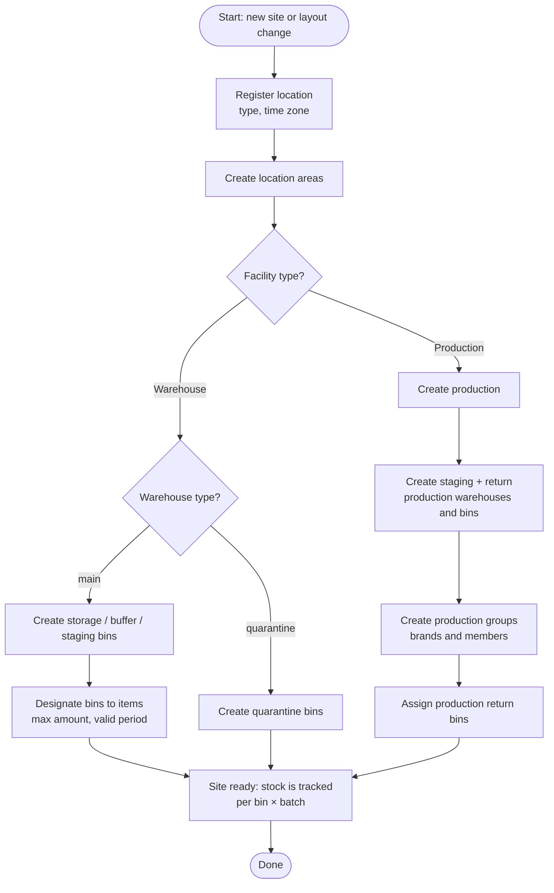

# Organization (Vendor, Location, Area, Facility, Warehouse, Bin, Production)

> **Organization** is every company involved. A **vendor** sends us goods. A **location** is our own manufacturing plant, where all stock movement is recorded. Inside a location are **areas** (zones). Inside areas are **facilities**: warehouses that store items, and productions that make products. Every piece of stock sits in a **warehouse bin**.

Related: [Brand & Item](brand.md) · [Stock movement](../moving_materials/stock_movement.md) · [Plotting](../moving_materials/plotting.md)

---

## 1. Data architecture

**In short:** organization → location → area → facility (warehouse or production) → bin → stock per batch.

Sometimes a warehouse and a production are side by side and are named by the zone (area). That is why both hang under `location_areas`.

---

## 2. Data structure

### `organizations`: every company (CTI parent)

`organization_type` (`location` or `vendor`), `code`, `name`, `address`.

### `vendors`

`type`: `supplier`, `contractor` or `logistics`. These are the senders and receivers on delivery notes.

### `locations`: our plants

| Field | Stores |
| --- | --- |
| `type` | `inhouse` (run by us) or `tpo` (run by a third party) |
| `time_zone` | `wib`, `wita` or `wit`. Business dates of the site are local dates in this zone. |

### `location_areas`

Zones inside a location (`code` unique within the location).

### `facilities`: CTI parent of warehouses and productions

`location_area_id`, `location_id` (copied for filtering), `facility_type`, `code`, `name`.

### `warehouses`

`warehouse_type`:

- `main`: normal storage
- `production`: serves a production (see `production_warehouses`)
- `quarantine`: rejected stock only

### `production_warehouses`

The warehouses that belong to a production. `storage_type`:

- `staging`: material handed over to production for today
- `return`: leftover kept for the next morning, used first before a new order

### `warehouse_bins`: the smallest stock location

| Field | Stores |
| --- | --- |
| `code` | What staff **scan**. Unique within the warehouse. |
| `hall`, `column`, `position` | Physical address |
| `sort_sequence` | Fill order for automatic plotting (ascending) |
| `maximum_pallet_amount` | Physical size in pallets |
| `type` | `buffer` (receiving), `storage` (actual storage), `staging` (picked stock waiting for handover), `quarantine` (rejected or not matching) |
| `is_active` | `0` stops new plottings and put aways |

### `warehouse_bin_designations`

Which **item** a bin is for and its `maximum_amount` (base unit), per time range. Bins are assigned by item, and so by brand. The room left in a bin = maximum amount − current stock − planned plottings.

### `warehouse_bin_inventories`: current stock

One row per **bin × batch**: `current_amount` (base unit), `current_pallet_amount`, `filled_at` (used for FIFO), `depleted_at`. It is a cache of the signed stock lines, and its rows are never deleted.

### `productions`, `production_groups`

A production facility and its working groups (`code`, `name`).

### `production_group_brands` / `production_group_members`

Which brands a group works on, and who is in the group, per date range.

### `production_return_bins`

Bins in the production's **return** warehouse that receive the end-of-day leftover.

---

## 3. What it does & business process

**Purpose:** model the physical site so that every stock amount has an exact place, and every movement knows where it comes from and goes to.

1. **Register organizations:** vendors (suppliers, contractors, logistics) and our own locations.
2. **Lay out the site:** a location is split into areas. Each area holds warehouses and productions.
3. **Set up warehouses:**
   - A main warehouse has storage and buffer bins.
   - A quarantine warehouse has quarantine bins for rejected stock.
   - Each production gets a **staging** warehouse (today's material) and a **return** warehouse (leftover for tomorrow).
4. **Create bins** with a scannable code, physical address, pallet capacity, type and fill order.
5. **Designate bins** to items with a maximum amount. Plotting uses this to suggest where incoming stock goes.
6. **Set up production groups**, their brands and members. The day sheet checks that whoever takes material is a member on that date.
7. **Assign return bins** for each production's end-of-day leftover.
8. From then on, **stock** is kept per bin × batch in `warehouse_bin_inventories`. Only signed stock documents change it.

### Rules

- A bin that is not active is not offered for new plottings or put aways.
- A quarantine warehouse holds rejected stock only.
- Return bins must be in the production's own return warehouse.
- Pallet count cannot be above zero when the stock amount is zero.

---

## 4. Flowchart

---

## 5. Swimlane

```mermaid
flowchart LR
    subgraph ADM["Site Admin / Admin"]
        direction TB
        a1["1 · Register location and areas"]
        a2["2 · Create warehouses<br/>main / quarantine / production"]
        a3["3 · Create bins"]
    end
    subgraph LOG["Logistic Leader"]
        direction TB
        l1["4 · Designate bins to items<br/>and set max amount"]
        l2["5 · Set fill order<br/>sort_sequence"]
    end
    subgraph PRD["Lead Production Unit"]
        direction TB
        p1["6 · Create production groups"]
        p2["7 · Assign group brands and members"]
        p3["8 · Choose return bins"]
    end
    subgraph SYS["System (WISBAR)"]
        direction TB
        s1["9 · Use layout for plotting,<br/>allocation and stock"]
    end
    a1 --> a2 --> a3 --> l1 --> l2 --> p1 --> p2 --> p3 --> s1
```

