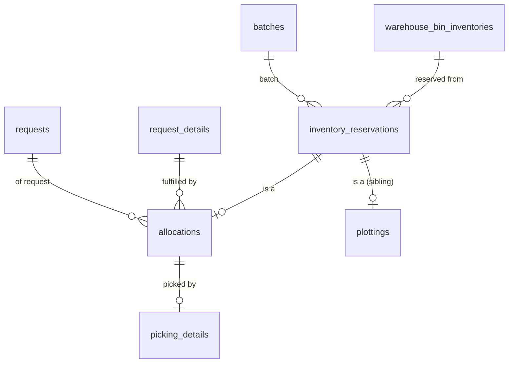
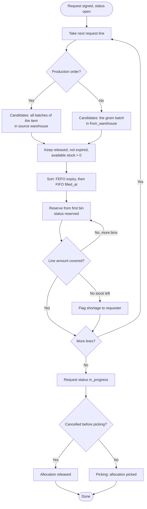
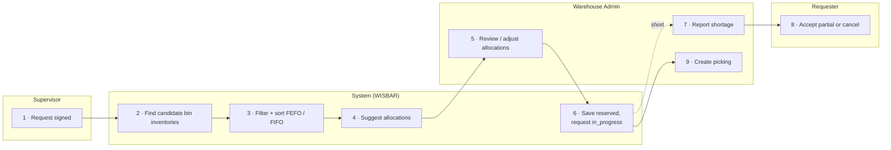

# Allocation (Reserving Stock for a Request)

> An **allocation** reserves stock in a specific bin and batch for one [request](request.md) line, so that nobody else takes it before it is [picked](picking.md). It is the "take out" twin of [plotting](plotting.md), which is the "put in" reservation. Allocation does not change stock. Picking does.

Related: [Request](request.md) · [Picking](picking.md) · [Plotting](plotting.md) · [Stock movement](stock_movement.md)

---

## 1. Data architecture



**In short:** one request line → one or more allocations, each from one bin × batch → one picking line each.

---

## 2. Data structure

### `inventory_reservations` (parent)

| Field | Stores |
| --- | --- |
| `reservation_type` | `allocation` here |
| `warehouse_bin_inventory_id` | Bin × batch the stock is reserved from |
| `batch_id` | Batch (copied) |
| `amount` | Reserved quantity, base unit |
| `reserved_by`, `reserved_at`, `remarks` | Who, when, notes |

### `allocations`

| Field | Stores |
| --- | --- |
| `request_detail_id`, `request_id` | The line being fulfilled |
| `status` | `reserved` (holds the stock), `picked` (done) or `released` (cancelled before picking) |

Allocations are never deleted. They are released instead.

### Available-to-allocate stock

```text
available = bin current_amount − reserved allocations on that bin inventory
```

Only batches with `quality_status = released` can be allocated.

---

## 3. What it does & business process

**Purpose:** decide *exactly which pallets* will fulfil a request, using FEFO/FIFO, and protect them from double use.

1. **Signed request arrives** (status `open`).
2. **Find candidates** for each line:
   - **production order** (item only): every bin inventory of that item in the source warehouse
   - **other types** (batch given): only bin inventories of that batch in the `from_warehouse`
3. **Filter:** batch is `released`, not expired, and the bin has available stock.
4. **Sort:**
   - **FEFO:** earliest `expiry_date` first
   - **FIFO:** then earliest `filled_at`
5. **Reserve** until the line's `base_amount` is covered, splitting over several bins if needed. Each reservation is an allocation with status `reserved`. The request becomes `in_progress`.
6. **Short stock:** if there is not enough, allocate what exists and leave the rest open (or tell the requester).
7. **Pick:** each allocation becomes one [picking](picking.md) line and its status becomes `picked`.
8. **Release:** if a request is cancelled or plans change before picking, the allocation becomes `released` and its stock is free again.

### Rules

- An allocation belongs to exactly one request line (and its request).
- One allocation is picked by at most one active picking line.
- A batch `on_hold` or `rejected` is never allocated.

---

## 4. Flowchart



---

## 5. Swimlane


