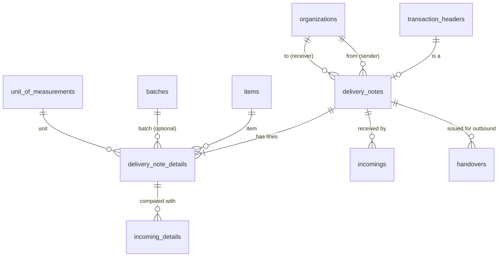
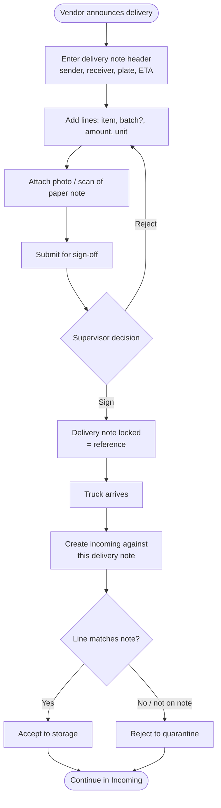
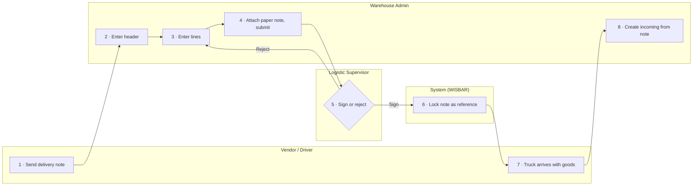

# Delivery Note

> A **delivery note** stores the delivery details: who sends goods to whom, by which vehicle, when, and what items are on it. For goods coming **in**, it is the reference the [incoming](incoming.md) is checked against. Items that do not match go to **reject**, and rejected items go to **quarantine**. For goods going **out**, WISBAR issues a delivery note for the [outbound](outbound.md).

Related: [Incoming](incoming.md) · [Outbound](outbound.md) · [Handover](handover.md)

---

## 1. Data architecture

---

## 2. Data structure

### `delivery_notes`: header

| Field | Stores |
| --- | --- |
| `delivery_number` | Number **printed by the sender** |
| `delivery_date` | Date printed on the note |
| `from_organization_id` | Sender (vendor, or our location for an outbound) |
| `to_organization_id` | Receiver (must differ from the sender) |
| `vehicle_plate_number` | Truck plate |
| `estimated_arrival_date` | When it should arrive |
| `service_name` | Delivery or logistics service |
| `active_key` | 1 = draft or signed, NULL = reversed or deleted |

Plus the common header: document number, status, location, creator.

### `delivery_note_details`: lines

| Field | Stores |
| --- | --- |
| `item_id` | Item on the note |
| `batch_id` | Batch, if printed on the note (NULL if not given or not created yet) |
| `amount` + `unit_of_measurement_id` | Quantity **as written**, in the unit written |

---

## 3. What it does & business process

**Purpose:** record what the sender *says* is coming before the truck arrives, so the actual receipt can be compared line by line.

### Incoming direction (vendor → us)

1. The vendor sends the delivery note (paper, e-mail or portal) before or with the truck.
2. The warehouse admin enters the **delivery note**: sender, receiver (our location), plate number, ETA, service.
3. They add **lines**: item, batch if known, and amount in the unit written on the note.
4. They attach a scan or photo of the paper note.
5. The supervisor **signs** it. It is now the official reference.
6. When the truck arrives, an [incoming](incoming.md) is created **against this delivery note**.
   - Matching lines are accepted.
   - Items not on the note, or not matching (wrong item, batch, brand or condition), are **rejected** and go to **quarantine**.

### Outbound direction (us → another organization)

1. When an [outbound](outbound.md) is handed over, the warehouse admin creates a delivery note *from our location to the receiver*.
2. The [handover](handover.md) must reference this delivery note and the driver's name.

### Rules

- Sender and receiver must be different organizations.
- A `delivery_number` is unique per sender among active notes.
- A delivery note has at most **one active incoming**. An outbound delivery note has at most **one active handover**.
- Amounts must be greater than 0.
- A batch on a line must belong to the line's item.
- Once signed, the note is read-only. Mistakes are fixed by reversing it and entering a new one.

---

## 4. Flowchart

---

## 5. Swimlane

