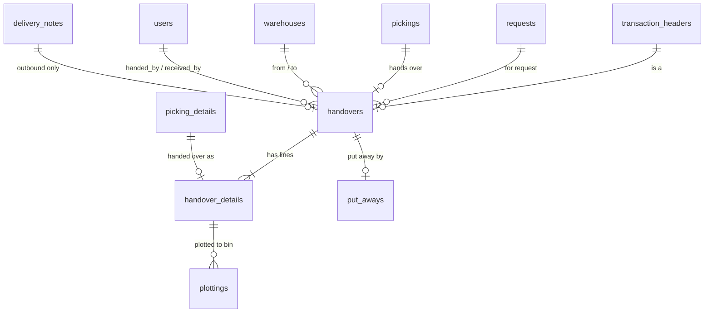
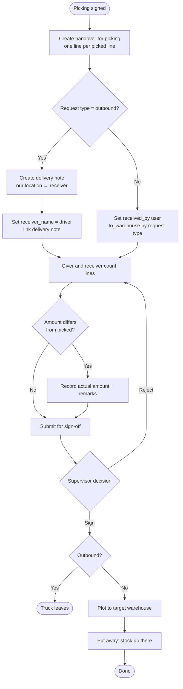
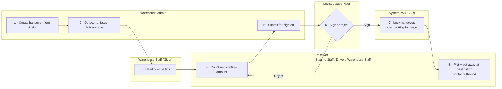

# Handover

> A **handover** records that picked material was **passed from the warehouse to the receiver**, and how much actually changed hands per picked line. It has **no stock effect**: stock already went down at [picking](picking.md). If the receiver is a warehouse (staging, return, quarantine, another warehouse), the handover lines are then [plotted](plotting.md) and [put away](put_away.md) there. For an [outbound](outbound.md) the receiver is the driver, with a delivery note.

Related: [Picking](picking.md) · [Plotting](plotting.md) · [Put away](put_away.md) · [Outbound](outbound.md) · [Delivery note](delivery_note.md)

---

## 1. Data architecture

---

## 2. Data structure

### `handovers`: header

| Field | Stores |
| --- | --- |
| `request_id`, `request_type` | The request. The type decides who receives. |
| `picking_id` | The picking being handed over |
| `from_warehouse_id` | Must be the picking warehouse |
| `to_warehouse_id` | Receiving warehouse. **NULL for an outbound.** |
| `handed_by` | Warehouse user giving it |
| `received_by` | User receiving it. **NULL exactly for an outbound.** |
| `receiver_name` | Driver or courier. **Required exactly for an outbound.** |
| `delivery_note_id` | Issued delivery note. **Required exactly for an outbound.** |
| `handed_over_at` | When it was handed over |

### `handover_details`: one per picked line

| Field | Stores |
| --- | --- |
| `picking_detail_id` | Picked line |
| `amount` + `unit_of_measurement_id` | Quantity **actually** handed over |
| `base_amount` | In base unit (trigger) |
| `remarks` | Notes on differences |

---

## 3. What it does & business process

**Purpose:** transfer responsibility for the material from the warehouse to the receiver, with both names on record.

1. **Picking is signed.** The material is in the staging area.
2. **Create the handover** for that picking. The system fills one line per picked line.
3. **Who receives depends on the request type:**

   | Request type | Receiver | `to_warehouse_id` |
   | --- | --- | --- |
   | Production order | Staging Staff of the production | Production **staging** warehouse |
   | Production return | Warehouse / Staging Staff | Production **return** warehouse |
   | Internal transfer | Warehouse Staff of the target | Target warehouse |
   | Production reject | Quarantine / Warehouse Staff | **Quarantine** warehouse |
   | Outbound | **Driver** (`receiver_name`) + **delivery note** | none |

4. **Count together:** the giver and receiver check each line, and record the amount actually handed over with remarks for any difference.
5. **Submit**, and the supervisor signs.
6. **After signing:**
   - **to a warehouse:** each line is [plotted](plotting.md) into the target warehouse and [put away](put_away.md), so stock rises there
   - **outbound:** the goods leave with the driver and the delivery note

### Rules

- `handed_by` and `received_by` must be different people.
- An outbound has no `received_by` or `to_warehouse_id`, but needs `receiver_name` and `delivery_note_id`.
- A non-outbound needs `received_by`, and has no receiver name or delivery note.
- One active handover per picking and per delivery note, and one active line per picked line.

---

## 4. Flowchart

---

## 5. Swimlane

