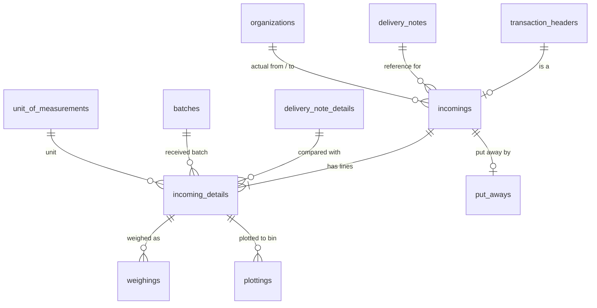
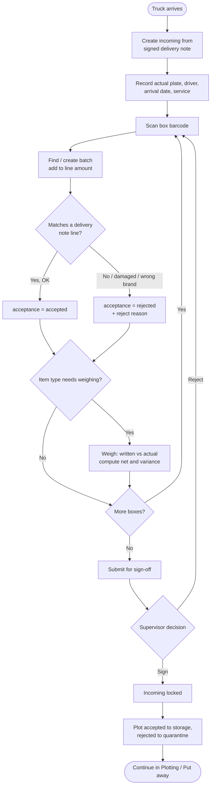
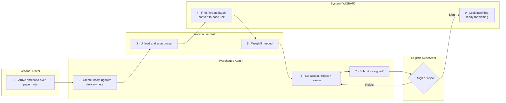

# Incoming (Receiving and Weighing)

> An **incoming** stores what items **actually arrived**, checked against the [delivery note](delivery_note.md). Each line is a batch and amount that was counted, and is **accepted** (goes to storage) or **rejected** (goes to quarantine). Items whose type needs weighing are also **weighed**. An incoming does **not** change stock by itself. Stock goes up when the received goods are [plotted](plotting.md) and [put away](put_away.md).

Related: [Delivery note](delivery_note.md) · [Scanning barcode](../data_process/scanning_barcode.md) · [Plotting](plotting.md) · [Put away](put_away.md)

---

## 1. Data architecture

---

## 2. Data structure

### `incomings`: header (one truck arrival)

| Field | Stores |
| --- | --- |
| `delivery_note_id` | The delivery note this is checked against |
| `from_organization_id`, `to_organization_id` | **Actual** sender and receiver |
| `vehicle_plate_number`, `driver_name` | Vehicle and driver that **actually** arrived |
| `actual_arrival_date` | Local date of arrival |
| `service_name` | Service that actually delivered |

### `incoming_details`: received lines

| Field | Stores |
| --- | --- |
| `delivery_note_detail_id` | Delivery note line it is compared with (NULL = **not on the note**) |
| `batch_id` | Batch received (from the box barcode) |
| `amount` + `unit_of_measurement_id` | Quantity **as counted** |
| `base_amount` | Same quantity in the item base unit (set by trigger) |
| `acceptance` | `accepted` (to a storage bin) or `rejected` (to a quarantine bin) |
| `reject_reason` | Required **only** when rejected |
| `remarks` | Notes |

### `weighings`: for item types with `need_weighing = 1`

| Field | Stores |
| --- | --- |
| `incoming_detail_id` | The line that was weighed |
| `box_count` | Boxes on the scale |
| `written_net_weight`, `written_gross_weight` | As stated on the document or label |
| `actual_packaging_weight` | Boxes, ropes, plastic |
| `actual_gross_weight` | Scale reading |
| `measured_net_weight` | Gross − packaging (computed) |
| `net_weight_variance` | Measured net − written net (negative = **shortage**) |
| `weight_unit_of_measurement_id` | A mass unit (kg …) |
| `moisture_content` | % (optional) |
| `weighed_by` | Who weighed |

---

## 3. What it does & business process

**Purpose:** record exactly what came off the truck, decide what is good and what is not, and prove shortages with weights.

1. **Truck arrives.** The warehouse admin opens a new **incoming** from the signed delivery note and records the actual vehicle, driver, arrival date and service.
2. **Unload and scan.** Warehouse staff scan every box ([scanning barcode](../data_process/scanning_barcode.md)):
   - the batch is found or created from batch code + production date
   - each box adds to the line's amount
3. **Match each line** to its delivery note line:
   - On the note and matching → `accepted`.
   - Not on the note, wrong item or brand for this site, damaged, or expired → `rejected` with a **reason**.
4. **Weigh** (only for item types that need weighing): put boxes on the scale and record the written weights, actual gross and packaging. The system computes the net and the **variance**. Moisture can be recorded.
5. **Unit conversion:** the system converts each counted amount into the base unit. If no conversion exists, the line is refused.
6. **Submit** for sign-off. The supervisor checks the differences against the delivery note and signs (or rejects with remarks).
7. **After signing:**
   - accepted lines are [plotted](plotting.md) to **storage** bins
   - rejected lines are plotted to **quarantine** bins
   - then a [put away](put_away.md) brings them into stock

### Rules

- One delivery note has **one active incoming**. To redo it, reverse or delete the old one first.
- `reject_reason` is set **exactly** when the line is rejected.
- Actual sender and receiver must differ.
- Gross weight must be at least the packaging weight, and written gross at least written net.
- Moisture must be between 0 and 100%.
- Only one active put away per incoming.

---

## 4. Flowchart

---

## 5. Swimlane

