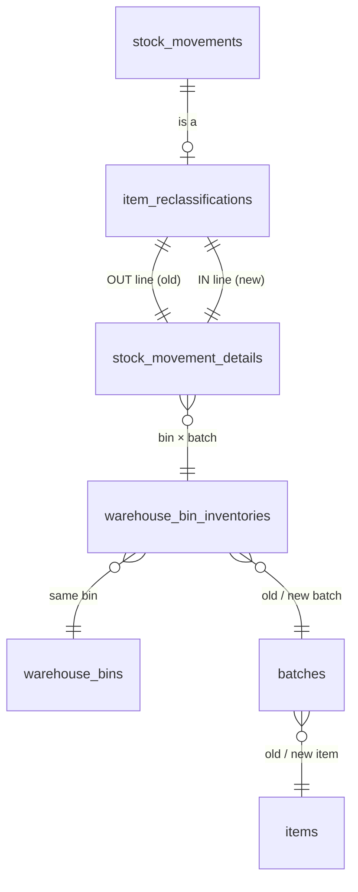
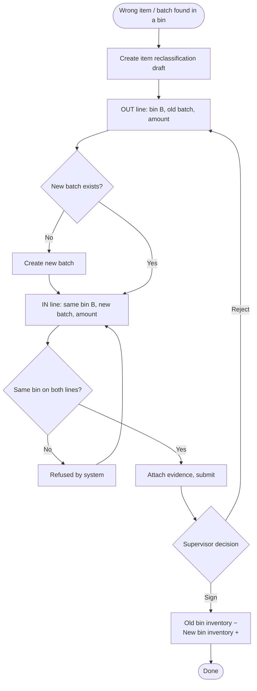
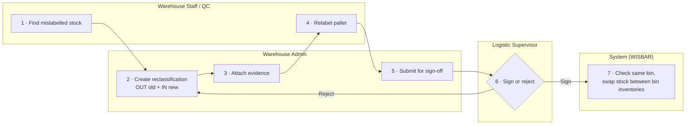

# Item Reclassification

> An **item reclassification** re-records stock that is **already in a bin** under **another item or batch**, without moving it physically. Use it when the label was read wrong, the batch code was corrected by the vendor, or the material is regraded to a different item code. It is one **OUT** line (old item or batch) and one **IN** line (new item or batch) **in the same bin**.

Related: [Stock movement](stock_movement.md) · [Stock reversal](stock_reversal.md) · [Brand & Item](../master_data/brand.md)

---

## 1. Data architecture

---

## 2. Data structure

### `item_reclassifications`

| Field | Stores |
| --- | --- |
| `out_stock_movement_detail_id` | Line that takes the **old** item or batch **out** of the bin (`out_movement_type` is always `out`) |
| `in_stock_movement_detail_id` | Line that puts the **new** item or batch **into the same bin** (`in_movement_type` is always `in`) |

The two lines are ordinary `stock_movement_details` of this document. Each has a bin inventory, amount, pallets and `moved_by`.

---

## 3. What it does & business process

**Purpose:** correct *what* the stock is, while keeping it in the same physical place and leaving a full audit trail. Data is never overwritten.

1. **Find the problem:** for example, during a stock check, QC review, or a vendor correction, a pallet in bin B is recorded as batch X, but it is really batch Y (or item P instead of Q).
2. **Create** an item reclassification (draft).
3. **Pick the OUT side:** the bin inventory *(bin B, batch X)* and the amount to reclassify.
4. **Pick the IN side:** the bin inventory *(bin B, batch Y)*. If the new batch does not exist yet, create it (see [Brand & Item](../master_data/brand.md)).
5. **Convert units:** if the new item has a different base unit, enter the amount in the new base unit.
6. **Attach evidence:** a photo of the label or the vendor letter.
7. **Submit.** The supervisor signs.
8. **On signing:** (bin B, X) goes **down** and (bin B, Y) goes **up**. Nothing moved physically.

### Rules

- Both lines must be in the **same bin**.
- Exactly one OUT and one IN line.
- Stock of the old bin inventory cannot go negative.
- To undo it, use a [stock reversal](stock_reversal.md).

---

## 4. Flowchart

---

## 5. Swimlane

