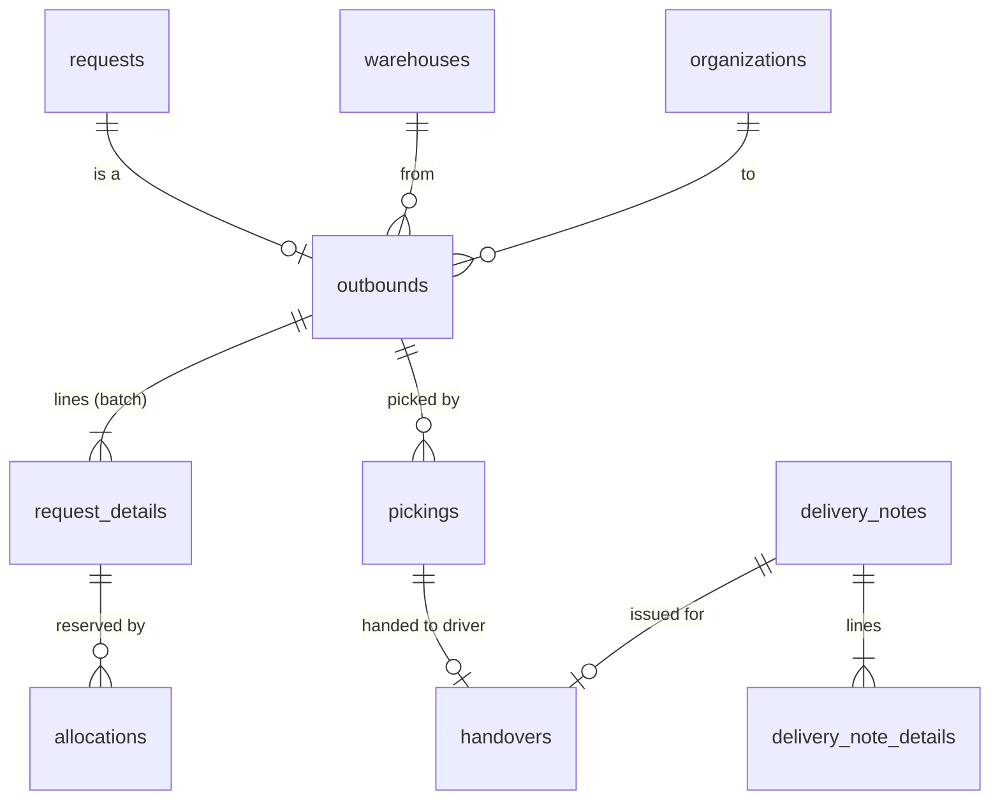
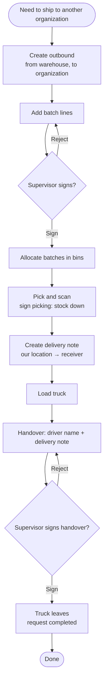
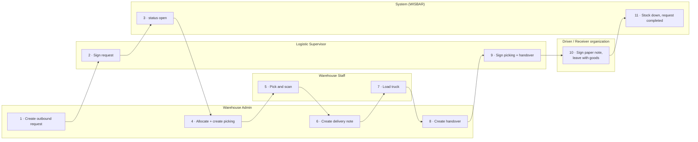

# Outbound (Shipping to Another Organization)

> An **outbound** is a [request](request.md) to send stock **out of our location to another organization**, such as a vendor return, another plant, or a partner. It follows request → allocation → picking → handover. At the [handover](handover.md), the goods go to the **driver** together with a **delivery note issued by us**. There is no put away, because the stock leaves the site.

Related: [Request](request.md) · [Allocation](allocation.md) · [Picking](picking.md) · [Handover](handover.md) · [Delivery note](delivery_note.md)

---

## 1. Data architecture

---

## 2. Data structure

### `outbounds`

| Field | Stores |
| --- | --- |
| `from_warehouse_id` | Warehouse the goods leave from |
| `to_organization_id` | Receiving organization |

The request status, document number and creator come from `requests` and `transaction_headers`.

### `request_details` (outbound lines)

`item_id`, `batch_id` (**required**), `amount`, `unit_of_measurement_id`, `base_amount`.

### At handover

| Table | Fields used for outbound |
| --- | --- |
| `handovers` | `receiver_name` = driver, `delivery_note_id` = our delivery note. `received_by` and `to_warehouse_id` are NULL. |
| `delivery_notes` | `from_organization_id` = our location, `to_organization_id` = receiver, `vehicle_plate_number`, `estimated_arrival_date`, `service_name` |
| `delivery_note_details` | Item, batch and amount shipped |

---

## 3. What it does & business process

**Purpose:** control everything that leaves the site, with a signed request, scanned picking and a delivery note for the receiver.

1. **Request:** the Warehouse Admin creates an **outbound** with the from warehouse, the receiving organization, and the **batches** and amounts.
2. **Sign:** the Logistic Supervisor signs. Status is `open`.
3. **Allocate** the requested batches in their bins ([allocation](allocation.md)).
4. **Pick:** staff scan and take the pallets out ([picking](picking.md)). Stock goes **down** when the picking is signed.
5. **Delivery note:** the admin creates a delivery note from our location to the receiver, with the truck plate, ETA, service, and the shipped lines.
6. **Handover to the driver:** load the truck and record the **driver name** and the **delivery note** on the handover. Both sign the paper copy, which is attached.
7. **Sign the handover.** The truck leaves and the request is `completed`.

### Rules

- Every outbound line needs a batch.
- The handover has no `received_by` or `to_warehouse_id`, but must have `receiver_name` and `delivery_note_id`.
- One delivery note serves one active handover.
- Stock leaves at picking. If the shipment is cancelled after picking is signed, use a [stock reversal](stock_reversal.md) on the picking.

---

## 4. Flowchart

---

## 5. Swimlane

