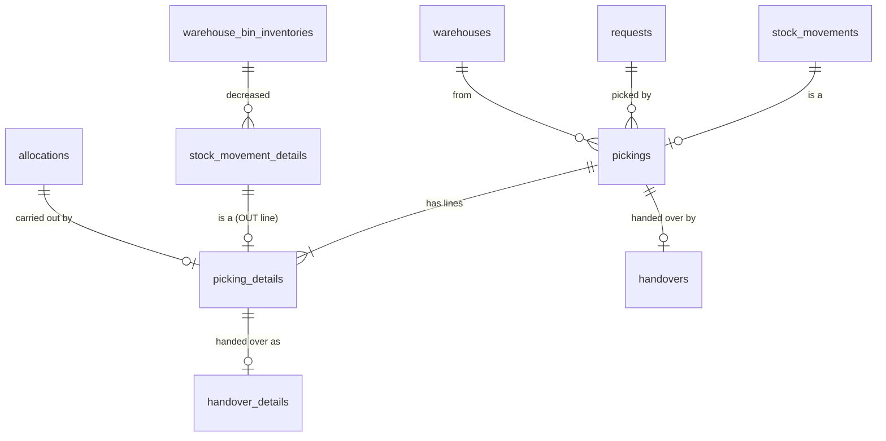
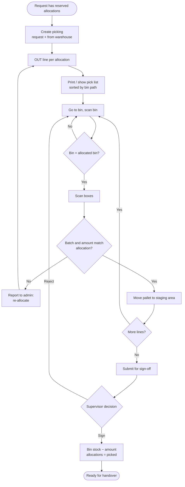
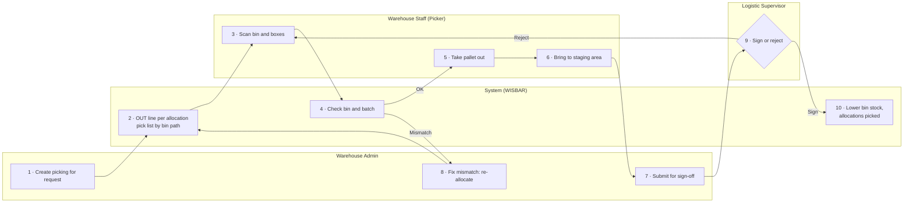

# Picking (Stock Out)

> A **picking** takes the [allocated](allocation.md) stock of one [request](request.md) **out of its bins**. Every picking line carries out exactly one allocation and is an **OUT** stock line, so signing a picking **lowers bin stock**. The picked material then waits for [handover](handover.md).

Related: [Allocation](allocation.md) · [Handover](handover.md) · [Stock movement](stock_movement.md)

---

## 1. Data architecture

---

## 2. Data structure

### `pickings`: header

| Field | Stores |
| --- | --- |
| `request_id` | Request being fulfilled |
| `from_warehouse_id` | Every line must come from a bin of this warehouse |

### `picking_details`: one OUT line per allocation

| Field | Stores |
| --- | --- |
| `allocation_id` | The allocation this line carries out |
| `request_id` | Copied (must match) |
| `active_key` | 1 = draft or signed, NULL = reversed or deleted |

It inherits from `stock_movement_details`: `warehouse_bin_inventory_id` (must be the allocation's), `type = out`, `amount`, `pallet_count`, `moved_by`.

---

## 3. What it does & business process

**Purpose:** remove reserved stock from the bins in a controlled, scanned way, so the stock figure drops exactly when material leaves the bin.

1. **Create a picking** for a request, from one warehouse. If allocations span several warehouses, make one picking per warehouse.
2. **Lines from allocations:** the system creates one **OUT** line per `reserved` allocation, on its bin inventory, with its amount.
3. **Pick list:** warehouse staff get the list sorted by bin path (hall, column, position).
4. **Pick and scan:** at each bin, scan the **bin** and the **boxes**. They must match the allocation. Record pallets and `moved_by`.
5. **Bring to staging:** picked pallets wait in the staging area for [handover](handover.md).
6. **Submit**, and the supervisor signs.
7. **On signing:**
   - bin stock **decreases**, and `depleted_at` is set if the bin reaches 0
   - allocations become `picked`
8. **Next:** create the [handover](handover.md).

### Rules

- A picking line is always **out**.
- It must move the bin inventory of its own allocation, from the picking's warehouse.
- One allocation has at most one active picking line.
- One picking has at most one active handover.
- Stock cannot go below zero.

---

## 4. Flowchart

---

## 5. Swimlane

