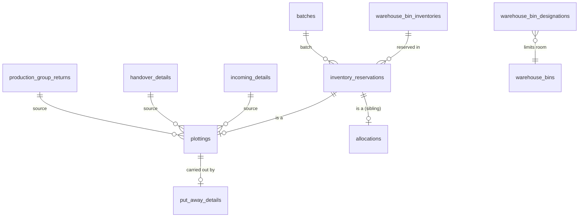
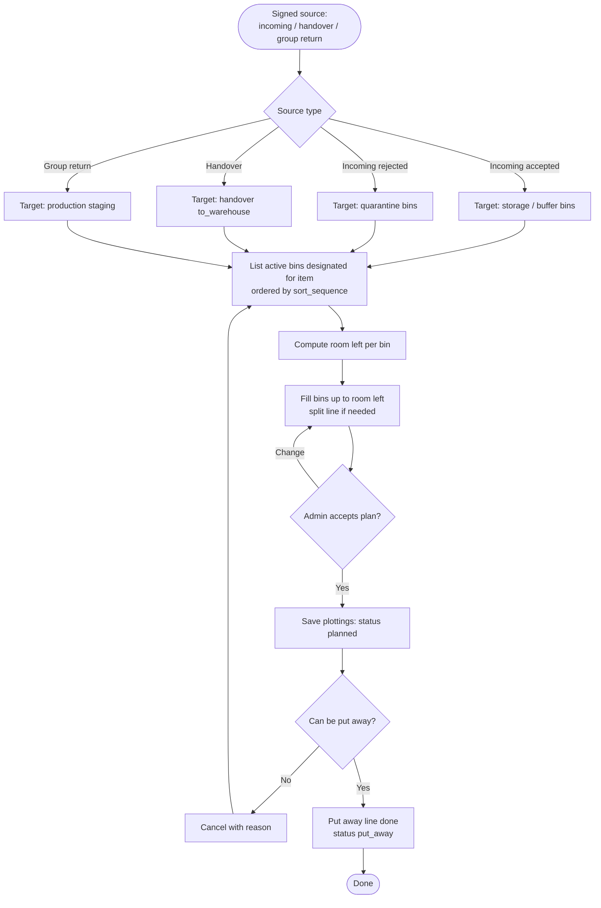
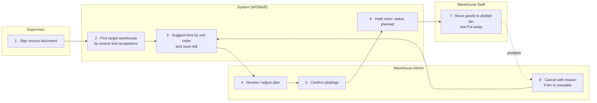

# Plotting (Planning Where Stock Goes)

> **Plotting** decides **which bin** a received quantity will be put into, *before* it is physically moved. A plotting is a reservation of room in a bin. It is made for three kinds of source line: an **incoming** line, a **handover** line, or a **production group return** line. It does not change stock. The [put away](put_away.md) that carries it out does.

Related: [Incoming](incoming.md) · [Handover](handover.md) · [Production usage](production_usage.md) · [Put away](put_away.md) · [Allocation](allocation.md)

---

## 1. Data architecture



**In short:** a source line → one or more plottings, each into one bin inventory (bin × batch) → one put-away line each.

---

## 2. Data structure

### `inventory_reservations`: parent of plottings and allocations

| Field | Stores |
| --- | --- |
| `reservation_type` | `plotting` (to put **in**) or `allocation` (to take **out**) |
| `warehouse_bin_inventory_id` | Target bin × batch |
| `batch_id` | Batch (copied from the bin inventory) |
| `amount` | Planned quantity, base unit |
| `reserved_by`, `reserved_at` | Who planned it and when |
| `remarks` | Notes |

Reservations are never deleted. They are cancelled through their status.

### `plottings`

| Field | Stores |
| --- | --- |
| `source_transaction_id` / `source_transaction_type` | The line being plotted: `incoming_detail`, `handover_detail` or `production_group_return` |
| `source_header_id` / `source_header_type` | Its document: `incoming`, `handover` or `production_group_usage` |
| `status` | `planned` (takes room in the bin), `put_away` (done) or `cancelled` |
| `cancel_reason` | Required **exactly** when cancelled |

### Room left in a bin (function `fn_warehouse_bin_room`)

```text
room left = designation max amount (valid now)
          − current stock of the item in the bin
          − planned plottings of the item into the bin
```

NULL means the bin has no designation for the item, so there is no limit.

---

## 3. What it does & business process

**Purpose:** put every received pallet in the right place (right warehouse type, designated bin, enough room) and give the forklift driver a clear "put it here" list.

1. **A source document is signed:** an incoming, a handover into a warehouse, or a day sheet with group returns.
2. **Choose the target warehouse:**
   - incoming **accepted** → main warehouse **storage** (or buffer) bins
   - incoming **rejected** → **quarantine** bins
   - handover → the handover's `to_warehouse` (for example the production staging warehouse)
   - production group return → the production **staging** warehouse
3. **Suggest bins:** the system lists active bins designated for the item, in `sort_sequence` order, and fills each up to its **room left**.
4. **Split if needed:** one source line can be plotted into several bins.
5. **The warehouse admin confirms or changes** the plan. Each plotting is saved as `planned`, and its room counts as taken immediately.
6. **Put away:** staff move the goods. Each [put-away line](put_away.md) carries out one plotting, and the plotting becomes `put_away`.
7. **Cancel:** if a plan cannot be done (bin blocked, damaged pallet), the plotting is `cancelled` with a reason and a new one is made.

### Rules

- The source must be an incoming, handover or production group return line.
- A cancel reason is required exactly when the plotting is cancelled.
- Only active bins are offered.
- Planned plottings reduce the room left, so two plans cannot fill the same space.

---

## 4. Flowchart



---

## 5. Swimlane


