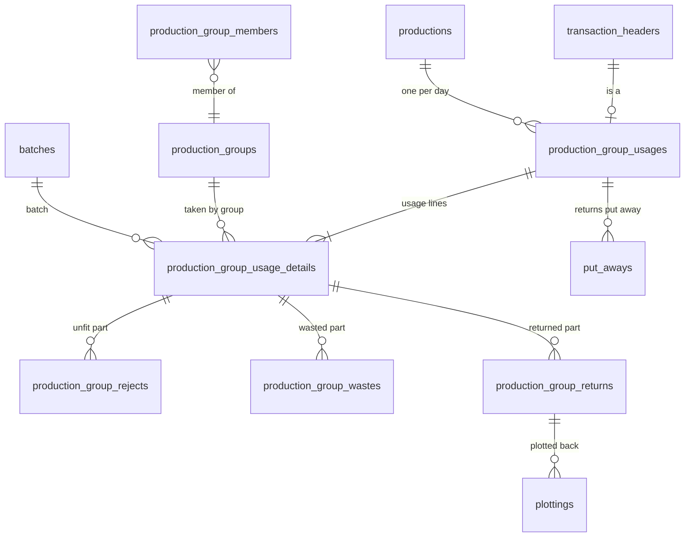
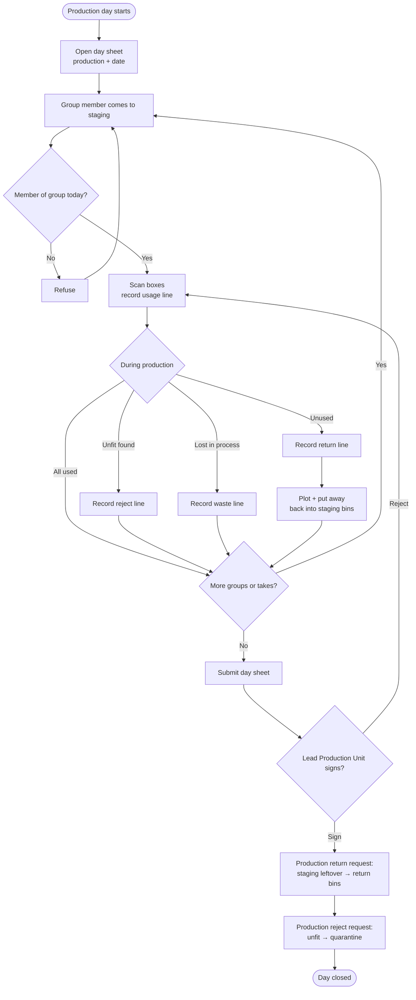
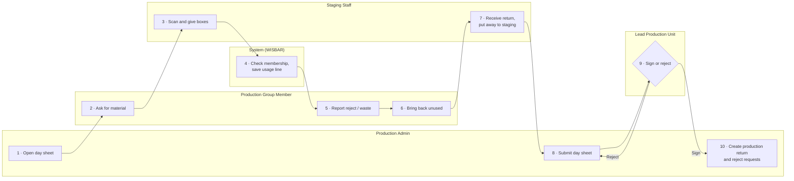

# Production Usage (Day Sheet: Usage, Reject, Waste, Return)

> The **production group usage** is the **day sheet** of one production for one day. It records what each **production group** took from the staging area, what part was **rejected** (unfit), what was **wasted** during production, and what was **returned** unused. The day sheet itself has **no stock effect**. Only group **returns** go back into stock, through [plotting](plotting.md) and [put away](put_away.md) into the staging warehouse.

Related: [Request](request.md) · [Handover](handover.md) · [Plotting](plotting.md) · [Put away](put_away.md) · [Organization](../master_data/organization.md)

---

## 1. Data architecture

---

## 2. Data structure

### `production_group_usages`: day sheet header

| Field | Stores |
| --- | --- |
| `production_id` | The production facility |
| `usage_date` | Production day (local date) |
| `active_key` | **One active day sheet per production per day** |

### `production_group_usage_details`: material a group took

| Field | Stores |
| --- | --- |
| `production_group_id` | Group (must belong to this production) |
| `batch_id` | Batch taken |
| `box_count` | Boxes (optional) |
| `amount` + `unit_of_measurement_id` | Quantity taken |
| `taken_by` | Group member. **Must be a member on the usage date.** |
| `given_by` | Staging staff who gave it |
| `remarks` | Notes |

### `production_group_rejects`: unfit part of a usage

`production_group_usage_detail_id`, `amount`, `unit_of_measurement_id`, `remarks`, `recorded_by`. This is recorded only. To move unfit material to quarantine, use a [production reject request](request.md).

### `production_group_wastes`: part wasted during production

`production_group_usage_detail_id`, `amount`, `unit_of_measurement_id`, `remarks`, `recorded_by`.

### `production_group_returns`: unused part brought back

| Field | Stores |
| --- | --- |
| `production_group_usage_detail_id` | Usage it comes from (same day sheet) |
| `amount` + `unit_of_measurement_id` | Returned quantity |
| `returned_by` | Group member |
| `received_by` | Staging staff |

Returns are **plotted** and **put away** into staging bins, and that is when stock rises.

---

## 3. What it does & business process

**Purpose:** account for every box that production groups take during the day, and explain where it went (used, rejected, wasted or returned).

1. **Morning:** material ordered by a [production order](request.md) has been handed over and put away into the production **staging** warehouse. Yesterday's leftover sits in the **return** bins and is used first.
2. **Open the day sheet:** the Production Admin opens the **day sheet** for the production and date. There is only one per production per day.
3. **Groups take material:** a group member comes to staging. Staging staff scan the boxes and record a **usage line** with the group, batch, box count, amount, `taken_by` and `given_by`. The member must belong to the group that day.
4. **During production:**
   - unfit material → **reject** line on that usage
   - material lost in the process → **waste** line on that usage
5. **Returns:** unused material is brought back as a **return** line (`returned_by` member, `received_by` staging staff). It is [plotted](plotting.md) and [put away](put_away.md) into staging bins. A day sheet may have several put aways during the day.
6. **End of day:**
   - the Production Admin completes the sheet and the Lead Production Unit signs it
   - leftover in staging is moved to the **return** bins with a [production return request](request.md)
   - rejected material is moved to **quarantine** with a [production reject request](request.md)

### Rules

- The group must belong to the day sheet's production.
- `taken_by` must be a member of the group on the usage date.
- Reject, waste and return lines must refer to a usage on the **same** day sheet.
- Box count, if given, is greater than 0.

### Open question

The day sheet has no stock effect, but group returns are put away into staging (stock **up**). The schema does not show where usage takes stock **down** in staging. Before go-live, decide whether a usage should create an OUT line from staging, or whether staging stock is not tracked per usage.

---

## 4. Flowchart

---

## 5. Swimlane

