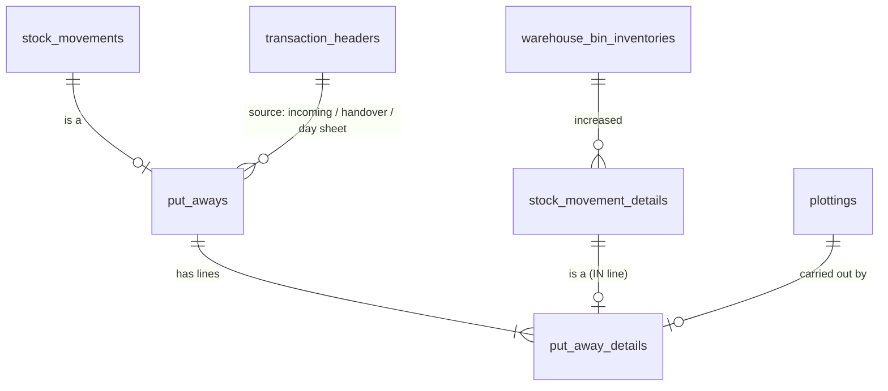
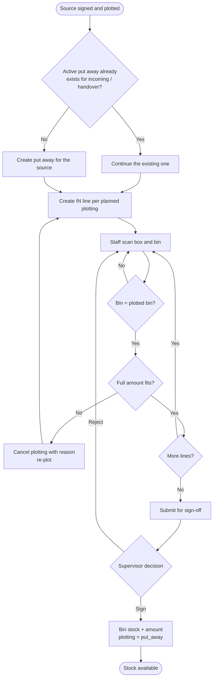
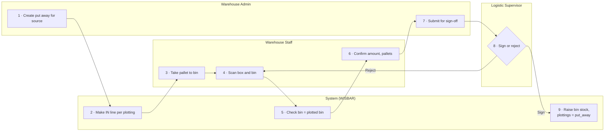

# Put Away (Stock In)

> A **put away** physically places plotted goods into their bins and **raises bin stock**. One put away covers the plotted lines of **one source document**: an incoming, a handover, or a production day sheet (for group returns). Each put-away line carries out exactly one [plotting](plotting.md).

Related: [Plotting](plotting.md) · [Incoming](incoming.md) · [Handover](handover.md) · [Production usage](production_usage.md) · [Stock movement](stock_movement.md)

---

## 1. Data architecture

---

## 2. Data structure

### `put_aways`: header

| Field | Stores |
| --- | --- |
| `source_header_id` / `source_header_type` | The document whose plotted stock is put away: `incoming`, `handover` or `production_group_usage` |
| `active_key` | 1 = draft or signed, NULL = reversed or deleted |
| `one_per_source_key` | Enforces **one active put away per incoming or handover**. A day sheet may have several. |

### `put_away_details`: one line per plotting

| Field | Stores |
| --- | --- |
| `plotting_id` | The plotting this line carries out |
| `source_header_id` | Copied from the header (must match the plotting's source) |

It inherits from `stock_movement_details`: `warehouse_bin_inventory_id`, `type = in`, `amount`, `pallet_count`, `moved_by`.

---

## 3. What it does & business process

**Purpose:** turn the plan into real stock, so the bin balance only goes up once the pallet is physically in the bin.

1. **Open a put away** for a signed source document that has planned plottings.
2. **One line per plotting.** The system creates an **IN** line on the plotted bin inventory with the plotted amount.
3. **Move:** warehouse staff (forklift) take each pallet to its bin.
   - Scan the box and the **bin barcode**. The bin must be the plotted bin.
   - Record `moved_by` and the pallet count.
4. **Differences:** if the full amount does not fit or a pallet is damaged:
   - cancel that plotting with a reason
   - plot again, and put away the new plotting
5. **Submit** for sign-off. The supervisor signs.
6. **On signing:**
   - bin stock **increases** by each line, and `filled_at` is set if the bin was empty
   - each plotting becomes `put_away`
7. **Mistakes after signing** are fixed with a [stock reversal](stock_reversal.md).

### Rules

- A put-away line must be **in**.
- It must move the bin inventory of its own plotting.
- Only one active put away per incoming or handover. A production day sheet can have several, for returns during the day.
- Bins must be active.

---

## 4. Flowchart

---

## 5. Swimlane

