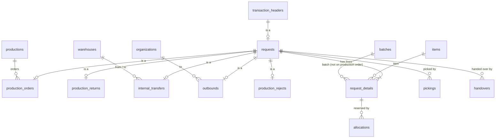
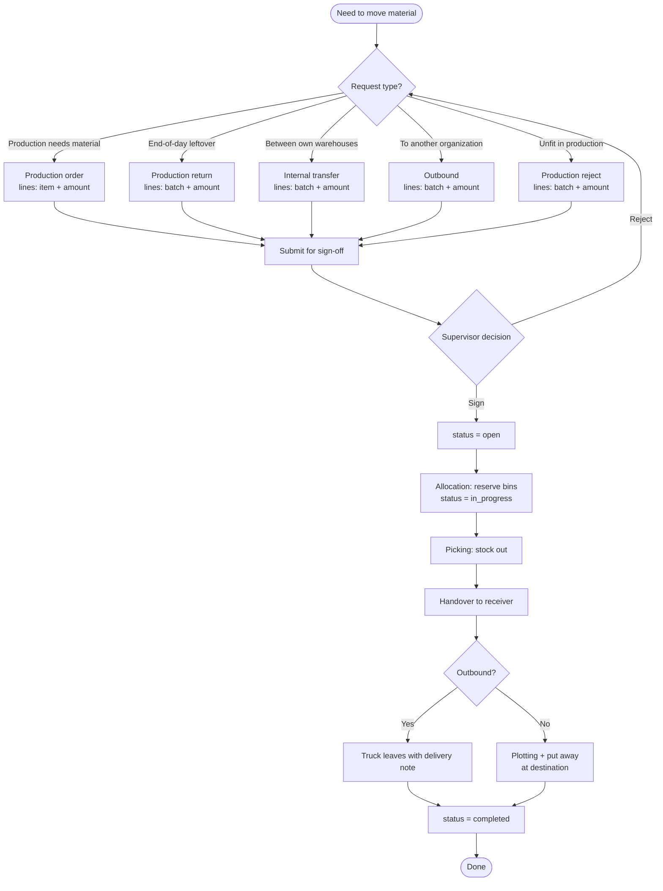
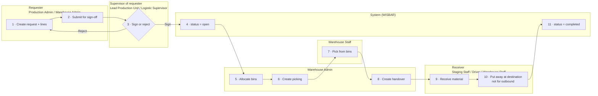

# Request (Production Order, Production Return, Internal Transfer, Outbound, Production Reject)

> A **request** asks the warehouse to **move material out of some bins to somewhere else**. All five request types follow the same chain: **request → [allocation](allocation.md) → [picking](picking.md) → [handover](handover.md) → [plotting](plotting.md) → [put away](put_away.md)**. An outbound stops at handover, because the goods leave the site.

Related: [Allocation](allocation.md) · [Picking](picking.md) · [Handover](handover.md) · [Outbound](outbound.md) · [Production usage](production_usage.md)

---

## 1. Data architecture

---

## 2. Data structure

### `requests`: common part of every request

| Field | Stores |
| --- | --- |
| `transaction_header_type` | Which request type (see below) |
| `status` | Fulfilment: `open`, `in_progress`, `completed` or `cancelled`. This can change **after** signing. |

### The five request types

| Type (table) | Extra fields | From → To | Line has |
| --- | --- | --- | --- |
| **Production order** (`production_orders`) | `production_id`, `production_date`, `required_at` | Main warehouse → production **staging** | **item only** (warehouse picks the batch) |
| **Production return** (`production_returns`) | `production_id`, `production_date`, `from_warehouse_id` (staging) | Production staging → production **return** bins | batch |
| **Internal transfer** (`internal_transfers`) | `from_warehouse_id`, `to_warehouse_id` | Warehouse → another warehouse, **same location** | batch |
| **Outbound** (`outbounds`) | `from_warehouse_id`, `to_organization_id` | Warehouse → **another organization** | batch |
| **Production reject** (`production_rejects`) | `production_id`, `from_warehouse_id` (staging or return), `to_warehouse_id` (quarantine) | Production warehouse → **quarantine** | batch |

### `request_details`: requested lines

| Field | Stores |
| --- | --- |
| `item_id` | Requested item |
| `batch_id` | Requested batch. **NULL exactly on a production order**, and required on every other type. |
| `amount` + `unit_of_measurement_id` | Requested quantity |
| `base_amount` | In base unit (set by trigger) |
| `remarks` | Notes |

---

## 3. What it does & business process

**Purpose:** a formal, signed demand for material, which drives allocation and picking.

### Common flow

1. **Create** the request (draft) with its type-specific header.
2. **Add lines:**
   - a production order asks for **items**, limited to the jobdesk's [orderable items](../master_data/account.md)
   - every other type asks for specific **batches**, because the material is already identified
3. **Sign:** the creator's supervisor signs. Status is `open`.
4. **Allocate:** the warehouse reserves bin stock for each line ([allocation](allocation.md)). Status becomes `in_progress`.
5. **Pick:** allocated stock is taken out of the bins ([picking](picking.md)).
6. **Hand over:** the picked material is given to the receiver ([handover](handover.md)).
7. **Put away** at the destination, except for outbound ([plotting](plotting.md), then [put away](put_away.md)).
8. Status becomes `completed` when everything is delivered, or `cancelled` if the request is dropped. Unpicked allocations are then released.

### Per type

- **Production order:** the Production Admin orders material for tomorrow's or today's production (`production_date`) and can give `required_at`. Material goes to the production **staging** warehouse.
- **Production return:** at the end of the day, leftover in staging is moved to the production's **return** bins, to be used first the next morning before a new order. Only **one active return per production per day**.
- **Internal transfer:** moves stock between two warehouses of the same location, such as main to main.
- **Outbound:** sends stock to another organization. See [Outbound](outbound.md).
- **Production reject:** unfit material found in production (staging or return) is moved to **quarantine**.

### Rules

- A production order line has no batch. Every other line must have a batch.
- From and to warehouses must be different and at the document's location.
- The unit must convert to the item base unit.
- Header and lines are locked once signed. Only `status` keeps changing.

---

## 4. Flowchart

---

## 5. Swimlane

