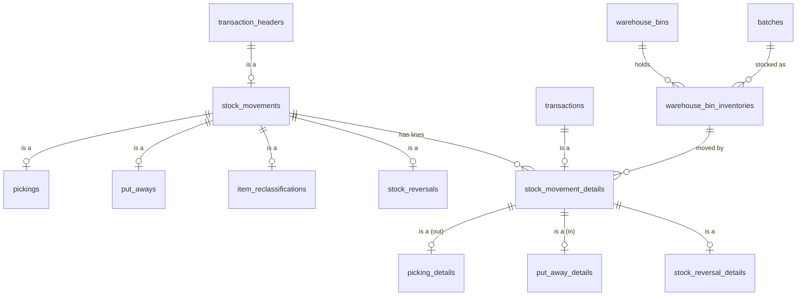
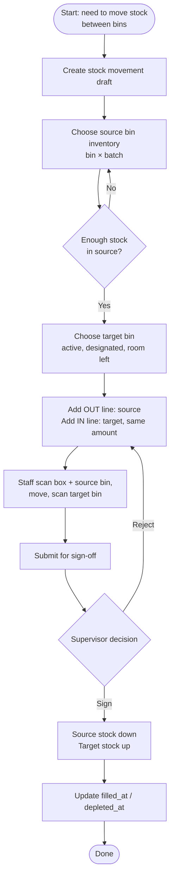
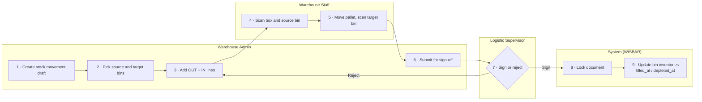

# Stock Movement (Bin Stock and Bin-to-Bin Move)

> **Stock movement** is the core of WISBAR. Every change to the stock in a bin is a **stock movement detail** line, either **in** or **out** of one bin inventory (bin × batch). The document types that move stock are: picking, put away, item reclassification, stock reversal, and the plain **stock movement** (moving stock between bins inside one warehouse).

Related: [Organization](../master_data/organization.md) · [Picking](picking.md) · [Put away](put_away.md) · [Item reclassification](item_reclassification.md) · [Stock reversal](stock_reversal.md)

---

## 1. Data architecture

**In short:** every stock document is a `stock_movements` row. Each of its lines points to **one bin inventory** and says *in* or *out* and *how much*. The sum of signed lines is the bin stock.

---

## 2. Data structure

### `stock_movements` (CTI parent)

`transaction_header_type` is one of `stock_movement`, `picking`, `put_away`, `item_reclassification` or `stock_reversal`. A plain `stock_movement` has no child table. It is a bin move inside one warehouse.

### `stock_movement_details`: one stock line

| Field | Stores |
| --- | --- |
| `warehouse_bin_inventory_id` | Which bin × batch is changed |
| `type` | `in` or `out`. A bin move is one *out* line plus one *in* line. |
| `amount` | Quantity in the item base unit (> 0) |
| `pallet_count` | Pallets moved (NULL means not counted) |
| `moved_by` | Who physically moved it |

### `warehouse_bin_inventories`: the stock balance

| Field | Stores |
| --- | --- |
| `warehouse_bin_id`, `batch_id` | The bin and batch (one row per pair) |
| `current_amount` | Stock now, in base unit (never negative) |
| `current_pallet_amount` | Pallets now |
| `filled_at` | Last time stock went above zero (for **FIFO**) |
| `depleted_at` | Last time stock hit zero |

The balance is a **cache** of the signed stock lines. Rows are never deleted, so an empty bin keeps its history.

---

## 3. What it does & business process

**Purpose:** keep one exact, auditable stock figure per bin and batch, and record why it changed.

### What changes stock

| Document | Direction | Page |
| --- | --- | --- |
| Put away | in | [put_away.md](put_away.md) |
| Picking | out | [picking.md](picking.md) |
| Stock movement (bin move) | out + in, same warehouse | this page |
| Item reclassification | out + in, same bin | [item_reclassification.md](item_reclassification.md) |
| Stock reversal | opposite of the original | [stock_reversal.md](stock_reversal.md) |

### Bin-to-bin move (plain stock movement)

Used to reorganise a warehouse: consolidate half-empty bins, move stock nearer to picking, or empty a bin for maintenance.

1. The warehouse admin creates a **stock movement** document (draft).
2. For each batch to move, add **two lines**:
   - an **out** line from the source bin inventory
   - an **in** line into the target bin inventory, with the same amount and pallets
3. Warehouse staff scan the box and the source bin, move the pallet, and scan the target bin.
4. The supervisor signs.
5. On signing, the bin inventories are updated:
   - the source goes down, and `depleted_at` is set if it reaches 0
   - the target goes up, and `filled_at` is set if it was 0

### Rules

- Stock can never go negative.
- Pallets need stock: pallets above 0 with an amount of 0 is refused.
- A picking line must be *out*, and a put-away line must be *in*.
- Lines of a signed document are locked. Use a stock reversal to cancel one.
- The target bin should be active and designated for the item, with room left.

---

## 4. Flowchart

---

## 5. Swimlane

