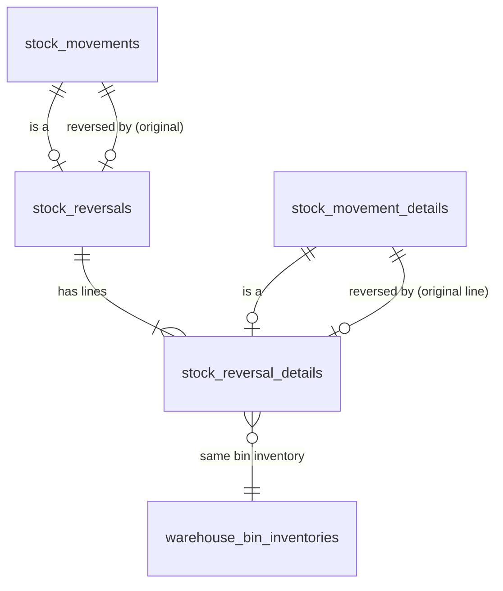
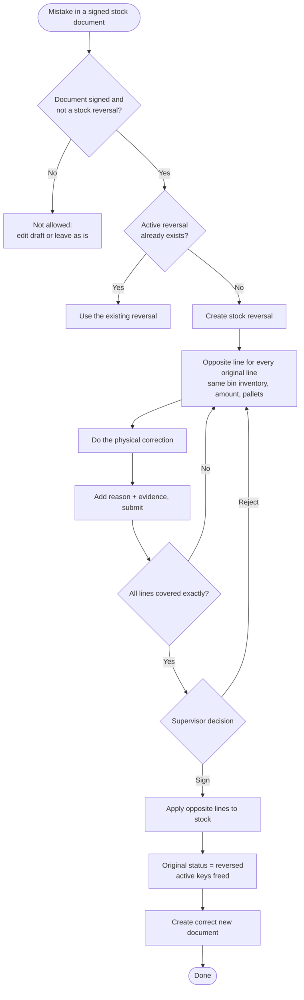
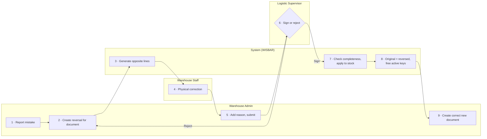

# Stock Reversal

> A **stock reversal** cancels a **signed stock document** (picking, put away, stock movement or item reclassification). Signed documents are never edited. Instead, the reversal adds the **exact opposite** of every line, and when it is signed the original becomes `reversed`. A stock reversal itself can never be reversed.

Related: [Signing](../data_process/signing.md) · [Stock movement](stock_movement.md) · [Picking](picking.md) · [Put away](put_away.md)

---

## 1. Data architecture

**In short:** one signed stock document ↔ at most one active reversal. Each original line ↔ exactly one opposite line.

---

## 2. Data structure

### `stock_reversals`

| Field | Stores |
| --- | --- |
| `reversed_transaction_header_id` | The signed stock document being cancelled |
| `reversed_header_type` | Its type. It cannot be `stock_reversal`. |
| `active_key` | **One active reversal per document** |

### `stock_reversal_details`

| Field | Stores |
| --- | --- |
| `reverses_stock_movement_detail_id` | The original line |
| `reversed_transaction_header_id` | Copied, so the line must belong to the reversed document |
| `active_key` | A line is reversed by one active line only |

It inherits from `stock_movement_details`: the **same** bin inventory, **same** amount and pallets, and the **opposite** `type` (in ↔ out).

---

## 3. What it does & business process

**Purpose:** fix mistakes in signed stock documents without deleting history. Both the mistake and the correction stay visible.

1. **Find the mistake:** for example, the wrong bin was put away, a picking was signed but the shipment was cancelled, or a reclassification used the wrong batch.
2. **Create a stock reversal** pointing to the signed document. Only one active reversal per document is allowed.
3. **Lines:** the system creates one opposite line for **every** line of the original. The bin inventory, amount and pallets are the same, and the direction is opposite.
   - put-away IN → reversal OUT
   - picking OUT → reversal IN
4. **Physical action** (if any): put the pallet back, or take it out again.
5. **Give a reason** in the remarks and attach evidence.
6. **Submit.** The supervisor signs.
7. **On signing:**
   - the opposite lines apply to bin stock, cancelling the original
   - the original document becomes `reversed`, read-only forever
   - its `active_key` rows are freed, so a **new correct document** can be made (for example a new put away for the same incoming)
8. **Redo** the operation correctly with a new document.

### Rules

- Only a **signed** stock document can be reversed.
- A stock reversal cannot be reversed.
- Every line must reverse a line of the reversed document, and every original line needs its opposite. This is checked when signing.
- Each reversal line must be the exact opposite of its original line.
- Non-stock documents (delivery note, incoming, request, handover, day sheet) are not reversed with this document.

---

## 4. Flowchart

---

## 5. Swimlane

