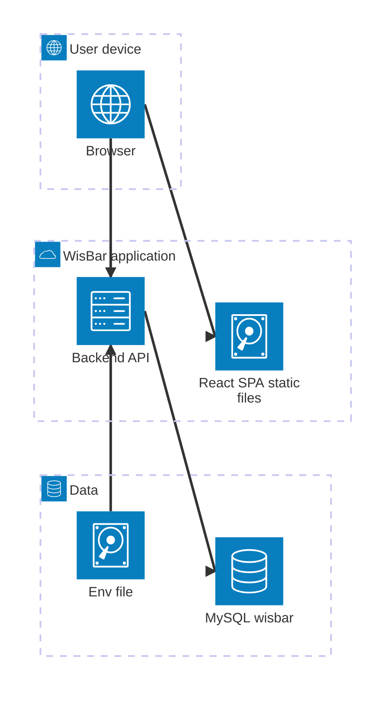
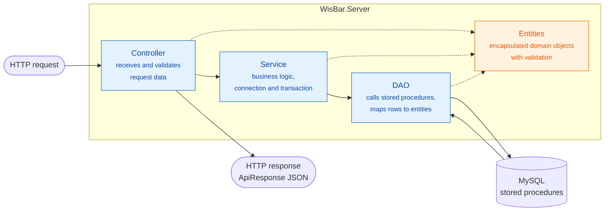
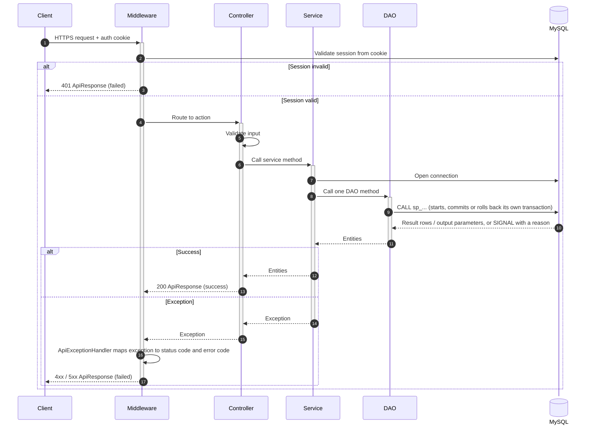
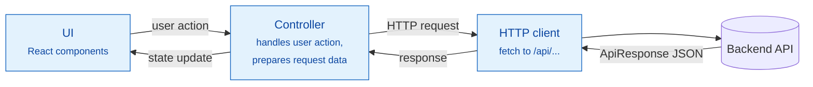
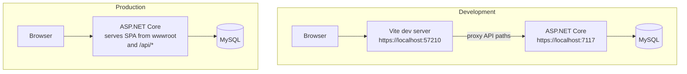

# Tech Stack

The technologies WisBar is built with and how its parts fit together: a React
single-page app talks to an ASP.NET Core HTTP API over HTTPS, and the API reads
and writes one MySQL database through stored procedures.

| Layer                  | Technology                                             | Version                                | Installation                                                | Installed By              |
| ---------------------- | ------------------------------------------------------ | -------------------------------------- | ----------------------------------------------------------- | ------------------------- |
| Frontend               | React + TypeScript, built with Vite                    | React 19.2 · TypeScript 6.0 · Vite 8.3 | Company Portal (Node.Js)                                    | Individual (Self Service) |
| Backend                | ASP.NET Core Web API (controllers), C#                 | .NET 10 (`net10.0`)                    | [Visual Studio Professional](https://my.visualstudio.com/?wt.mc_id=visual-studio-gh-bundle-subscription_eml)                                                            | IT Help Desk              |
| Database               | MySQL, single (monolithic) database `wisbar`           | MySQL 8, InnoDB, `utf8mb4`             | [MySQL Community Downloads](https://dev.mysql.com/downloads/installer/) | IT Help Desk              |
| Database access        | MySql.Data (ADO.NET), stored procedures only           | MySql.Data 26.7.0                      | Visual Studio NuGet Manager                                 | Individual (Self Service) |
| Database build scripts | Python 3                                               | 3.10 or newer                          | Company Portal                                              | Individual (Self Service) |
| Linting                | ESLint with typescript-eslint and React Hooks rules    | ESLint 10                              | Node.Js                                                     | Individual (Self Service) |
| Authentication         | ASP.NET Core cookie authentication + database sessions | —                                      | Visual Studio Package Manager                               | Individual (Self Service) |
| Configuration          | `.env` file loaded with DotNetEnv                      | DotNetEnv 3.2.0                        | Visual Studio Package Manager                               | Individual (Self Service) |

## System Architecture



- **Browser.** It loads the React app once and then calls the API with HTTP
  requests.
- **Backend API.** One ASP.NET Core process serves both the built React files
  and the `/api/*` endpoints. Any path that is not an API route or a static file
  falls back to `index.html`, so client-side routes work on refresh.
- **MySQL.** It holds all data in one schema. The API never sends raw SQL; it
  calls stored procedures.
- **`.env`.** It holds the database connection settings and is loaded at
  startup. The server refuses to start if a required variable is missing.

## Software Architecture

### Backend

The backend is an HTTP API server with four layers. Each layer only talks to
the layer directly below it.



| Layer | Folder | Responsibility |
| --- | --- | --- |
| Controller | [Controllers/](../../WisBar/WisBar.Server/Controllers) | Defines the route (`/api/...`), reads route, query and body data, checks input format, calls one service method, and wraps the result in an `ApiResponse`. |
| Service | [Services/](../../WisBar/WisBar.Server/Services) | Checks the input with the entities, opens a connection (`OpenConnectionAsync`) and makes one DAO call per operation. It never starts a transaction: the stored procedure does (see [Database](#database)). An update may read the row back after its write to return it as stored. |
| DAO | [DAO/](../../WisBar/WisBar.Server/DAO) | Static data-access methods. Each method calls one stored procedure with typed parameters and turns the result rows into entities. |
| Entities | [Domains/Entities/](../../WisBar/WisBar.Server/Domains/Entities) | Domain objects with private fields and validating property setters, so an invalid entity cannot be created. `ToDictionary()` produces the JSON shape returned to the client. |
| Enums | [Domains/Enums/](../../WisBar/WisBar.Server/Domains/Enums) | Domain enums with `ToString` / `FromString` helpers that map to the database enum values. |
| Utilities | [Utils/](../../WisBar/WisBar.Server/Utils) | Configuration, database connection, dependency registration, authentication, error handling, response format, input validation. |

#### Request lifecycle



### Frontend

The frontend is a React app written in TypeScript. User actions go
through a controller that calls the API and hands the response back to the UI
to display.



| Layer | Responsibility |
| --- | --- |
| UI | React components that render state and raise user actions. No API calls. |
| Controller | Handles a user action: validates form input, calls the HTTP client, and turns the `ApiResponse` into UI state, including error messages from the error code. |
| HTTP client | A thin wrapper around `fetch` that sends JSON to `/api/...` with the authentication cookie and parses the `ApiResponse` envelope. |

Tooling:

- **Vite** for the dev server (HTTPS, using the ASP.NET Core dev certificate)
  and the production build (`npm run build` → `tsc -b && vite build`).
- **ESLint** with `typescript-eslint`, `react-hooks` and `react-refresh` rules
  (`npm run lint`).
- The `@` import alias points to `src/`.

> The client in [WisBar/wisbar.client](../../WisBar/wisbar.client) is still the
> Vite template. The layers above describe the intended structure; no screens
> or API calls exist yet.

### Backend and frontend communication

The frontend and backend communicate only through HTTP requests and JSON
responses.

| Aspect | Convention |
| --- | --- |
| Base path | Every endpoint is under `/api/`, e.g. `/api/sites`, `/api/vendors/{id}`. |
| Methods | `GET` read, `POST` create, `PUT` update, `DELETE` delete. |
| Transport | HTTPS only (`UseHttpsRedirection`). |
| Authentication | Cookie set by `POST /api/authentication` (login), removed by `DELETE /api/authentication` (logout). The browser sends it automatically on same-origin requests. |
| Request body | JSON. |
| Response body | Always the `ApiResponse` envelope below, for success and for errors. |

```json
{
  "status": "success",
  "message": "OrganizationController.QueryOrganizations.OrganizationsRetrieved",
  "data": { "organizations": [ ] }
}
```

```json
{
  "status": "failed",
  "message": "Database.DuplicateEntry.uq_organizations_code",
  "data": null
}
```

- `status` is `success` or `failed`; the HTTP status code carries the detail
  (200, 400, 401, 403, 404, 409, 500, 503).
- `message` is a dotted **message code** (`Class.Method.Reason`), not
  human-readable text. The frontend maps codes to display text, which keeps
  translation (e.g. Indonesian and English) on the client.
- `data` holds the payload, or extra error detail such as `invalidFields` for a
  bad request.

#### Development vs production



- **Development.** Starting the server project also starts `npm run dev`
  through the ASP.NET Core SPA proxy. The browser talks to the Vite dev server,
  which proxies API paths to the backend. The proxy list is in
  [vite.config.ts](../../WisBar/wisbar.client/vite.config.ts) and currently
  only contains the template's `/weatherforecast`. Add `/api` there before the
  client calls the API.
- **Production.** Publishing the server builds the client and copies it into
  the server's `wwwroot`, so one process serves the app and the API from the
  same origin. The cookie therefore works without any CORS setup.

## Database

| Aspect | Convention |
| --- | --- |
| Engine | MySQL 8, InnoDB, `utf8mb4` / `utf8mb4_0900_ai_ci`. |
| Time | Every stored time is UTC: the server runs with `default_time_zone = '+00:00'`, and the API sets `time_zone = '+00:00'` on every connection it opens. Business dates are the local date of the location (`locations.time_zone`, `fn_site_local_date`). |
| Shape | One monolithic schema `wisbar` for every site and organization; rows carry `location_id` / `organization_id`. |
| Access | Only through stored procedures (`sp_<module>_<action>`) called by the DAOs; the API's database user only needs `EXECUTE`. |
| Transactions | Every write procedure is one complete operation: it checks its rules, starts and commits its own transaction, and rolls back on any error. The API calls it once and never opens a transaction of its own, because a procedure's `START TRANSACTION` would commit it early. A composite write (a site with its organization, an employee with its user account, a document with its lines copied in) is one procedure too. Procedures whose `COMMENT` starts with `Internal` are building blocks: they never start a transaction and are only called by other procedures. |
| Refusals | A procedure refuses with `SIGNAL SQLSTATE '45000'` and a named reason, for example `BrandNotFound` or `AllocationIsNotReserved`. `ApiExceptionHandler` returns it as `Database.DataNotFound.<Reason>` (404) when the reason ends in `NotFound`, otherwise as `Database.RuleViolation.<Reason>` (409). |
| Concurrency | Signing is optimistic: the API reads the document (`draft_version`) and the end of the seal chain, computes the seals, and signs in one call; the procedure refuses with `DocumentChangedSinceRead` or `SealChainMoved` when either moved, and the API starts again. |
| Integrity | Business rules are enforced in the database where possible: foreign keys (composite ones carry the discriminators and the parent document), `CHECK` constraints, unique keys that ignore soft-deleted or reversed rows, generated columns and triggers. |
| Documents | Class table inheritance under `transaction_headers` and `transactions`; the discriminators hold the leaf table name. Signing seals with HMAC-SHA256 (keys in `.env`, never in the database), appends to a per-site seal chain, and posts stock. A signed document is reversed, never edited. See [Signing and corrections](../business_process/records_and_audit/signing_and_corrections.md). |
| Stock | Every stock amount is in the item base unit. `warehouse_bin_inventories` is a helper kept by `sp_stock_post`; the signed `stock_movement_details` are the record (`v_bin_inventory_check`). |
| Soft delete | `deleted_at` plus a generated `is_deleted` flag on master data and drafts; ledger and audit rows are never deleted. |
| Scheduled jobs | MySQL events (need `event_scheduler = ON`): nightly purge of old sessions, monthly log partitions. The API runs the nightly seal chain verification (`SealVerificationService`). |

Build the full DDL with the Python scripts:

```sh
python database/mysql/combine_folders.py      # database/mysql/<folder>/*.sql -> combined/_<folder>.sql
python database/mysql/build_master.py 0_7     # combined/_*.sql -> combined/ddl_ver_0_7.sql
```

Every table and column is documented by the comments in its `CREATE TABLE`
statement; the design is explained in [DatabaseAnalysis.md](../../DatabaseAnalysis.md).

## Project Structure

```text
WisBar/
├── WisBar/                      Visual Studio solution (WisBar.slnx)
│   ├── WisBar.Server/           ASP.NET Core Web API
│   │   ├── Controllers/         HTTP endpoints by module
│   │   ├── Services/            Business logic and transactions
│   │   ├── DAO/                 Stored procedure calls
│   │   ├── Domains/             Entities and enums
│   │   ├── Utils/               Configuration, database, DI, auth, errors, responses, validation
│   │   ├── Program.cs           Startup and middleware pipeline
│   │   └── .env.example         Required environment variables
│   └── wisbar.client/           React + TypeScript + Vite
├── database/                    SQL source and build scripts
└── documentation/               Business process, schema and tech stack docs
```
